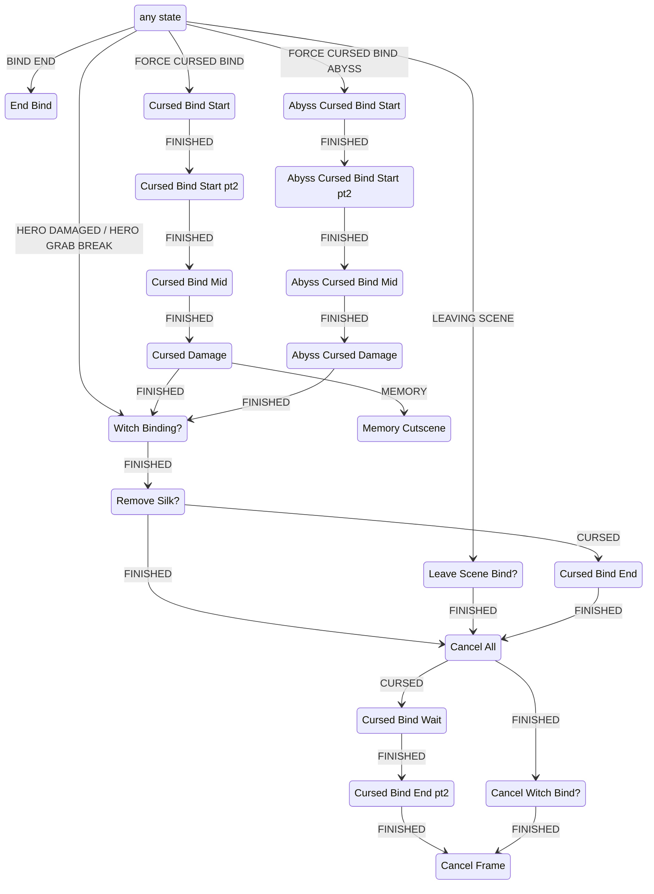

# Bind (healing) and Architect Craft Bind

Bind is the healing action: the player presses the Bind button, Silk is spent from the spool, and after a short
charge Hornet regains health. All of it runs in the PlayMaker FSM `Bind` on `Hero_Hornet(Clone)`, with a few
C# methods on `HeroController` called from the FSM. The Architect crest (internal `Toolmaster`) adds a second
action on Up + Bind ("Craft Bind", internally "Quick Craft"), which goes through the same FSM.

Conventions used on this page:

- Times are in seconds and use scaled time. `TimeLimitSetV2` stores `Time.time + delay`, and `TimeLimitCheckV2`
  compares `Time.time` with the stored value every `Update`.
- tk2d clip timing: a trigger on frame `k` fires `k / fps` seconds after the clip starts, and a `wrap=Once` clip
  completes at `frames / fps`. Hero clip names resolve through `IHeroAnimationController.GetClip`: the crest
  override library first, then the base `Knight` library (see [sprint.md](sprint.md) for details).
- `DecelerateV2` multiplies the velocity by the factor on state entry and then once per `FixedUpdate`
  (0.02 s).
- If an action fires a transition event during `OnEnter`, PlayMaker leaves the state at that point and the
  remaining actions of the state do not run.
- Crest names: Beast = `Warrior`, Witch = `Witch`, Shaman = `Spell`, Architect = `Toolmaster`. Tool names: see
  section 4.

---

## 1. Input and start conditions

### 1.1 Button

- Bind uses the `Cast` player action (`HeroActions.Cast`). Default bindings (`input-handler.txt`): keyboard `A`,
  controller `Action2`. The separate `QuickCast` action (`F` / `RightBumper`) is the Skill button and is not
  read by the `Bind` FSM.
- In state `Idle`, `ListenForCast` fires `BUTTON DOWN` on `inputActions.Cast.WasPressed`, which moves the FSM to
  `Can Bind?`. Only a fresh press counts. Holding the button does nothing.
- `ListenForCast` and `ListenForUp` do nothing while `gm.isPaused`.
- After every completed or aborted bind the FSM passes through `Cooldown` (`Wait 0.2`) or `Cancel Frame`
  (next frame) before it returns to `Idle`, so a press is not read during that time.

### 1.2 `Can Bind?` (actions in order)

| # | Action | Effect |
|---|---|---|
| 0–2 | `CheckIfCrestEquipped` | Stores `Is Warrior Equipped`, `Is Witch Equipped`, `Is Shaman Equipped` (crest `Spell`). |
| 3–4 | `HeroController.CanBind()` | False → `CANCEL` → `Cancel Frame` → `Idle`. |
| 5 | `Bind Unbound` | True → `FINISHED` (skips the rest, including the Silk check). |
| 6 | `Bind Locked` | True → `CANCEL`. |
| 7 | `TimeLimitCheckV2 Can Bind Time` | `Time.time` below `Can Bind Time` → `CANCEL`. Only the cursed-bind states set `Can Bind Time` (to now + 0.7). |
| 8 | `PlayerData.IsAnyCursed` | True → `FINISHED` (skips the Silk check; the bind becomes a cursed bind, section 2.13). |
| 9 | `ConvertBoolToInt` | `Current Silk Cost` = `Silk Cost Witch` if Witch, else `Silk Cost`. Both are **9**. |
| 10 | | `Used Reserve Bind = False`. |
| 11 | `PlayerdataIntCompare silk < Current Silk Cost` | → `NOT ENOUGH` → `Not Enough` → `Reserve Bind?` (section 4.4). Otherwise → `FINISHED` → `Can Quick Craft?`. |

- `Silk Cost` / `Silk Cost Witch` are read in state `Pause` (the start state) from `Constants.BIND_SILK_COST = 9`
  and `Constants.BIND_SILK_COST_WITCH = 9`.
- `Bind Unbound` and `Bind Locked` are both `False` in the dump. No dumped FSM or decompiled C# writes them.
- On the `Bind Unbound` path, `Current Silk Cost` is not recomputed and keeps its previous value.

### 1.3 `HeroController.CanBind()`

Returns true only if all of the following hold:

- `CanDoFsmMove()` (`!blockFsmMove`)
- not `IsHardLanding()` (`hardLanded` or `hero_state == hard_landing`)
- not `IsInputBlocked()` (cheat menu or any registered input blocker)
- `ToolItemManager.ActiveState != Cutscene`
- `!gm.isPaused`, `!cState.dashing`, `!cState.backDashing`
- not attacking within the recovery window: `!cState.attacking || attack_time >= Config.AttackRecoveryTime`
- `!cState.recoiling`, `!cState.transitioning`, `!cState.recoilFrozen`, `!cState.hazardDeath`,
  `!cState.hazardRespawning`, `!cState.dead`
- `Config.CanBind` (the active `HeroControllerConfig`)
- `CanDoFSMCancelMove()`: `CanInput()`, or `cState.isInCancelableFSMMove` when input is not allowed
- `!HeroChargeEffects.Instance.IsCharging`

### 1.4 Up input: `Can Quick Craft?`

This state runs for every bind that passed `Can Bind?` (directly or via `Reserve Bind?`), in the same frame as the
press.

| # | Action | Effect |
|---|---|---|
| 0 | | `Was Up Pressed = False`. |
| 1–2 | `ToolItemManager.IsInCutscene` | True → `FINISHED` (normal bind). |
| 3 | `ListenForUp` | If `Up` is **not** held (`!inputActions.Up.IsPressed`) → `FINISHED` (normal bind). If held, `Was Up Pressed = True` and the state continues. |
| 4 | `CheckIfCrestEquipped Toolmaster` | Not Architect → `FINISHED` (normal bind; Up has no effect for other crests). |
| 5–6 | `TryReplenishTools(DoReplenish=False, QuickCraft)` | Dry run (section 3.4). True → `FINISHED`. |
| 7 | `CurrencyCounterMethod Shard Take 0` | Takes 0 shards. |
| 8 | `PlayRandomAudioClipTable ui_failure_sound` | Failure sound. |
| 9 | `SendEvent CANCEL` | → `Cancel Frame` → `Idle`. Nothing is spent. |

- The Up check reads `IsPressed` in the frame of the Bind press, so Up has to be held at that moment. Pressing Up
  later during the bind has no effect.
- The crafting choice is made in state `Quick Craft?` (section 3), after the shared start chain.
- `crests.txt` lists the Architect custom action as `hasCustomAction = True`,
  `customButtonCombo.ActionButton = CAST`, `DirectionModifier = Up`, `PromptText = "Craft Bind"`
  (`Tools/PROMPT_QUICK_CRAFT`). The crest description is "Spin the needle as a screw, shredding foes. Spend Silk
  to rapidly craft new tools."

### 1.5 Start chain (shared by every bind and Craft Bind)

`Can Quick Craft?` → `Fsm Cancel` → global `FSM CANCEL` → `Cancel All` → `Kick From Wall` → `Do Bind` →
`Set Bind Anims` → `Bind Type` → crest setup → `Quick Bind?` → `Bind Shared` → `Lifeblood State?` →
`Take Control` → movement setup → `Use Reserve Bind?` → `Quick Craft?`. None of these states waits.

- `Fsm Cancel`: `Not Enough Silk = False`, `Do Bind = True`, reads hero states `isSprinting` → `Is Sprinting` and
  `shuttleCock` → `Is Shuttlecock`, `SetAllowNailChargingWhileRelinquished(false)`, sends `FSM CANCEL` to every
  FSM on the hero (this cancels other FSM moves, and the `Bind` FSM's own global transition goes to
  `Cancel All`), deactivates `shaman_focus_halo`.
- `Cancel All` with `Do Bind = True` stops audio and antic effects, sets hero state `isBinding = False`, then
  fires `DO BIND`.
- `Kick From Wall`: `HeroController.WallKickoff()`. While wall-sliding it flips the sprite and uses a kick speed
  of 10; while only touching a wall it uses 8; otherwise it returns without doing anything.
- `Do Bind`: `CancelActiveHeroActions` (`HeroUtility.CancelCancellables()`), `Do Bind = False`, hero state
  `isBinding = True`, `On Ground = GetState("onGround")`. If `IsAnyCursed` → `Cursed Bind Start`.
- `Set Bind Anims`: defaults `Quick Bind Effect Delay = 0.3`, `Quick Binding = False`,
  `Bind Silk Anim = "Bind Silk"`, `Air BindCharge Anim = "BindCharge Air"`,
  `Ground BindCharge Anim = "BindCharge Ground"`. Then the Claw Mirror setup (section 4.3).
- `Bind Type`: `Can Bind Break = True` (from here on, damage interrupts the bind; section 2.8), activates
  `Bind Silk` and `Pt Charge`, then Beast → `Rage Bind`, Witch → `Witch Bind`, Shaman → `Shaman Bind`,
  others → `Set Normal`.
- `Bind Shared`: `Burst Rise Velocity = 0`, `Start Rise Velocity = 0`, `Heal Anim` scale 1.845, `Pt Heal Crt = Pt Heal`.
- `Lifeblood State?`: if `HeroController.IsInLifebloodState`, `Heal Amount = 1` (overrides every crest value).

`Take Control`: `SetCState("focusing", true)`, `RelinquishControlNotVelocity`, `StopAnimationControl`, plays
`BindCharge Ground`, then branches in this order:

| Test (first match wins) | Target | Movement setup |
|---|---|---|
| Beast | `Warrior Kickup` → `Warrior` | section 2.12 |
| Witch | `Witch` | section 2.10 |
| `Is Sprinting` | `Sprint Adjust` → `Start Bind Air` | moves +0.3 up, `onGround = false`, `On Ground = False`, `Deceleration = 0.9` |
| `Is Shuttlecock` | `Shuttlecock` → `Start Bind Air` | `ShuttleCockCancel()`, `Deceleration = 0.9` |
| `On Ground` | `Start Bind Ground` | velocity (0, 0), `Deceleration = 1`, `AffectedByGravity` |
| otherwise | `Off Ground` → `Start Bind Air` | vy clamped to [-12, 12], `Deceleration = 0.85` |

`Start Bind Air`: if `GetShuttlecockTime() > 0.26`, vy = 0. Then vy is clamped to at most 7.5, and
`AffectedByGravity` is sent. The air branches set `Bind Anim = Air BindCharge Anim`.

The `AffectedByGravity` calls are `SendMessage` actions with `BoolParameter = False`. The dump does not record the
parameter type of these calls.

`Use Reserve Bind?`: `Used Reserve Bind` → `Reserve Bind Charge` (section 4.4), otherwise → `Quick Craft?`.

`Quick Craft?`: `Is Binding = True`; Architect equipped **and** `Was Up Pressed` → `Quick Craft Start`
(section 3), otherwise → `Bind Bell?` → `Bind Start` (the normal bind).

---

## 2. The `Bind` FSM

### 2.1 Overview

- FSM `Bind` on `Hero_Hornet(Clone)`, start state `Pause` → `Init` → `Idle`. 96 states.
- `Init` finds and deactivates the effect objects under `Bind Effects/` and `Tool Effects/` (`Bind Silk`,
  `Heal Anim`, `Pt Charge`, `Pt Heal`, `Pt Heal Small`, `Effects/Cursed Bind Hornet`, `Tool Effects/Bell Bind`,
  `Witch Bind`, `Witch Bind Maggot Cleanse`, `Special Attacks/Sphere Flash`, `Tool Effects/Pt QuickCraft`,
  `Tool Effects/QuickCraft Silk`, `shaman_focus_halo`, `hornet_quick_bind_effect`, `Shaman_Bind_antic_silk`,
  `Warrior_Bind_antic_silk`, `Whip_Bind_silk_antic`), spawns `crest rage_burst_effect` under `Bind Effects`, and
  stores `Silk Scale` (world x scale of `Bind Silk`, 1.361231 in the dump).

Global transitions:

| Event | Target |
|---|---|
| `FSM CANCEL` | `Cancel All` |
| `LEAVING SCENE` | `Leave Scene Bind?` |
| `FORCE CURSED BIND` | `Cursed Bind Start` |
| `FORCE CURSED BIND ABYSS` | `Abyss Cursed Bind Start` |
| `HERO DAMAGED` | `Witch Binding?` |
| `HERO GRAB BREAK` | `Witch Binding?` |
| `BIND END` | `End Bind` |

### 2.2 State graph

```mermaid
stateDiagram-v2
    [*] --> Pause
    Pause --> Init: FINISHED
    Init --> Idle: FINISHED
    Idle --> CanBind: BUTTON DOWN
    CanBind: Can Bind?
    CanBind --> CancelFrame: CANCEL
    CanBind --> NotEnough: NOT ENOUGH
    CanBind --> CanQC: FINISHED
    NotEnough: Not Enough
    NotEnough --> ReserveQ: FINISHED
    ReserveQ: Reserve Bind?
    ReserveQ --> CancelFrame: CANCEL
    ReserveQ --> CanQC: FINISHED
    CanQC: Can Quick Craft?
    CanQC --> CancelFrame: CANCEL
    CanQC --> FsmCancel: FINISHED
    FsmCancel: Fsm Cancel
    FsmCancel --> CancelAll: (global) FSM CANCEL
    CancelAll: Cancel All
    CancelAll --> KickFromWall: DO BIND
    CancelAll --> CancelWitchQ: FINISHED
    CancelAll --> CursedWait: CURSED
    CancelWitchQ: Cancel Witch Bind?
    CancelWitchQ --> CancelFrame: FINISHED
    CancelFrame: Cancel Frame
    CancelFrame --> Idle: FINISHED
    KickFromWall: Kick From Wall
    KickFromWall --> DoBind: FINISHED
    DoBind: Do Bind
    DoBind --> SetBindAnims: FINISHED
    DoBind --> CursedStart: CURSED
    SetBindAnims: Set Bind Anims
    SetBindAnims --> BindType: FINISHED
    BindType: Bind Type
    BindType --> SetNormal: FINISHED
    BindType --> WitchBind: WITCH
    BindType --> RageBind: WARRIOR
    BindType --> ShamanBind: FOCUS
    SetNormal: Set Normal
    SetNormal --> MultiBind: MULTI BIND
    SetNormal --> QuickBindQ: FINISHED
    MultiBind: Multi Bind
    MultiBind --> QuickBindQ: FINISHED
    WitchBind: Witch Bind
    WitchBind --> QuickBindQ: FINISHED
    ShamanBind: Shaman Bind
    ShamanBind --> QuickBindQ: FINISHED
    RageBind: Rage Bind
    RageBind --> BindShared: FINISHED
    QuickBindQ: Quick Bind?
    QuickBindQ --> BindShared: FINISHED
    BindShared: Bind Shared
    BindShared --> LifebloodQ: FINISHED
    LifebloodQ: Lifeblood State?
    LifebloodQ --> TakeControl: FINISHED
    TakeControl: Take Control
    TakeControl --> StartGround: ON GROUND
    TakeControl --> SprintAdjust: SPRINTING
    TakeControl --> Shuttlecock: SHUTTLECOCK
    TakeControl --> OffGround: OFF GROUND
    TakeControl --> Witch: WITCH
    TakeControl --> WarriorKickup: WARRIOR
    SprintAdjust: Sprint Adjust
    SprintAdjust --> StartAir: FINISHED
    Shuttlecock --> StartAir: FINISHED
    OffGround: Off Ground
    OffGround --> StartAir: FINISHED
    Witch --> WitchMulti: MULTI BIND
    Witch --> WitchQuick: QUICKBIND
    Witch --> StartAir: FINISHED
    WitchMulti: Witch Multibind
    WitchMulti --> StartAir: FINISHED
    WitchQuick: Witch Quickbind
    WitchQuick --> StartAir: FINISHED
    WarriorKickup: Warrior Kickup
    WarriorKickup --> Warrior: FINISHED
    Warrior --> WarriorMulti: MULTI BIND
    Warrior --> WarriorQuick: QUICKBIND
    Warrior --> StartAir: FINISHED
    WarriorMulti: Warrior Multibind
    WarriorMulti --> StartAir: FINISHED
    WarriorQuick: Warrior Quickbind
    WarriorQuick --> StartAir: FINISHED
    StartGround: Start Bind Ground
    StartGround --> UseReserveQ: FINISHED
    StartAir: Start Bind Air
    StartAir --> UseReserveQ: FINISHED
    UseReserveQ: Use Reserve Bind?
    UseReserveQ --> ReserveCharge: TRUE
    UseReserveQ --> QuickCraftQ: FALSE
    ReserveCharge: Reserve Bind Charge
    ReserveCharge --> ReserveBurst: FINISHED
    ReserveBurst: Reserve Bind Burst
    ReserveBurst --> QuickCraftQ: FINISHED
    QuickCraftQ: Quick Craft?
    QuickCraftQ --> QCStart: TRUE
    QuickCraftQ --> BindBellQ: FALSE
    QCStart: Quick Craft Start
    QCStart --> QCGround: ON GROUND
    QCStart --> QCAir: OFF GROUND
    QCGround: QC Start Ground
    QCGround --> Crafting: FINISHED
    QCAir: QC Start Air
    QCAir --> Crafting: FINISHED
    Crafting: Crafting Started
    Crafting --> QCBurst: FINISHED
    QCBurst: Quick Craft Burst
    QCBurst --> EndBind: FINISHED
    BindBellQ: Bind Bell?
    BindBellQ --> BindStart: FINISHED
    BindStart: Bind Start
    BindStart --> CheckGrounded: FINISHED
    CheckGrounded: Check Grounded
    CheckGrounded --> Rise: RISE
    CheckGrounded --> ShamanSilkQ: ON GROUND
    CheckGrounded --> BindAir: OFF GROUND
    Rise --> BindAir: FINISHED
    ShamanSilkQ: Shaman Silk?
    ShamanSilkQ --> BindAir: FINISHED
    ShamanSilkQ --> BindGround: CANCEL
    BindAir: Bind Air
    BindAir --> ShamanAir: FOCUS
    BindAir --> WitchTentQ: FINISHED
    ShamanAir: Shaman Air
    ShamanAir --> ShamanFall: FINISHED
    ShamanFall: Shaman Fall
    ShamanFall --> ShamanImpact: FINISHED
    ShamanFall --> ShamanAirCancel: CANCEL
    ShamanAirCancel: Shaman Air Cancel
    ShamanAirCancel --> EndBind: FINISHED
    ShamanImpact: Shaman Impact
    ShamanImpact --> BindGround: FINISHED
    BindGround: Bind Ground
    BindGround --> WitchTentQ: FINISHED
    WitchTentQ: Witch Tentacles?
    WitchTentQ --> WitchTent: TRUE
    WitchTentQ --> RageBurstQ: CANCEL
    WitchTent: Witch Tentancles!
    WitchTent --> BurstRiseQ: FINISHED
    RageBurstQ: Rage Burst?
    RageBurstQ --> BurstRiseQ: FINISHED
    BurstRiseQ: Burst Rise?
    BurstRiseQ --> Binding: FINISHED
    Binding --> DazzleQ: FOCUS COMPLETED
    DazzleQ: Dazzle?
    DazzleQ --> MaggotedQ: FINISHED
    MaggotedQ: Maggoted?
    MaggotedQ --> Heal: FINISHED
    Heal --> BindCounter: FINISHED
    Heal --> BellDisappearQ: WITCH
    BindCounter: Bind Counter
    BindCounter --> BellDisappearQ: FINISHED
    BellDisappearQ: Bind Bell Disappear?
    BellDisappearQ --> SendBindEvent: FINISHED
    SendBindEvent: Send Bind Event
    SendBindEvent --> BindBurst: FINISHED
    BindBurst: Bind Burst
    BindBurst --> BindLoopQ: ANIM END
    BindBurst --> QueueDash: DASH
    BindBurst --> WitchBindEnd: WITCH
    WitchBindEnd: Witch Bind End
    WitchBindEnd --> BindLoopQ: FINISHED
    WitchBindEnd --> QueueDash: DASH
    QueueDash: Queue Dash
    QueueDash --> BindLoopQ: FINISHED
    BindLoopQ: Bind Loop?
    BindLoopQ --> LoopStart: TRUE
    BindLoopQ --> EndBind: FALSE
    LoopStart: Loop Bind Start
    LoopStart --> CheckGrounded: FINISHED
    LoopStart --> FlipScale: DAZZLE
    LoopStart --> WitchLoop: WITCH
    FlipScale: Flip Scale
    FlipScale --> CheckGrounded: FINISHED
    FlipScale --> WitchLoop: WITCH
    WitchLoop: Witch Loop Bind
    WitchLoop --> CheckGrounded: FINISHED
    EndBind: End Bind
    EndBind --> SprintQ: FINISHED
    SprintQ: Sprint?
    SprintQ --> Idle: FINISHED
    SprintQ --> DashQ: CANCEL
    DashQ: Dash?
    DashQ --> ShamanEndQ: FINISHED
    ShamanEndQ: Shaman End?
    ShamanEndQ --> ShamanEndAir: CANCEL
    ShamanEndQ --> RegainControl: FINISHED
    ShamanEndAir: Shaman End Air
    ShamanEndAir --> RegainControl: FINISHED
    RegainControl: Regain Control
    RegainControl --> Cooldown: FINISHED
    Cooldown --> Idle: FINISHED
```

Interruption and scene-change paths (all entered through global transitions):

`Fsm Cancel` has no local transitions; it leaves through the global `FSM CANCEL`. `Memory Cutscene` only sends
`SILK CURSED BIND` and has no outgoing transitions.

### 2.3 Values per crest and tool (set during the start chain)

| Setup state | `Heal Amount` | `Bind Amount` (loops) | `Bind Time` |
|---|---|---|---|
| `Set Normal` (Hunter, Reaper, Wanderer, Architect, and every crest not listed below) | 3 | 1 | 1.2 |
| `Multi Bind` (normal + Multibinder) | 2 | 2 | 0.8 |
| `Shaman Bind` | 3 | 1 | 1.2 |
| `Shaman Bind` + Multibinder | 2 | 2 | 0.8 |
| `Witch Bind` | 3 (4 with Multibinder); not applied by `Heal` (section 2.10) | 1 | 0.2 |
| `Rage Bind` (Beast) | 0 | 1 | 0.2 |
| `Quick Bind?` (Injector Band equipped) | unchanged | unchanged | × 0.6 |
| `Lifeblood State?` (`IsInLifebloodState`) | **1** (overrides all of the above) | unchanged | unchanged |

Resulting `Bind Time` with Injector Band: 0.72 (normal / Shaman), 0.48 (with Multibinder), 0.12 (Witch, Beast).

### 2.4 Normal bind walk-through (Hunter / Reaper / Wanderer / Architect without Up)

1. **Start (frame of the press):** `Can Bind?` → … → `Bind Bell?` (Warding Bell, section 4.5) → `Bind Start`.
2. **`Bind Start`:**
   - plays a random clip from `Bind Hornet Voice`
   - `RandomlyFlipFloat Silk Scale`, which randomly mirrors the `Bind Silk` effect
   - `SetSilkRegenBlocked(true)`
   - sends `STARTED BIND`
   - `Is First Loop = True`
   - `Ground BindCharge Anim Next = Ground BindCharge Anim`
   - **`TakeSilk(Current Silk Cost)`**: 9 Silk (0 after a Reserve Bind). This is the only place where a normal bind
     spends Silk. `HeroController.TakeSilk` → `PlayerData.TakeSilk` (`silk = max(silk - amount, 0)`), then
     `silkSpool.RefreshSilk`, then `ResetSilkRegen()`. It does nothing while
     `ToolItemManager.ActiveState == Cutscene`.
3. **`Check Grounded`:** plays `hornet_bind_pt_1`, camera shake `EnemyKillShake`. `Start Rise Velocity > 0`
   → `Rise` (Witch only). `On Ground` → `Shaman Silk?` (not Shaman → `Bind Ground`). Otherwise → `Bind Air`.
4. **`Bind Ground` / `Bind Air`:**
   - Bind Ground only: sets `On Ground = True`, `BindBurst Anim = "BindBurst Ground"`,
     `BindCancel Anim = "BindCancel Ground"`.
   - Bind Air only: sets `On Ground = False`, `BindBurst Anim = "BindBurst Air"`, `BindCancel Anim = "BindCancel Air"`.
     A Shaman leaves here (section 2.11).
   - Both: play the Claw Mirror sound (section 4.3), start the `Pt Charge` particles, show `Bind Silk` with scale
     x = `Silk Scale`, and play `Bind Silk Anim` on it.
   - `DecelerateV2(Deceleration)`. Bind Ground uses `brakeOnExit = True`.
   - Play the hero charge clip with a trigger event:
     - Bind Ground: `Ground BindCharge Anim Next`, then sets `Ground BindCharge Anim Next = Ground BindCharge Anim`.
     - Bind Air: `Bind Anim`.
   - **`Bind Time Limit = now + Bind Time`**.
   - Bind Ground only: `CheckIsCharacterGrounded` every frame (3 rays, distance 0.2). Leaving the ground fires
     `BIND END` → `End Bind`. The bind ends with no heal, and the Silk is not returned.
   - On the clip trigger → `Witch Tentacles?` (not Witch → `CANCEL`) → `Rage Burst?` (deactivates
     `crest rage_burst_effect`; Beast reactivates it) → `Burst Rise?` (`Burst Rise Velocity == 0` → `Binding`).
5. **`Binding`:**
   - `Skip Heal = False`
   - waits until `Time.time >= Bind Time Limit`, then fires `FOCUS COMPLETED`
   - keeps decelerating, plays the `Bind Loop` audio and the looping `hornet_bind_loop` vibration
   - Injector Band: activates `hornet_quick_bind_effect` after `Quick Bind Effect Delay` (section 4.2)
   - if `On Ground` is true and the grounded check fails, fires `BIND END`
6. **Heal sequence (same frame):**
   - `Dazzle?`: Claw Mirror flash (section 4.3).
   - `Maggoted?`: maggot handling (section 2.7).
   - `Heal`:
     - Witch → `Bind Bell Disappear?`.
     - Otherwise: hides `Bind Silk`, calls `flashFocusHeal` and camera shake `EnemyKillShake`.
     - If `Skip Heal` → `FINISHED`. Otherwise **`HeroController.AddHealth(Heal Amount)`**, spawns `White Flash R`,
       and activates `Heal Anim`.
   - `Bind Counter`: if `Bind Amount <= 1`, `Can Bind Break = False`.
   - `Bind Bell Disappear?`: if `Bind Amount <= 1`, sends `DISAPPEAR` to `Bell Bind`.
   - `Send Bind Event`:
     - sends `DID BIND`
     - if `Skip Heal` → `FINISHED`
     - otherwise **`HeroController.BindCompleted()`**, plus `BLUE HEALTH UPDATE` (excluding the owner) when
       `IsInLifebloodState`
7. **`Bind Burst`:**
   - `Dash Queued = False`, `SetCState("focusing", false)`. Witch → `Witch Bind End`.
   - Plays `hornet_bind_pt_2` and sends `FreezeMoment` to the GameManager.
   - `Burst Time = now + 0.17`.
   - Plays `BindBurst Anim`. Shaman replaces it with `"BindCharge Heal Burst"` and Beast with
     `BindBurst Anim Warrior`.
   - Leaves with `ANIM END` on clip completion, or as soon as the 0.17 s have passed (Beast waits for the clip).
   - `DecelerateV2`.
   - `ListenForDash`: a Dash press → `Queue Dash` (`Dash Queued = True`, waits for the 0.17 s, then → `Bind Loop?`).
8. **`Bind Loop?`:** `Bind Amount -= 1`. If still `> 0` → `Loop Bind Start` (section 2.6), otherwise → `End Bind`.
9. **`End Bind`:**
   - `SetSilkRegenBlocked(false)`, `RefreshScale()`
   - hides `Bind Silk`, turns off `Warrior_Bind_antic_silk`
   - `SetCState("freezeCharge", false)`
   - `Can Bind Break = False`, `Is Binding = False`, hero state `isBinding = False`
   - sends `DISAPPEAR` to `Bell Bind`
10. **`Sprint?`:**
    - `Can Dash = PlayerData.hasDash && !GetAirdashed()`.
    - If `Can Dash`, not `On Ground` and `Dash Queued`: sends `MANTLE SPRINT` to the hero, then → `Idle`. Control
      is not regained by this FSM on that path.
    - Otherwise → `Dash?`: if `Can Dash` and `Dash Queued` → `SetStartWithDash()`.
    - Then → `Shaman End?` (section 2.11) → `Regain Control`.
11. **`Regain Control`:**
    - clamps vy to [-100, -0.25]
    - `RegainControl()`, `StartAnimationControlToIdle()`
    - → `Cooldown` (0.2 s) → `Idle`

### 2.5 Normal bind timeline (no tools, Knight library clips)

| Time after press | Ground | Air |
|---|---|---|
| 0 | 9 Silk taken (`Bind Start`), `Bind Ground` entered, `Bind Silk` (34 f @ 28.333 fps = 1.2 s) starts | same, `Bind Air` |
| 0.2333 / 0.2 | `BindCharge Ground` trigger (frame 7 @ 30 fps; 13 frames, LoopSection from 7) → `Binding` | `BindCharge Air` trigger (frame 6 @ 30 fps; 12 frames, LoopSection from 6) |
| **1.2** | `FOCUS COMPLETED` → **+3 health**, `BindCompleted()`, `Bind Burst` | same |
| 1.3667 | `BindBurst Ground` (2 f @ 12 fps = 0.1667 s) complete → `End Bind` … `Regain Control` | `BindBurst Air` (same length) |
| 1.5667 | `Cooldown` over → `Idle` (next press read) | same |

- With Multibinder: heals +2 at 0.8 s, then the burst (0.1667 s), then a second 0.8 s loop, so the second +2
  comes at ≈1.767 s. Total +4.
- With Injector Band: the heal comes at 0.72 s (0.48 s per loop with Multibinder).

### 2.6 Multibinder loop (`Loop Bind Start`)

`Loop Bind Start` (entered from `Bind Loop?` while `Bind Amount > 0`):

- `Is First Loop = False`, `Dash Queued = False`, `Silk Scale *= -1` (mirrors the silk effect).
- Shaman → `Check Grounded`.
- Claw Mirror → `Flip Scale` (`HeroController.FlipSprite()`), Witch → `Witch Loop Bind`.
- Otherwise → `Check Grounded`.

The loop skips `Bind Start`, so no Silk is taken, `STARTED BIND` is not sent again and regen stays blocked. It plays
`hornet_bind_pt_1` again in `Check Grounded`, re-enters `Bind Ground`/`Bind Air`, waits the full `Bind Time`
again and heals `Heal Amount` again. `Can Bind Break` stays `True` until the heal of the last loop
(`Bind Counter`), so damage during the first loop or the first burst interrupts the bind.

### 2.7 Maggoted (`Maggoted?`)

- `Skip Heal = cState.isMaggoted`. If not maggoted → `Heal`.
- If maggoted, the state then:
  - spawns `Maggot_Bind_Burst` and `focus_flash_maggoted`
  - plays `swamp_maggots_cleanse_pop` (pitch 0.95–1.05)
  - `SetHeroMaggoted(False)`
- Because `Skip Heal` is true:
  - `Heal` skips `AddHealth`, `White Flash R` and `Heal Anim`. It still hides `Bind Silk`, flashes and shakes the
    camera.
  - `Send Bind Event` skips `BindCompleted()`, so Beast rage and Reaper mode do not start.
- The full Silk cost is spent. A maggoted bind only removes the maggots.
- Witch: `Witch Tentancles!` activates `Witch Bind Maggot Cleanse` instead of `Witch Bind` when maggoted.

### 2.8 Interruption (`HERO DAMAGED`, `HERO GRAB BREAK`)

1. `Witch Binding?`: if `Witch Binding`, sends `WITCH BIND ENDED` and deactivates `Witch Bind`.
2. `Remove Silk?`:
   - `Started Curse` → `Cursed Bind End`.
   - `Can Bind Break == False` → `Cancel All`. Nothing else happens.
   - Otherwise:
     - sends `STARTED BIND`
     - **`HeroController.BindInterrupted()`**: `mossCreep1Hits = 0`, `mossCreep2Hits = 0`,
       `silkSpool.SetMossState(0)`, `PlayerData.silkParts = 0`
     - Warding Bell equipped → `FINISHED` (skips the rest)
     - otherwise:
       - spawns `Bind_Fail_Burst`, plays `bind_break_with_note_opt_2` and the `hornet_bind_break` vibration
       - **`TakeSilk(9999)`**: all remaining Silk is removed
       - `FreezeMoment BindBreak`
       - sends `BIND INTERRUPTED`
       - if `Used Reserve Bind`: sets it to `False`, `CustomToolUsage(Reserve Bind, 1)`, sends `RESERVE BIND USED`
3. `Cancel All` (with `Is Binding`):
   - `Is Binding = False`, `SetSilkRegenBlocked(false)`, `SetCState("focusing", false)`
   - sends `DISAPPEAR` to the bell, turns off the Craft Bind effects, stops audio, hides `Bind Silk`
   - sets the CameraShake FSM bool `RumblingFocus = False`
   - → `Cancel Witch Bind?` (Witch: `WITCH BIND ENDED`, `WitchBindEffects.CancelDamage()`) → `Cancel Frame` → `Idle`

`Cancel All` does not call `RegainControl`. Nothing is refunded: the 9 Silk spent in `Bind Start` (or in
`Quick Craft Start`) is gone, and without Warding Bell the rest of the spool is emptied too.

`Can Bind Break` window:

- set `True` in `Bind Type`, i.e. from the frame of the press (this also covers Reserve Bind and Craft Bind)
- set `False` in:
  - `Bind Counter` on the last heal
  - `Witch Tentancles!`
  - `End Bind`
  - `Idle`
  - `Cursed Bind Wait`

### 2.9 Leaving the scene mid-bind (`Leave Scene Bind?`)

On `LEAVING SCENE`, if `Is Binding` is true and the crest is neither Witch nor Shaman, the state:

- calls `AddHealth(Heal Amount)`
- hides `Bind Silk`, calls `flashFocusHeal`, spawns `White Flash R`, shakes the camera, activates `Heal Anim`
- sends `DID BIND`, calls `BindCompleted()`
- plays `BindBurst Anim` and the `Pt Heal Crt` particles

It then goes to `Cancel All`. `Is Binding` is set in `Quick Craft?` (before the craft/bind split), so this also
fires during a Craft Bind and heals the current `Heal Amount`.

### 2.10 Witch branch

- `Witch Bind`:
  - deactivates the normal bind effects
  - `Heal Amount` 3, or 4 with Multibinder (stores `Is Multibind Equipped`)
  - `Bind Amount = 1`, `Quick Bind Effect Delay = 0`, `Bind Time = 0.2`
- `Witch` (from `Take Control`):
  - sends `WITCH BIND STARTED`, `Witch Binding = True`
  - vy clamped to [-12, 12], `Deceleration = 0.8`
  - `Bind Anim = Ground BindCharge Anim = "BindCharge Witch"`; `Start Rise Velocity = 10` if on the ground
  - activates `Whip_Bind_silk_antic`
  - with only Multibinder → `Witch Multibind` (`"BindCharge Witch Long"`); with only Injector Band →
    `Witch Quickbind` (`"BindCharge Witch Quick"`). With both or neither, the clip stays `"BindCharge Witch"`.
  - all paths → `Start Bind Air`
- On the ground, `Check Grounded` → `Rise` (vy = 10) → `Bind Air`, so the Witch bind always happens in the air.
- Charge clip trigger (Knight library):
  - `BindCharge Witch` frame 5 @ 14 fps = 0.357 s
  - `BindCharge Witch Long` frame 9 @ 14 fps = 0.643 s
  - `BindCharge Witch Quick` frame 4 @ 15 fps = 0.267 s
- `Witch Tentacles?`: `Bind Time Limit = now + Bind Time` (0.2, or 0.12 with Injector Band). When it passes →
  `Witch Tentancles!`:
  - `Can Bind Break = False`
  - plays `hornet_witch_vine_burst_separate_burst` and its vibration
  - `Skip Heal = isMaggoted`; activates `Witch Bind Maggot Cleanse` if maggoted, otherwise `Witch Bind`
  - plays Animator state `Witch Bind`, `Witch Bind Quick` (Injector Band), `Witch Bind Multi` (Multibinder) or
    `Witch Bind Multi Quickened` (both)
  - sends `SILK CURSED UPDATE`
  - `Bind Time Limit = now + 0.2`
  - → `Binding` (0.2 s)
- Charge length from `Bind Air` entry to the heal step (charge trigger + `Bind Time` + 0.2):

  | Tools | Calculation | Total |
  |---|---|---|
  | none | 0.357 + 0.2 + 0.2 | 0.757 s |
  | Multibinder | 0.643 + 0.2 + 0.2 | 1.043 s |
  | Injector Band | 0.267 + 0.12 + 0.2 | 0.587 s |
  | both | 0.357 + 0.12 + 0.2 | 0.677 s |

- **Healing:** `Heal` sends `WITCH` and skips `AddHealth`. The Witch heals through `WitchBindEffects` on the
  `Witch Bind` object:
  - `OnEnable`: `healCapLeft = GetWitchHealCap()`, which is 3, or 4 when Multibinder `IsEquippedHud`.
  - Every enemy damaged by one of its 4 `DamageEnemies` children (`Damager (1)`–`(4)`: `attackType = Generic`,
    `useNailDamage = True`, `nailDamageMultiplier = 1`, `silkGeneration = Full`, `multiHitter = False`) that
    does not ignore `WitchHeal` gives `AddHealth(1)` while `healCapLeft > 0`.
  - The first hit of each damager calls `FreezeMoment(WitchBindHit)` and the camera shake.
  - `Witch Bind` has `DisableAfterTime waitTime = 0.7` and an `Enemy Sucker` (`RecoilEnemiesToRadius`).
  - A Witch bind that hits no enemy heals 0.
- After the heal step: `Send Bind Event` → `Bind Burst` → `WITCH` → `Witch Bind End`:
  - sends `WITCH BIND ENDED` and `SILK CURSED UPDATE`
  - waits 0.17 s (Dash → `Queue Dash`)
  - → `Bind Loop?` (`Bind Amount = 1` → `End Bind`)
- `Leave Scene Bind?` does nothing extra for the Witch.

### 2.11 Shaman branch

- `Shaman Bind` sets the same values as `Set Normal`, plus Multibinder, and activates `Shaman_Bind_antic_silk`.
  Claw Mirror twirl clips are not used for Shaman.
- Clips come from the Shaman override library (`Hornet CrestWeapon Shaman Anim`):

  | Clip | Frames @ fps | Trigger / length |
  |---|---|---|
  | `BindCharge Air` | 7 @ 15 | trigger frame 3 = 0.2 s |
  | `BindCharge Ground` | 7 @ 15 | trigger frame 3 = 0.2 s |
  | `BindCharge Ground Land` | 7 @ 15 | trigger frame 3 = 0.2 s |
  | `BindCharge Heal Burst` | 3 @ 15 | 0.2 s |
  | `BindCharge End` | 2 @ 15 | 0.1333 s |

- Grounded start, first loop: `Check Grounded` → `Shaman Silk?`. It activates `shaman_focus_halo` (Animator
  `Start`), sets **vy = 20**, then → `Bind Air`. Later loops go `Shaman Silk?` → `Bind Ground`.
- `Bind Air` with Shaman → `FOCUS` → `Shaman Air`. The `Bind Time Limit` of `Bind Air` is not set on this path.
  `Shaman Air`:
  - `AffectedByGravity`
  - `DecelerateV2 0.8` (`brakeOnExit`)
  - plays `BindCharge Air` until its trigger (0.2 s)
- `Shaman Fall`:
  - plays the `Shaman Bind Fall` audio and the bind loop
  - sets velocity (0, -26) and clamps vy every frame to at least `-GetMaxFallVelocity()` (30, or 38 with Weighted
    Anklet)
  - landing → `Shaman Impact`
  - **cancel:** once Hornet is more than 15 units below the fall start and Bind (`Cast`) is not held →
    `Shaman Air Cancel` (spawns `Shaman_Bind_Cancel_Effect`) → `End Bind`. No heal; the Silk is not returned.
- `Shaman Impact`:
  - `Ground BindCharge Anim Next = "BindCharge Ground Land"`
  - spawns `Hard Land Effect` and plays the hard landing audio
  - `On Ground = True`, `onGround = true`, `HeroBoxControl Normal`
  - if `willHardLand`: `DeliveryQuestItem.TakeHit()`
  - → `Bind Ground`. The `Bind Time` (1.2 / 0.8 / × 0.6) starts at this landing.
- `Bind Burst` uses `BindCharge Heal Burst` and the 0.17 s cut.
- `Shaman End?`:
  - on the ground: plays `BindCharge End` (0.1333 s) and the halo `End`
  - in the air: `Shaman End Air` → `FinishedDashing(true)`
  - then → `Regain Control`
- `HeroController` applies the max-fall clamp while `cState.isBinding && SpellCrest.IsEquipped` even with
  control relinquished (`HeroController.cs` ~9736).
- `Leave Scene Bind?` does nothing extra for the Shaman.

### 2.12 Beast branch (`Warrior`)

- `Rage Bind`:
  - deactivates `Warrior_Bind_antic_silk`, `Bind Silk` and `Pt Charge`
  - `Heal Amount = 0` (1 in lifeblood state), `Bind Amount = 1`, `Quick Bind Effect Delay = 0`, `Bind Time = 0.2`
- `Warrior Kickup`: `Do Burst Rise = On Ground`. If sprinting on the ground: moves +0.3 up, `onGround = false`,
  `On Ground = False`, `Do Burst Rise = True`, `Deceleration = 0.9`.
- `Warrior`:
  - vy clamped to [-12, 12]
  - `Bind Anim = "Rage Bind"`, `Ground BindCharge Anim = "Rage Bind Grounded"`,
    `BindBurst Anim Warrior = "Rage Bind Burst"`
  - `Deceleration` 0.8 on the ground, 0.9 in the air
  - `Burst Rise Velocity = 15` if `Do Burst Rise`
  - activates `Warrior_Bind_antic_silk`
  - Multibinder only → `Warrior Multibind` (`Long` clips); Injector Band only → `Warrior Quickbind`
    (`Quick` clips, antic silk `Warrior Bind Antic Silk Quick`)
  - all paths → `Start Bind Air` (also on the ground)
- The charge length is set by the clip trigger. `Bind Time` (0.2 / 0.12) has already passed when the trigger fires.
  Warrior library (`Hornet CrestWeapon Warrior Anim`):

  | Clip | Trigger | Burst clip | Burst length |
  |---|---|---|---|
  | `Rage Bind` / `Rage Bind Grounded` | frame 9 @ 15 = **0.6 s** | `Rage Bind Burst` | 7 @ 18 = 0.389 s |
  | `Rage Bind Quick` / `Rage Bind Quick Grounded` | frame 5 @ 15 = **0.333 s** | `Rage Bind Burst Quick` | 6 @ 18 = 0.333 s |
  | `Rage Bind Long` / `Rage Bind Long Grounded` | frame 12 @ 15 = **0.8 s** | `Rage Bind Burst Long` | 7 @ 18 = 0.389 s |

- At the trigger: `Rage Burst?` activates `crest rage_burst_effect`. `Burst Rise?` with `Burst Rise Velocity = 15`
  sets `On Ground = False` and **vy = 15**, so the Beast always jumps when binding from the ground. Then
  `Binding` completes on the next update.
- `Heal` adds 0 (1 in lifeblood state). **`BindCompleted()`** starts rage mode:
  - if not already raging: `AddFrost(-15)` and `StatusVignette InRageMode`
  - `warriorState` is reset, `IsInRageMode = true`
  - `RageEffectTimeLeft = warriorRageDuration` (5)
  - `RageHealTimeLeft = 5 + warriorRageGraceTime` (0.5)
  - restarts the rage effect, brightness flash 1.15 → 1
  - sends `WARRIOR RAGE STARTED`
- In rage mode, `HeroController.NailHitEnemy` heals 1 per rage hit up to `GetRageModeHealCap()`: 3, or 4 with
  Multibinder `IsEquipped`. Each heal adds `warriorRageHitAddTimePerHit` = [1, 0.5, 0.25, 0] s to both timers.
- `Bind Burst` waits for the full burst clip; the 0.17 s cut does not apply to the Beast. A queued Dash still
  ends the burst after 0.17 s via `Queue Dash`.

### 2.13 Reaper

The Reaper bind is a normal bind (section 2.4). `BindCompleted()` additionally starts Reaper mode; see
[Reaper crest, section 6](../crests/reaper.md#6-reaper-mode-bind-effect).

### 2.14 Cursed bind

When `PlayerData.IsAnyCursed` is true, the press skips the Silk check and `Do Bind` → `CURSED` →
`Cursed Bind Start`. The same path also runs from the global events `FORCE CURSED BIND` and
`FORCE CURSED BIND ABYSS`.

1. `Cursed Bind Start`:
   - vy = 20 on the ground or 10 in the air, `DecelerateV2 0.85`
   - `Can Bind Break = True`, `Started Curse = True`
   - voice, camera shake `Enemy Kill`, failure sound
   - `focusing = true`, `RelinquishControlNotVelocity`
   - shows `Cursed Bind Hornet` playing `Bind Cursed Start` (6 f @ 24 fps, trigger frame 4 = 0.1667 s)
2. `Cursed Bind Start pt2`: hides the hero mesh and waits for that clip to complete.
3. `Cursed Bind Mid`: stops the hero and plays `Bind Cursed Mid` (3 f @ 18 fps = 0.1667 s).
4. `Cursed Damage`:
   - `Can Bind Time = now + 0.7` (the next bind is refused for 0.7 s)
   - spawns `cursed_bind_impact`, sends `BONK BACK` to the hero
   - **takes all Silk** (`TakeSilkV2 Current Silk Amount`, source `Curse`)
   - if `Bind Unbound` → `Memory Cutscene`
5. → `Witch Binding?` → `Remove Silk?` (`Started Curse`) → `Cursed Bind End` → `Cancel All` (`CURSED`) →
   `Cursed Bind Wait` (`SILK CURSED UPDATE`, flags reset) → `Cursed Bind End pt2` (mesh on, `Bind Cursed End`) →
   `Cancel Frame`.

No health is restored. The Abyss variant uses vy = 50.

---

## 3. Architect Craft Bind (Up + Bind, "Quick Craft")

### 3.1 Conditions

All of the following must hold:

- The `Can Bind?` checks pass, including `silk >= 9` or an available Reserve Bind (section 1.2).
- Architect (`Toolmaster`) is equipped, Up is held in the frame of the Bind press, and the game is not in a tool
  cutscene.
- `ToolItemManager.TryReplenishTools(false, QuickCraft)` returns true (section 3.4). If it returns false, the press
  is cancelled with `ui_failure_sound`. No Silk is spent and no bind happens.

The start chain of section 1.5 then runs unchanged, including `Bind Type` (`Can Bind Break = True`) and
`Take Control` (movement setup). The chain splits at `Quick Craft?`.

### 3.2 States

| State | Actions | Leaves on |
|---|---|---|
| `Quick Craft Start` | **`TakeSilk(Current Silk Cost)`**: 9 Silk (0 when this follows a Reserve Bind). Re-activates `QuickCraft Silk` (tk2d, `DeactivateAfter2dtkAnimation`; clip `Quick Craft Silk` 16 f @ 15 fps). Plays `hornet_architect_bind_pt_1` (kept in `Loop Audio Spawned`). | `ON GROUND` → `QC Start Ground`, `OFF GROUND` → `QC Start Air` (from `On Ground`) |
| `QC Start Ground` / `QC Start Air` | Plays `Quick Craft Ground` / `Quick Craft Air` with trigger events, `DecelerateV2(Deceleration)` | first clip trigger |
| `Crafting Started` | Vibration `hornet_quick_craft_pt_1`, activates `Pt QuickCraft` particles, `Tk2dWatchAnimationEvents` (trigger), `DecelerateV2`, sends **`TOOLMASTER QUICK CRAFTING`** | second clip trigger |
| `Quick Craft Burst` | Stops `Loop Audio Spawned`, plays `hornet_architect_bind_pt_2`, stops `Pt QuickCraft`, `flashFocusHeal`, `White Flash R`, activates `Sphere Flash`, camera shake `EnemyKillShake`, **`TryReplenishTools(DoReplenish=True, QuickCraft)`**, `DecelerateV2` | clip complete → `End Bind` |

After `End Bind` the end sequence of section 2.4 runs (`Sprint?` → `Dash?` → `Shaman End?` → `Regain Control` →
`Cooldown` 0.2 s → `Idle`).

### 3.3 Timing (Knight library)

| Clip | Frames @ fps | Trigger 1 (`Crafting Started`) | Trigger 2 (tools refilled) | Complete (`End Bind`) |
|---|---|---|---|---|
| `Quick Craft Ground` | 15 @ 15 | frame 4 = 0.2667 s | frame 13 = **0.8667 s** | 1.0 s |
| `Quick Craft Air` | 17 @ 15 | frame 4 = 0.2667 s | frame 15 = **1.0 s** | 1.1333 s |

Times are measured from `Quick Craft Start`, which is the frame of the press (or the end of the Reserve Bind
animation, about 0.367 s, section 4.4).

Movement during the craft uses the `Deceleration` from `Take Control`:

- ground: 1, velocity zeroed at start
- air: 0.85 (or 0.9 for sprint/shuttlecock), with gravity and vy ≤ 7.5 at start

The Architect has no crest override for these clips; its override library (`Hornet CrestWeapon Drill Lance Anim`)
has no bind or craft clips.

### 3.4 `ToolItemManager.TryReplenishTools(doReplenish, QuickCraft)`

1. If `CurrentCrestID` is empty or the equipped tool list is null, it returns false.
2. It takes the equipped tools and keeps only `IsAutoReplenished()` ones: not Skill type and
   `BaseStorageAmount > 0`.
3. It loops over them repeatedly, one unit per tool per pass, until no tool changes. A tool is skipped if:
   - `ReplenishResource == None` (QuickCraft only; this excludes Reserve Bind, whose `replenishResource = None`), or
   - `ReplenishUsage == OneForOne`, or
   - `AmountLeft >= GetToolStorageAmount(tool)`. Storage is `BaseStorageAmount`, plus
     `floor(Base × 0.5)` with Shell Satchel.
4. Cost per unit, for `Percentage` tools: `1 / BaseStorageAmount × toolReplenishCost (40) ×
   replenishUsageMultiplier` of the tool's `ReplenishResource` (Shards for all tools in `tools.txt` that have a
   resource). `Custom` tools cost 0 here.
5. A unit is added only while the running Shard total stays above `-0.5` after paying and is above 0 before
   paying. `ToolItemStatesLiquid` tools also reserve liquid refills and are skipped when their refills cannot
   cover them.
6. **Fallback (QuickCraft only):** if no unit could be added and `ceil(Shards) > 0`, the result is still
   **true**:
   - if some tool was below max but unaffordable, the ending Shard amount is set to **0** (all Shards are taken)
   - if every tool was full, **`toolmasterQuickCraftNoneUsage` (5) Shards** are taken (down to 0)
7. With `doReplenish = True`:
   - `TakeCurrency(start - end, Shard, showCounter)`
   - `TakeLiquid` for liquid tools
   - `ReportAllBoundAttackToolsUpdated()`, `SendEquippedChangedEvent(force: true)`

So Craft Bind is refused only when there is nothing to buy **and** the player has 0 Shards (or the crest/tool
list is missing). The dry run in `Can Quick Craft?` and the real run in `Quick Craft Burst` use the same rules. The
Shard amount can change between them, because the real run happens up to 1 s later.

### 3.5 What Craft Bind does and does not do

- Spends 9 Silk (once). Refills equipped tools as above, paid with Shards.
- No health is restored: `Heal`, `AddHealth` and `BindCompleted()` are not on this path. The exception is
  `Leave Scene Bind?` (section 2.9).
- Does not run `Bind Start`, so it does not:
  - call `SetSilkRegenBlocked(true)` (`TakeSilk` still resets the regen timer)
  - send `STARTED BIND`
  - show the bind voice, `Bind Silk` or the Warding Bell shield
- Damage during the craft interrupts it like a bind (`Can Bind Break = True`, section 2.8): `BindInterrupted()`,
  all remaining Silk removed unless Warding Bell is equipped, no tools refilled if before `Quick Craft Burst`.
- Multibinder, Injector Band and Claw Mirror have no effect on the craft path. Their values are set in the start
  chain but only read by bind states.

---

## 4. Tools that modify binding

All are Blue tools (`ToolItemBasic`) in `tools.txt`. The FSM checks them with `CheckIfToolEquipped` (`IsEquipped`;
`IsEquippedHud` on UI-layer objects). For tools with `BaseStorageAmount > 0` it also requires
`AmountLeft >= RequiredAmountLeft`.

| Internal | Display name | Description (`tools.txt`) |
|---|---|---|
| `Multibind` | Multibinder | "Extends the act of binding, but increases its healing effect." |
| `Quickbind` | Injector Band | "Increases the speed of binding." |
| `Dazzle Bind` | Claw Mirror | "When binding, emits a dazzling flash that damages surrounding enemies." |
| `Dazzle Bind Upgraded` | Claw Mirrors | "When binding, emits a searing blast that damages surrounding enemies." |
| `Reserve Bind` | Reserve Bind | "…able to hold a Bind's worth of Silk… The Reserve Bind will be restored when resting at a bench." (`baseStorageAmount = 1`, `replenishResource = None`, `preventStorageIncrease = True`) |
| `Bell Bind` | Warding Bell | "Shields the bearer as they bind their wounds." |

### 4.1 Multibinder (`Multibind`)

- `Set Normal` → `MULTI BIND` → `Multi Bind`: `Heal Amount = 2`, `Bind Amount = 2`, `Bind Time = 0.8` (two loops,
  +4 total, section 2.6). `Shaman Bind` does the same.
- Witch: `Heal Amount` 4 (unused) and `GetWitchHealCap()` 4 instead of 3 (via `IsEquippedHud`). The charge clip is
  `BindCharge Witch Long`, the Animator state `Witch Bind Multi` or `Witch Bind Multi Quickened`, and the antic
  silk is `Witch Bind Antic Silk Long`. Still one loop.
- Beast: `Long` clips (0.8 s charge) and `GetRageModeHealCap()` 4 instead of 3 (via `IsEquipped`). Still one loop
  with 0 direct heal.
- Referenced as `Gameplay.multibindTool` in `global-settings.txt`.

### 4.2 Injector Band (`Quickbind`)

`Quick Bind?` (after the per-crest setup):

- `Bind Time *= 0.6`
- `Quick Binding = True`
- `Bind Silk Anim = "Bind Silk Quick"` (14 f @ 20 fps = 0.7 s)

In `Binding`, `hornet_quick_bind_effect` (Animator + random audio) is activated after `Quick Bind Effect Delay`
and reset on exit. The delay is 0.3 s, or 0 s with Claw Mirror (non-Shaman), Witch or Beast.

Witch and Beast use their own `Quick` clips when Injector Band is equipped without Multibinder.

### 4.3 Claw Mirror / Claw Mirrors (`Dazzle Bind`, `Dazzle Bind Upgraded`)

`Set Bind Anims`:

- `Is Dazzle Equipped = Dazzle Bind || Dazzle Bind Upgraded`, `Is Dazzle Upgraded = Dazzle Bind Upgraded`.
- If equipped and not Shaman:
  - `Quick Bind Effect Delay = 0`
  - `Air BindCharge Anim = "BindCharge Twirl Air"`, `Ground BindCharge Anim = "BindCharge Twirl Ground"` (both
    11 f @ 20 fps, trigger frame 8 = 0.4 s). The heal time is still `Bind Time` from `Bind Ground`/`Bind Air` entry.

Other hooks:

- `Bind Ground` / `Bind Air`: play `hornet_cloak_swish_for_umbrella_quest_fin` when equipped.
- `Dazzle?` (each loop, right before the heal step, all crests including Shaman/Witch/Beast): spawns
  `hero_dazzle_flash`, or `hero_dazzle_flash_upgraded` when `Is Dazzle Upgraded`, at the hero. The damage values of
  these prefabs are not in the dump. The Shaman-specific flash prefabs exist in the state but those actions are
  disabled.
- `Loop Bind Start` (Multibinder second loop, non-Shaman): `Flip Scale` → `HeroController.FlipSprite()`.

### 4.4 Reserve Bind (`Reserve Bind`)

1. `Can Bind?` with `silk < 9` → `Not Enough` (`Not Enough Silk = True`) → `Reserve Bind?`:
   - Reserve Bind equipped with `AmountLeft >= 1`: `Used Reserve Bind = True` → `Can Quick Craft?`.
   - Otherwise → `Cancel Frame`, which sends `BIND FAILED NOT ENOUGH` (spool failure animation and sound) →
     `Idle`.
2. After the start chain, `Use Reserve Bind?` → `Reserve Bind Charge`: `DecelerateV2`, plays
   `Reserve BindCharge Ground`/`Air` (6 f @ 30 fps = 0.2 s, waits for completion).
3. `Reserve Bind Burst`:
   - `Current Silk Cost = 0`
   - `CustomToolUsage(Reserve Bind, 1)` (`AmountLeft` 1 → 0), sends `RESERVE BIND USED`
   - spawns `Reserve Bind Use Effect`, `Strike Nail R` and `reserve_bind_flash` at (0, -0.3)
   - `FreezeMoment QuickFreeze`, camera shake `Small Shake`
   - plays `Reserve BindBurst Ground`/`Air` (2 f @ 12 fps = 0.1667 s) → `Quick Craft?`
4. The bind (or Craft Bind) then proceeds with **0 Silk taken**. The normal bind timeline starts ≈0.367 s after the
   press.

Interruption during the Reserve animation or later (with `Can Bind Break`):

- `Remove Silk?` calls `CustomToolUsage(Reserve Bind, 1)` again while `Used Reserve Bind` is true.
  `ToolItem.CustomUsage` does nothing when `AmountLeft` is already 0.
- If the press was cancelled at `Can Quick Craft?` after `Reserve Bind?`, `Not Enough Silk` is still true, so
  `Cancel Frame` also sends `BIND FAILED NOT ENOUGH`.
- Quick Craft does not refill Reserve Bind (`replenishResource = None`).

### 4.5 Warding Bell (`Bell Bind`)

- `Bind Bell?` (before `Bind Start`; normal binds only, not Craft Bind): when equipped, re-activates
  `Tool Effects/Bell Bind` (layer `Attack`, components `KeepWorldScalePositive`, `PlayMakerFSM Control`, two
  `EventRegister`s). `HeroController.bellBindFSM` points to that FSM.
- `DISAPPEAR` is sent to it:
  - from `Bind Bell Disappear?` at the last loop's heal
  - from `End Bind`
  - from `Cancel All`
- C#:
  - `HeroController.WillDoBellBindHit()` returns the FSM bool `Is Shielding`.
  - In `TakeDamage` for `ENEMY`/`EXPLOSION` hazards, if shielding: sends `HIT` to the bell FSM and sets
    `damageAmount = 0`. The health-loss block `if (damageAmount > 0)` is then skipped.
  - `CanBeBarnacleGrabbed()` returns false while shielding (and sends `HIT`).
- `Remove Silk?`: if equipped, an interrupted bind skips `Bind_Fail_Burst`, `TakeSilk(9999)`,
  `FreezeMoment BindBreak`, `BIND INTERRUPTED` and the Reserve Bind consumption. `BindInterrupted()` and
  `STARTED BIND` still run, and the bind is still cancelled without a heal.
- The bell FSM `Control` was not initialised when dumped (`fsm_Hero_Hornet(Clone)~Tool Effects~Bell Bind_Control.txt`
  only contains `State 1`), so its own states and the moment `Is Shielding` becomes true are not in the dump.
  Bell clips (`Tools Anim`):
  - `Bell Bind Appear`: 4 f @ 20 fps, trigger frame 2
  - `Bell Bind Idle`: 24 f @ 18 fps, loop
  - `Bell Bind Hit`: 1 f
  - `Bell Bind Disappear`: 3 f @ 20 fps

### 4.6 Other tools touched by bind code

- **Mosscreep tools** (`Mosscreep Tool 1/2`): `BindInterrupted()` resets `mossCreep1Hits`, `mossCreep2Hits` and the
  spool moss state.
- **Weighted Anklet**: changes the Shaman fall clamp (30 → 38) through `GetMaxFallVelocity()`.
- **Spool Extender**: `CurrentSilkMax += spoolExtenderSilk (3)`. The bind cost stays 9.
- **White Ring**: scales the Silk regen delay/duration that `SetSilkRegenBlocked(false)` / `TakeSilk` restart.

---

## 5. HUD and Silk display during a bind

- **Spool (`SilkSpool`):**
  - `SilkSpool.BindCost` is 9 (`float.MaxValue` while `IsAnyCursed`; the Witch check in the getter does not
    change the value).
  - Every `TakeSilk` / `AddSilk` calls `RefreshSilk` → `ChangeSilk`. With `silk >= 9` the first 9 chunks glow and
    `BIND ACTIVE` is sent to the `Bind Orb` FSM `Display` (`Bind Orb Up`, 6 f @ 18 fps). Below 9, chunks stop
    glowing and `BIND INACTIVE` is sent (`Bind Orb Down`, 4 f @ 18 fps).
  - The bind notch is placed at chunk 9 when `CurrentSilkMax > 9`.
- **Failure:** `BIND FAILED NOT ENOUGH` (from `Cancel Frame`) triggers the spool's failed animator and
  `silkFailedAudioTable`. `HeroController.CanThrowTool` sends the same event for tools.
- **Silk regen:** blocked from `Bind Start` to `End Bind`/`Cancel All` (`SetSilkRegenBlocked`).
  `ResetSilkRegen()` sets the delay to `SILK_REGEN_DELAY = 2` (or `FIRST_SILK_REGEN_DELAY = 0.65` at 0 Silk /
  upgraded regen), and the spool shows regen 0.
- **Can-bind effect:** `AddSilk` re-activates `Effects/Can Bind Effect` when Silk crosses from below 9 to 9 or
  more (not during refill-sound suppression, not outside `ToolsActiveStates.Active`, not while the hero renderer is
  off).
- **Bind orb frame (`BindOrbHudFrame`):**
  - Architect: `ToolmasterCrestRoutine` plays `toolmasterSilkGetAnim` whenever `silk >= BindCost` changes, and once
    after `TOOLMASTER QUICK CRAFTING` (sent by `Crafting Started`).
  - The frame is tinted with `lifebloodTint` on `HEALTH UPDATE` / `CHARM INDICATOR CHECK`.
- **Reserve Bind HUD** (`Extras/Reserve Bind`, FSM `Animation`): `RESERVE BIND USED` → `Unequipped or Emptied?` →
  `Use` (`Reserve Bind Use`, 3 f @ 15 fps) → `Empty`.
- **Witch:** `WITCH BIND STARTED`, `WITCH BIND ENDED` and `SILK CURSED UPDATE` are sent during the Witch bind.
  The Bind Orb `Curse Effects` FSM plays `Witch Wiggle Once` on `SILK CURSED UPDATE`.
- **Health:**
  - `AddHealth` sends `HERO HEALED` (`EventRegisterEvents.HeroHealed`).
  - `PlayerData.AddHealth` caps at `maxHealth` / `CurrentMaxHealth`.
  - In lifeblood state, `Send Bind Event` sends `BLUE HEALTH UPDATE`.
- **Maggots:** the Bind Orb child `Maggots` (FSM `Maggot Effect`) shows `Maggot Orb Loop` while maggoted and plays
  `Maggot Orb Disappear` → `Maggot Orb Burst` on `MAGGOT CHECK` after `SetHeroMaggoted(False)`.
- **Bind reminder:** `DoBindReminder()` sends `REMINDER BIND` once (`SeenBindPrompt`) when `health < 3`,
  `silk >= 9` and refill sounds are not suppressed.

---

## 6. Source references

All raw-dump paths are under `docs/knowledge-base/raw-dump/`.

- **FSM** `fsm_Hero_Hornet(Clone)_Bind.txt`. Key states:
  - Start and checks: `Pause`, `Init`, `Idle`, `Can Bind?`, `Not Enough`, `Reserve Bind?`, `Can Quick Craft?`,
    `Fsm Cancel`, `Cancel All`, `Kick From Wall`, `Do Bind`
  - Setup: `Set Bind Anims`, `Bind Type`, `Set Normal`, `Multi Bind`, `Shaman Bind`, `Witch Bind`, `Rage Bind`,
    `Quick Bind?`, `Bind Shared`, `Lifeblood State?`, `Take Control`
  - Movement: `Start Bind Ground`, `Start Bind Air`, `Sprint Adjust`, `Off Ground`, `Shuttlecock`
  - Reserve Bind: `Use Reserve Bind?`, `Reserve Bind Charge`, `Reserve Bind Burst`
  - Craft Bind: `Quick Craft?`, `Quick Craft Start`, `QC Start Ground`, `QC Start Air`, `Crafting Started`,
    `Quick Craft Burst`
  - Bind: `Bind Bell?`, `Bind Start`, `Check Grounded`, `Bind Ground`, `Bind Air`, `Binding`, `Dazzle?`,
    `Maggoted?`, `Heal`, `Bind Counter`, `Bind Bell Disappear?`, `Send Bind Event`, `Bind Burst`, `Queue Dash`,
    `Bind Loop?`, `Loop Bind Start`, `Flip Scale`
  - End: `End Bind`, `Sprint?`, `Dash?`, `Shaman End?`, `Regain Control`, `Cooldown`
  - Interruption and scene change: `Witch Binding?`, `Remove Silk?`, `Leave Scene Bind?`
  - Witch: `Witch`, `Witch Tentacles?`, `Witch Tentancles!`, `Witch Bind End`
  - Shaman: `Shaman Silk?`, `Shaman Air`, `Shaman Fall`, `Shaman Impact`, `Shaman Air Cancel`
  - Beast: `Warrior Kickup`, `Warrior`, `Rage Burst?`, `Burst Rise?`
  - Cursed bind: `Cursed *`, `Abyss Cursed *`
- **Other FSMs:**
  - `fsm_Hero_Hornet(Clone)~Tool Effects~Bell Bind_Control.txt` (uninitialised)
  - `fsm__GameCameras~…~Bind Orb_Display.txt`, `…~Bind Orb_Curse Effects.txt`, `…~Bind Orb~Maggots_Maggot Effect.txt`
  - `fsm__GameCameras~…~Extras~Reserve Bind_Animation.txt`
- **`tools.txt`:** `Bell Bind` 2790, `Multibind` 3033, `Quickbind` 3276, `Reserve Bind` 3438, `Dazzle Bind` 3519,
  `Dazzle Bind Upgraded` 3600.
- **`crests.txt`:** `Toolmaster` 575 (`hasCustomAction`, `customButtonCombo`).
- **`global-settings.txt`:**
  - `toolReplenishCost = 40` (164)
  - `warriorRageDuration = 5`, `warriorRageGraceTime = 0.5`, `warriorRageHitAddTimePerHit` (199–201)
  - `reaperModeDuration = 10` (205)
  - `toolmasterQuickCraftNoneUsage = 5` (215)
  - `shellSatchelToolIncrease = 0.5` (235)
  - `spoolExtenderSilk = 3` (237)
  - `multibindTool` (313)
- **`hero-controller.txt`:** `MAX_FALL_VELOCITY = 30`, `MAX_FALL_VELOCITY_WEIGHTED = 38`, `FIRST_SILK_REGEN_DELAY`,
  `SILK_REGEN_DELAY`, `canBindEffect`, `bellBindFSM`.
- **`hero-hierarchy.txt`:** `Bind Effects` 36322, `Bind Silk` 36461, `Witch Bind` 36533 (damagers,
  `DisableAfterTime 0.7`), `Witch Bind Maggot Cleanse` 37477, `hornet_quick_bind_effect` 37525, `Bell Bind` 45088,
  `Pt QuickCraft` 46069, `QuickCraft Silk` 46077.
- **`animations-tk2d.txt`:**
  - Knight: `BindCharge Ground` 748, `BindCharge Air` 921, `BindBurst Ground/Air` 749 / 922, `Bind Silk` 721,
    `Bind Silk Quick` 1137, `Quick Craft Ground` 822, `Quick Craft Air` 1062, `BindCharge Witch*` 1010 / 1160–1161,
    `BindCharge Twirl*` 1021–1022, `Reserve Bind*` 1046–1049, `Bind Cursed*` 812 / 999–1000
  - Shaman 313–323, Warrior 358–366, Tools Anim `Bell Bind*` 1306–1309, HUD `Bind Orb*` 452–486
- **`input-handler.txt`:** cast / quickCast bindings.
- **Decompiled C#:**
  - `HeroController.cs`:
    - binding: `CanBind` (7849), `BindCompleted` (6267), `BindInterrupted` (6307), `AddHealth` (6234)
    - Silk: `TakeSilk` (6109–6125), `SetSilkRegenBlocked` (6199), `ResetSilkRegen`, `AddSilk` (6033)
    - Warding Bell: `WillDoBellBindHit` (5796), `TakeDamage` bell block (~5414), `CanBeBarnacleGrabbed` (11250)
    - crest helpers: `NailHitEnemy` / `GetRageModeHealCap` / `GetWitchHealCap` (5880–5937)
    - other FSM calls: `WallKickoff` (8529), `GetMaxFallVelocity`, `DoBindReminder` (5787)
  - `PlayerData.cs`: `AddHealth` (3589), `TakeSilk` (3741), `CurrentSilkMax` (3216).
  - `Constants.cs`: `BIND_SILK_COST`, `BIND_SILK_COST_WITCH`.
  - `ToolItemManager.cs`: `TryReplenishTools` (946), `ReplenishMethod`, `IsInCutscene`.
  - `ToolItem.cs`: `IsAutoReplenished`, `TryReplenishSingle`, `CustomUsage` (670).
  - `WitchBindEffects.cs`, `SilkSpool.cs` (`BindCost`, `ChangeSilk`, `RefreshBindNotch`), `BindOrbHudFrame.cs`
    (`ToolmasterCrestRoutine`).
  - `HutongGames.PlayMaker.Actions/`: `ListenForCast`, `ListenForUp`, `TryReplenishTools`, `TakeSilk`,
    `CustomToolUsage`, `CheckIfToolEquipped`, `CancelActiveHeroActions`.
