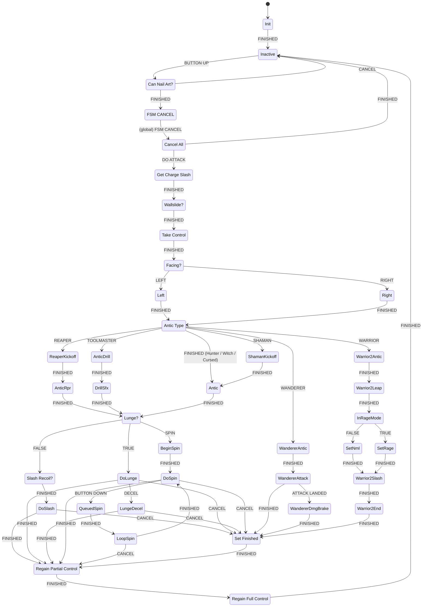

# Needle Strike (charged nail attack, "Nail Arts")

The needle strike is the attack released after holding the attack button until the nail is charged. It has two parts:

- **Charging** runs in C# in `HeroController.Update()`.
- **Execution** runs in the PlayMaker FSM `Nail Arts` on `Hero_Hornet(Clone)`. The FSM activates the per-crest "Charge Slash" GameObject, which is `HeroControllerConfig`'s `ChargeSlash` attack object.

Conventions used in this page:

- Times are in seconds. Frame counts are given "@60" (frames at 60 fps).
- tk2d animation triggers fire when the clip reaches frame index `i`, at `i / fps` seconds after the clip starts.
- Hornet's facing convention, from `HeroController.FaceRight()`: `localScale.x < 0` means facing **right**, and `localScale.x > 0` means facing **left**.
- `SetVelocityByScale` sets `vx = speed` when `localScale.x > 0` and `vx = -speed` otherwise. So a **negative** `speed` moves Hornet **forward** (in the facing direction), and a positive `speed` moves her backward.

---

## 1. Charging (C#)

### Charge loop (`HeroController.Update`, inside `if (!gm.isPaused && !playerData.isInventoryOpen)`)

```csharp
if (inputHandler.inputActions.Attack.IsPressed && CanNailCharge()) {
    cState.nailCharging = true;
    nailChargeTimer += Time.deltaTime;
} else if (cState.nailCharging || nailChargeTimer != 0f) {
    CancelNailCharge();   // stops effects, nailCharging=false, nailChargeTimer=0
}
```

Charge effects:

- `nailChargeTimer > CurrentNailChargeBeginTime` and `< CurrentNailChargeTime`: activates `artChargeEffect` and plays `HeroSounds.NAIL_ART_CHARGE`.
- `nailChargeTimer >= CurrentNailChargeTime`: does the following:
  - activates `artChargedEffect`
  - sends camera shake `"EnemyKillShake"`
  - plays `nailArtChargeComplete` and `HeroSounds.NAIL_ART_READY`
  - calls `spriteFlash.flashFocusGet()`
  - calls `ScreenFlash(new Color(1,1,1,0.3f))`

### Charge time values (`hero-controller.txt`)

| Field | Value |
|---|---|
| `NAIL_CHARGE_TIME` | 1.35 |
| `NAIL_CHARGE_TIME_QUICK` | 0.8 |
| `NAIL_CHARGE_BEGIN_TIME` | 0.3 |
| `NAIL_CHARGE_BEGIN_TIME_QUICK` | 0.225 |
| `NailChargeTimeQuickTool` | Pinstress Tool (ToolItemBasic) |

`CurrentNailChargeTime` and `CurrentNailChargeBeginTime` return the `_QUICK` values when `NailChargeTimeQuickTool.IsEquipped` is true, and the normal values otherwise.

### `CanNailCharge()` (private)

All of the following must be true:

- `!cState.dead`
- `!cState.attacking`
- `(!controlReqlinquished || allowNailChargingWhileRelinquished)`
- `!cState.recoiling`
- `!cState.recoilingLeft`
- `!cState.recoilingRight`
- `!cState.hazardDeath`
- `!cState.hazardRespawning`
- `playerData.hasChargeSlash` (a `PlayerData` bool)
- `Config.CanNailCharge` (`HeroControllerConfig.canNailCharge`)
- `!IsInputBlocked()`
- `InteractManager.BlockingInteractable == null`

`canNailCharge` is `True` in every config except `Cloakless` (`False`).

### `CanNailArt()` (called by the FSM on button release)

```csharp
if (!CanDoFsmMove()) return false;            // CanDoFsmMove() => !blockFsmMove
if (!cState.transitioning && (hero_state != ActorStates.no_input || allowNailChargingWhileRelinquished)
    && !cState.attacking && !cState.hazardDeath && !cState.hazardRespawning
    && nailChargeTimer >= CurrentNailChargeTime) { nailChargeTimer = 0f; return true; }
nailChargeTimer = 0f; return false;
```

When `CanDoFsmMove()` passes, `nailChargeTimer` is reset whether the call succeeds or fails.

### Other charge resets

- Taking damage calls `SetAllowNailChargingWhileRelinquished(false)` and `CancelNailCharge()`.
- `ResetMotion(resetNailCharge: true)` sets `nailChargeTimer = 0` unless `allowNailChargingWhileRelinquished` is true.

---

## 2. Nail Arts FSM overview

- **FSM:** `Nail Arts` on `Hero_Hornet(Clone)`
- **Start state:** `Init`

### Variables (dump defaults)

| Name | Type | Default |
|---|---|---|
| Audio Player | GameObject | null |
| Beast Lunge Stopper | GameObject | null |
| Can Drift | Bool | False |
| Chain | Int | 0 |
| Charge Slash Basic | GameObject | null |
| Charge Slash Upgraded | GameObject | null |
| Charge Slash Warrior | GameObject | Charge Slash Warrior |
| Charge Slash Warrior R | GameObject | Charge Slash Warrior Rage |
| Current Charge Slash | GameObject | null |
| Current Lunge Stopper | GameObject | null |
| Cyclone Accel | Float | 1 |
| Cyclone Decel | Float | 0 |
| Cyclone Speed Max | Float | 8 |
| Dash Burst | GameObject | Dash Burst |
| Dash Stopper | GameObject | dash stopper |
| Dashing | Bool | False |
| Deceleration | Float | 0.92 |
| In Rage Mode | Bool | False |
| Is Anim Finished | Bool | False |
| Is Grounded | Bool | False |
| Lunge Deceleration | Float | 0 |
| Lunge Speed | Float | 0 |
| Queued Attack | Bool | False |
| Rage Lunge Stopper | GameObject | null |
| Recoil Method | String | "" |
| Return Bool | Bool | False |
| Special Attack Folder | GameObject | Special Attacks |
| Sphere Flash | GameObject | Sphere Flash |
| Velocity Before Cancel | Vector2 | (0.00, 0.00) |
| Velocity Y | Float | 0 |
| Wall Sliding | Bool | False |
| Wanderer Lunge Stopper | GameObject | Lunge Stopper |
| damager 01 | GameObject | null |
| damager 02 | GameObject | null |

The `Charge Slash Basic` and `Charge Slash Upgraded` FSM variables are never assigned in any state. `Cancel All` deactivates them, which does nothing because they are null. The Hunter charge slash object is reached through `Current Charge Slash`, as described in section 3.

### Global transitions

- `HERO DAMAGED` → `Cancel All`
- `LEAVING SCENE` → `Cancel All`
- `FSM CANCEL` → `Cancel All`

### Dump limitations

- **`SendMessage`/`SendMessageV2`:** the dump prints `functionCall = HutongGames.PlayMaker.FunctionCall` without the method name. The method called by every SendMessage action is therefore **not determinable from the dump**. This affects:
  - Take Control [0–2]
  - Regain Partial Control [0], [2]
  - Regain Full Control [0–2]
  - Antic [0]
  - Do Slash [1], [2]
  - all other SendMessage actions
- **`CallMethodProper.storeResult` and `GetHeroConfigVariable.StoreValue`:** the dump prints the stored *value* (`False` / `0`), not the target variable. The variables later tested (`Return Bool`, `Lunge Speed`, `Chain`, `Lunge Deceleration`) are the ones these actions are presumed to write.

### State graph



**Unreachable states.** No transition leads into `Warrior Antic`, `State 1`, `Warrior Attack` or `Warrior DmgBrake`. `Warrior Antic` → `State 1` → `Warrior Attack`, and `Warrior Attack` → `Warrior DmgBrake` on `ATTACK LANDED`. Because nothing enters `Warrior Antic`, this whole chain never runs.

### Start sequence (all crests)

1. **`Inactive`**
   - [0] `Queued Attack = False`
   - [1] `ListenForAttack`: `wasReleased` → `BUTTON UP`
   - The FSM therefore reacts to the attack button being **released**.
2. **`Can Nail Art?`**
   - [0] `HeroController.GetState("dashing")`
   - [1] `HeroController.CanNailArt()`
   - [2] `BoolTest Return Bool`: false → `CANCEL` → `Inactive`. Otherwise the state ends with `FINISHED` → `FSM CANCEL`.
3. **`FSM CANCEL`**
   - [0] `Queued Attack = True`
   - [1] `HeroController.SetAllowNailChargingWhileRelinquished(False)`
   - [2] `GetVelocity2d` → `Velocity Before Cancel` (World)
   - [3] `SendEventByName "FSM CANCEL"` (delay 0)
   - The event triggers the global transition → `Cancel All`.
4. **`Cancel All`**
   - [0] `BoolTest Queued Attack`: true → `DO ATTACK` → `Get Charge Slash`
   - [1]–[5] destroy `Audio Player`, and deactivate `Charge Slash Basic`, `Charge Slash Upgraded`, `Dash Burst` and `Current Charge Slash`.
   - Without a queued attack (for example on `HERO DAMAGED`), the state ends `FINISHED` → `Inactive`.
5. **`Get Charge Slash`**
   - `GetHeroAttackObject Attack = ChargeSlash` → `Current Charge Slash`.
   - This returns `HeroController.CurrentConfigGroup.ChargeSlash`.
6. **`Wallslide?`**
   - [0] `Queued Attack = False`
   - [1] `TrySetCorrectFacing(True)`
   - [2] `GetState("wallSliding")`
   - [3] `BoolTest Wall Sliding`: false → `FINISHED`
   - [4] SendMessage to owner (function not in dump), which runs only when wall sliding.
   - → `Take Control`
7. **`Take Control`**
   - [0–2] three SendMessages to owner (functions not in dump)
   - [3] `AffectedByGravity(False)`
   - [4] `SetVelocity2d = Velocity Before Cancel`
   - [5] log `"TAKEN"`
8. **`Facing?`**
   - `SendEventByScale` (World): `localScale.x` positive → `LEFT`, negative → `RIGHT`.
9. **`Left` / `Right`**
   - `Left`: `Recoil Method = "ChargeSlashRecoilRight"`
   - `Right`: `Recoil Method = "ChargeSlashRecoilLeft"`
   - The recoil method therefore always pushes **away from the facing direction**.
   - Each state also has a disabled `SetDamageEnemyDirectionV2` (180 for `Left`, 0 for `Right`).
10. **`Antic Type`**
    - [0] plays `hornet_needle_art_release_burst` (pitch 1, volume 1)
    - [1] `DoCameraShakeV2 Small Shake`
    - [2]–[6] `CheckIfCrestEquipped` in this order: Reaper → `REAPER`, Wanderer → `WANDERER`, Warrior → `WARRIOR`, Toolmaster → `TOOLMASTER`, Spell → `SHAMAN`.
    - If none matches (Hunter, Hunter_v2, Hunter_v3, Witch, Cursed), the state ends `FINISHED` → `Antic`.

### End sequence (all crests)

- **`Set Finished`**: `Is Anim Finished = True` → `Regain Partial Control`.
- **`Regain Partial Control`**:
  - [0] SendMessageV2 to `Current Charge Slash` (function not in dump)
  - [1] `AffectedByGravity(True)`
  - [2] SendMessage to owner (function not in dump)
  - [3] `DoHeroMovement`: each FixedUpdate calls `hc.UpdateMoveInput()` (in Update) and `hc.DoMovement(useInput: true)`.
  - [4] `CallMethodProper HeroController.<Recoil Method>()`
  - [5] `BoolTest Is Anim Finished`: true → `FINISHED`
  - [6] `Tk2dWatchAnimationEvents`: clip complete → `FINISHED`
  - [7] `DecelerateV2 deceleration = Deceleration (0.92)`, applied every FixedUpdate.
- **`Regain Full Control`**: three SendMessages to owner (functions not in dump) → `Inactive`.

---

## 3. Hunter path (Default config)

Hunter, Hunter_v2 and Hunter_v3 all have `heroConfig=null` (`crests.txt`), so they use `configs[0] Default`. None has an animation override library, so the hero clip is the base `Knight` library clip.

### Default config charge-slash values (`hero-configs.txt` configs[0])

| Field | Value |
|---|---|
| canNailCharge | True |
| chargeSlashRecoils | True |
| chargeSlashLungeSpeed | 0 |
| chargeSlashLungeDeceleration | 1 |
| chargeSlashChain | 0 |
| ChargeSlash object | `Charge Slash Basic` |

### Hero clip `Slash_Charged` (Knight library, `hero-animations.txt`)

`fps=25 frames=13 wrap=Once triggers=[3:'' 7:'']`

| Point | Frame | Time | @60 |
|---|---|---|---|
| Clip start | 0 | 0.000 s | 0 |
| Trigger 1 | 3 | 0.120 s | 7.2 |
| Trigger 2 | 7 | 0.280 s | 16.8 |
| Clip complete | 13 | 0.520 s | 31.2 |

`HeroAnimationController.AnimationEventTriggered` has no handler for `Slash_Charged`; it only handles "Wake Up Ground", "Footstep" and "Sprint Backflip". `HeroAnimationController.IsTurnBlocked()` returns true while `Slash_Charged` plays.

### State walk-through

Times below are measured from entry into `Antic`.

**`Antic`** (t = 0)

- [0] `SendMessageV2` to owner (RequireReceiver, function not in dump)
- [1] activate `Sphere Flash`
- [2] `Tk2dPlayAnimationWithEvents clipName="Slash_Charged"`, `animationTriggerEvent=FINISHED`
- [3] `DecelerateV2 deceleration=0.85`, `brakeOnExit=False`, applied every FixedUpdate
- Gravity is off from `Take Control`.
- Exit: the first trigger (frame 3, **0.12 s**) → `Lunge?`

**`Lunge?`** (instant)

- [0] `GetHeroConfigVariable "ChargeSlashLungeSpeed"`
- [1] `FloatCompare Lunge Speed vs 0` (tolerance 0): less than or greater than → `TRUE`
- [2] `GetHeroConfigVariable "ChargeSlashChain"`
- [3] `IntCompare Chain vs 0`: greater than → `SPIN`
- [4] `SendEvent FALSE`
- Default has 0 / 0, so the result is `FALSE` → `Slash Recoil?`

**`Slash Recoil?`** (instant)

- [0] `CheckIfCrestEquipped Spell`: false → `FINISHED`
- [1] `CallMethodProper <Recoil Method>` runs only when Spell is equipped.
- For Hunter, Spell is not equipped, so **no recoil is called here** → `Do Slash`.

**`Do Slash`** (t = 0.12 s)

- [0] activate `Current Charge Slash` (= `Charge Slash Basic`)
- [1], [2] two `SendMessageV2` to `Current Charge Slash` (DontRequireReceiver, functions not in dump)
- [3] `DecelerateV2 deceleration = Deceleration (0.92)`
- [4] `Is Anim Finished = False`
- [5] `Tk2dWatchAnimationEvents`: trigger → `FINISHED`, complete → `CANCEL`
- Exit: the next trigger (frame 7, **0.28 s**, i.e. 0.16 s after `Do Slash` began) → `Regain Partial Control`.

**`Regain Partial Control`** (t = 0.28 s)

- Runs the actions listed in the end sequence.
- [4] calls `ChargeSlashRecoilRight` when facing left, or `ChargeSlashRecoilLeft` when facing right (section 5).
- `Is Anim Finished` is False, so the state waits for clip complete (frame 13, **0.52 s**) → `Regain Full Control` → `Inactive`.
- The fallback (`Do Slash` receives `CANCEL` because the clip completed before trigger 2) goes `Set Finished` → `Regain Partial Control`. That state calls the recoil method and immediately finishes.

Summary of Hunter needle strike timing:

| Interval | Duration |
|---|---|
| Antic (button release to Charge Slash Basic activation) | 0.12 s (7.2 @60) |
| Charge Slash Basic active until partial control | 0.16 s (9.6 @60) |
| Partial control phase | 0.24 s (14.4 @60) |
| Total FSM-controlled duration | 0.52 s (31.2 @60) |

---

## 4. `Charge Slash Basic` (Hunter / Default ChargeSlash object)

Source: `hero-configs.txt` configs[0] `ChargeSlash: Charge Slash Basic`.

### Root object

`Charge Slash Basic`:

- `activeSelf=False`
- `localPos=(-1.03, 0.15, 0.00)`
- `localScale=(0.98, 1.20, 1.27)`
- `localRot=(0.00, 0.00, 2.41)`

| Component | Values |
|---|---|
| SpriteRenderer | – |
| Animator | enabled, speed=1, controller=`Charge Slash Basic` |
| DisableAfterTime | `waitTime = 1`, `isRealtime = False`, `sendEvent = ""`. `OnEnable` sets `timeLeft = waitTime`. Update deactivates the object when `timeLeft <= 0`. |
| CameraShakeAnimator | `cameraShakeTargets = (1)[CameraShakeTarget]` |
| ScreenFlashAnimator | `screenFlashColours = (2)[RGBA(1,1,1,0.209), RGBA(1,1,1,0.500)]` |
| HeroExtraNailSlash | `tintSprites = (1)[Charge Slash Basic (SpriteRenderer)]`. On enable, copies the current nail imbuement (`NailElement` / `NailImbuement`) onto all child `DamageEnemies` and tints the sprites. On disable, resets them. |
| HeroNailImbuementEffect | `nailElement = Fire`, `activateObjects = (2)[Embers, Embers]` |
| HeroNailImbuementEffect | `nailElement = Poison`, `activateObjects = (2)[Poison, Poison ]` |

### Animator clip

`Hornet Charge Slash Basic`: `length=0.417s fps=24 loop=False`

| Time | Function | Params |
|---|---|---|
| 0s | `DoCameraShake` | f=0, i=0, s='', o=null |
| 0s | `DoScreenFlash` | f=0, i=0, s='', o=null |

These are the **only** animation events. Both are handled by the object's own `CameraShakeAnimator` / `ScreenFlashAnimator`. **No animation event calls a HeroController method.** In particular, no event calls `ChargeSlashRecoil*`, `Recoil*`, or any velocity or lunge function.

The dump does not include Animator property curves. Both `slash 01` and `slash 02` (and both `Audio Player Actor` children) are `activeSelf=False` in the prefab. They are presumably toggled by Animator curves, but **their activation and deactivation times are not determinable from the dump**.

The clip runs from t = 0.12 s to t = 0.537 s on the section 3 timeline. `DisableAfterTime` deactivates the root at t = 1.12 s unless something else deactivates it first.

### Children

| Child | activeSelf | Notes |
|---|---|---|
| Audio Player Actor | False | `PlayRandomAudioEvent`, clip `hornet_hunter_needleart_slash_1`, pitch 0.95–1.05, vol 1, `playOnEnable=True` |
| Audio Player Actor (1) | False | `PlayRandomAudioEvent`, clip `hornet_hunter_needleart_slash_2`, pitch 0.95–1.05, vol 1, `playOnEnable=True` |
| slash 01 | False | hitbox (below) |
| slash 02 | False | hitbox (below) |
| Noise Maker | True | `NoiseMaker` radius=3, intensity=Normal, `createNoiseOnEnable=True`, localPos (-1.27, 0, 0) |
| Flintstone Charge Slash Basic 1 | True | holds Poison / Embers particle effects (duration 0.1) |
| Flintstone Charge Slash Basic 2 | False | same structure as Flintstone 1 |
| Charge Slash Hornet Voice | True | `PlayRandomAudioEvent`, table `Attack Needle Art Hornet Voice`, `playOnEnable=True` |

### Hitboxes

| Field | slash 01 | slash 02 |
|---|---|---|
| Components | PolygonCollider2D, DamageEnemies, NailSlashTerrainThunk | same |
| localPos | (1.04, -0.16, 0.00) | (1.04, -0.16, 0.00) |
| localScale | (0.73, 0.73, 0.73) | (0.81, 0.66, 0.73) |
| localRot | (0, 0, 357.59) | (0, 0, 357.59) |
| PolygonCollider2D (trigger, offset 0,0) | `(-0.093,2.106) (-3.894,1.937) (-7.608,0.809) (-8.522,-0.362) (-6.193,-1.474) (-2.765,-1.586) (-0.334,-1.351)` | `(-0.191,2.568) (-4.239,1.948) (-6.841,0.719) (-6.991,-0.615) (-5.324,-1.397) (-0.964,-1.847)` |
| attackType | Heavy | Heavy |
| specialType | CocoonBreak, Heavy | CocoonBreak, Heavy |
| useNailDamage | True | True |
| nailDamageMultiplier | **1.4** | **1.4** |
| damageDealt | 5 (unused when useNailDamage) | 5 |
| useHeroDamageAffectors | False | False |
| stunDamage | 1 | 1 |
| direction | 180 | 180 |
| flipDirectionIfXScaleNegative | True | True |
| circleDirection | False | False |
| magnitudeMult | **0.5** | **1** |
| corpseMagnitudeMult | enabled, 1.2 | enabled, 1.2 |
| multiHitter / stepsPerHit / hitsUntilDeath | False / 0 / 0 | False / 0 / 0 |
| hitOnceUntilEnd | False | False |
| silkGeneration | Full | Full |
| lagHitOptionsProfile | null | null |
| doesNotStun / doesNotTink / doesNotParry | False | False |
| NailSlashTerrainThunk | `generateChild=True`, **`doRecoil=False`**, `overrideTransform=Hero_Hornet(Clone)` | same |
| NailSlashRecoil component | **absent** | **absent** |

The two hitboxes differ only in collider shape, `localScale` and `magnitudeMult` (0.5 vs 1). Neither has a `NailSlash` component, so `NailSlash` never calls `NailSlashRecoil.Add(...)` for them (it only does so on its own GameObject).

---

## 5. Everything that moves Hornet during and after the Hunter needle strike

### 5.1 FSM-driven velocity (Hunter path)

| State | Action | Effect |
|---|---|---|
| Take Control | `AffectedByGravity(False)`, `SetVelocity2d = Velocity Before Cancel` | Gravity off. Velocity is restored to the value captured in `FSM CANCEL`. |
| Antic | `DecelerateV2 0.85` | Each FixedUpdate multiplies vx and vy by 0.85 (from 0 to 0.12 s). |
| Lunge? | – | No lunge, because `chargeSlashLungeSpeed = 0`. |
| Slash Recoil? | – | No recoil call for non-Spell crests. |
| Do Slash | `DecelerateV2 0.92` | Each FixedUpdate multiplies vx and vy by 0.92 (from 0.12 to 0.28 s). |
| Regain Partial Control | `AffectedByGravity(True)`, `DoHeroMovement`, `<Recoil Method>`, `DecelerateV2 0.92` | Gravity on. Input movement plus recoil movement (see 5.2). Velocity multiplied by 0.92 each FixedUpdate after `DoHeroMovement` (from 0.28 to 0.52 s). |

### 5.2 The needle-strike pushback (`ChargeSlashRecoilRight` / `ChargeSlashRecoilLeft`)

**Caller.** The only caller in the Hunter path is the FSM action `Regain Partial Control` [4], `CallMethodProper HeroController.<Recoil Method>()`. The action runs on state entry, which happens at Hunter `Slash_Charged` frame 7 (0.28 s), or at clip end through the `Set Finished` fallback. It is **not** called by:

- an animation event (the `Charge Slash Basic` Animator only has `DoCameraShake` / `DoScreenFlash`, and `HeroAnimationController` has no `Slash_Charged` handler)
- a hit callback (`slash 01` / `slash 02` have no `NailSlashRecoil`, and `NailSlashTerrainThunk.doRecoil = False`)

The only other FSM caller is `Slash Recoil?` [1], which runs only when the **Spell** (Shaman) crest is equipped.

Direction: facing left → `ChargeSlashRecoilRight`; facing right → `ChargeSlashRecoilLeft`. Both push away from the facing direction.

```csharp
public void ChargeSlashRecoilRight() {
    if (Config.ChargeSlashRecoils) { SetAllowRecoilWhileRelinquished(true); RecoilRight(); }
}
public void ChargeSlashRecoilLeft() {
    if (Config.ChargeSlashRecoils) { SetAllowRecoilWhileRelinquished(true); RecoilLeft(); }
}
public void RecoilRight() { if (CanRecoil()) Recoil(isRight: true,  isLong: false); }
public void RecoilLeft()  { if (CanRecoil()) Recoil(isRight: false, isLong: false); }

private bool CanRecoil() {
    if (!CanCustomRecoil()) return false;                    // Time.timeAsDouble >= recoilAllowTime
    if ((cState.recoilingDrill || (!cState.recoilingLeft && !cState.recoilingRight))
        && (!controlReqlinquished || allowRecoilWhileRelinquished))
        return InteractManager.BlockingInteractable == null;
    return false;
}
```

`Recoil(bool isRight, bool isLong)` works as follows:

- `steps = RECOIL_HOR_STEPS` (8).
- If WitchCrest or CursedCrest is equipped, `steps = Gameplay.WitchCrestRecoilSteps` (5).
- If WeightedAnkletTool is equipped, `steps = WeightedAnkletRecoilSteps` (4), or 0 when the Witch/Cursed crest is also equipped.
- `isLong == false`, so it calls `Recoil(isRight, steps, RECOIL_HOR_VELOCITY)`.

`Recoil(bool isRight, int steps, float velocity)` then does the following:

- cancels any dash
- sets `recoilStepsLeft = steps`
- sets `cState.recoilingRight = isRight` and `recoilingLeft = !isRight`
- clears `recoilingDrill`, `wallJumping` and `wallJumpedL/R`
- sets `recoilVelocity = velocity`
- **immediately sets `rb2d.linearVelocity.x = ±velocity`** (y unchanged)

Values (`hero-controller.txt`, `gameplay-settings.txt`):

| Field | Value |
|---|---|
| RECOIL_HOR_VELOCITY | 3.75 |
| RECOIL_HOR_VELOCITY_LONG | 16 (not used here) |
| RECOIL_HOR_VELOCITY_DRILLDASH | 10 (not used here) |
| RECOIL_HOR_STEPS | 8 |
| RECOIL_DURATION | 0.2 (damage recoil, not used here) |
| witchCrestRecoilSteps | 5 |
| weightedAnkletRecoilSteps | 4 |

#### Duration

`HeroController.FixedUpdate` runs this logic while `cState.recoilingLeft || cState.recoilingRight`:

- if `recoilStepsLeft > 0`, it decrements `recoilStepsLeft`
- otherwise it calls `CancelRecoilHorizontal()`, which clears the flags

With 8 steps, the recoil state lasts 8 FixedUpdate decrements and is cancelled on the 9th FixedUpdate. With the fixed timestep of 0.02 s (see [nail attacks and pogo](nail-attacks-and-pogo.md)), that is 0.16 s (0.08 s with Weighted Anklet).

#### Sustained recoil velocity

`DoRecoilMovement()` is called from `HeroController.DoMovement()`, which the FSM action `DoHeroMovement` calls every FixedUpdate in `Regain Partial Control`:

- **recoilingRight:** `vx = (vx + 3.75 < 3.75) ? 3.75 : vx + 3.75`. The velocity is at least 3.75 to the right; if Hornet is already moving right, 3.75 is added.
- **recoilingLeft:** the mirror case (at least 3.75 to the left).

In the same FixedUpdate, after `DoHeroMovement`, the state's `DecelerateV2 0.92` multiplies the result by 0.92.

### 5.3 Does the second slash of the Hunter needle strike push Hornet back?

- **There is exactly one pushback event.** The FSM calls `ChargeSlashRecoil{Right|Left}` once, on entry to `Regain Partial Control`, at Hunter `Slash_Charged` frame 7 (0.28 s after the antic starts and 0.16 s after `Charge Slash Basic` is activated).
- **Its values** are a horizontal recoil away from the facing direction, with `RECOIL_HOR_VELOCITY` 3.75 for `RECOIL_HOR_STEPS` 8 FixedUpdate steps (4 with Weighted Anklet).
- **It runs because** Default `chargeSlashRecoils = True`.
- **It does not depend on hitting anything.** Neither `slash 01` nor `slash 02` has a recoil-on-hit mechanism:
  - no `NailSlashRecoil` component
  - `NailSlashTerrainThunk.doRecoil = False`
  - no hero-method animation events
- **Neither slash hitbox triggers the pushback.** The pushback is tied to the FSM state change, not to `slash 02`.
- **Its timing relative to the `slash 02` hitbox is not determinable from the dump.** Slash 01/02 activation is driven by Animator curves that the dump does not contain. On the `Charge Slash Basic` clip timeline (24 fps, 0.417 s), the recoil call happens at 0.16 s, around clip frame 3.84.

### 5.4 Other movement sources checked

- **Lunge:** Default `chargeSlashLungeSpeed = 0`, so `Do Lunge` is never entered, and `chargeSlashLungeDeceleration = 1` is unused.
- **`NailSlashRecoil` on hit:** not present on `Charge Slash Basic` children.
  - For reference, where `NailSlashRecoil` exists, its `HitResponse` checks that the hit's cardinal direction equals the damager's cardinal direction. It then calls `SetAllowRecoilWhileRelinquished(true)` if the object has no `NailAttackBase`.
  - For hits on the ENEMIES layer (non-`NonBouncer`), it calls `RecoilLeft` / `RecoilRight` / `RecoilDown`, or `RecoilLeftLong` / `RecoilRightLong` against a `BounceShroom`, or `DrillPull` when `drillPull` is set.
  - For TERRAIN / INTERACTIVE_OBJECT hits, it recoils only when the target is tagged `Recoiler`.
- **Terrain thunk:** `NailSlashTerrainThunk` with `doRecoil=True` calls `SetAllowRecoilWhileRelinquished(true)`, then `RecoilLeft` / `RecoilRight` / `RecoilDown`, then `SetAllowRecoilWhileRelinquished(false)`. On `Charge Slash Basic`, `doRecoil=False`.
- **Gravity:** off from `Take Control` until `Regain Partial Control` [1].

---

## 6. Other crest branches

### Config values per crest

From `hero-configs.txt` and `crests.txt`.

| Crest (ToolCrest) | heroConfig | canNailCharge | chargeSlashRecoils | chargeSlashLungeSpeed | chargeSlashLungeDeceleration | chargeSlashChain | ChargeSlash object |
|---|---|---|---|---|---|---|---|
| Hunter / Hunter_v2 / Hunter_v3 | null → Default | True | **True** | 0 | 1 | 0 | Charge Slash Basic |
| Reaper | Reaper | True | False | 0 | 1 | 0 | Charge Slash Scythe |
| Wanderer | Wanderer | True | False | 0 | 1 | 0 | Charge Slash Wanderer |
| Warrior (Beast) | Warrior (HeroControllerConfigWarrior) | True | False | 0 | 1 | 0 | Charge Slash Warrior Old (config). The FSM substitutes `Charge Slash Warrior` / `Charge Slash Warrior Rage`. |
| Warrior rage (specialConfigs[0]) | Warrior | True | False | 0 | 1 | 0 | null |
| Toolmaster (Architect) | Toolmaster | True | False | **-40** | **0.9** | 0 | Charge Slash Toolmaster |
| Witch, and Cursed (both use the Whip config) | Whip | True | False | 0 | 1 | **3** | Charge Slash Witch |
| Spell (Shaman) | Shaman | True | **True** | 0 | 1 | 0 | Charge Slash Shaman |
| Cloakless | Cloakless | **False** | False | 0 | 1 | 0 | null |

`Regain Partial Control` [4] calls `<Recoil Method>` on every branch. It only produces a recoil for configs with `chargeSlashRecoils = True` (Default and Shaman).

### Charged clip per animation library

| Library | Clip | fps | frames | triggers | trigger times | length |
|---|---|---|---|---|---|---|
| Knight (base; Hunter) | Slash_Charged | 25 | 13 | 3, 7 | 0.12 s, 0.28 s | 0.52 s |
| Scythe (Reaper) | Slash_Charged | 15 | 10 | 4, 8 | 0.2667 s, 0.5333 s | 0.6667 s |
| Dagger (Wanderer) | Slash_Charged | 18 | 12 | 2 | 0.1111 s | 0.6667 s |
| Warrior | Slash_Charged | 15 | 9 | 2 | 0.1333 s | 0.6 s (not used by the FSM's Warrior branch) |
| Warrior | NeedleArt Dash | 12 | 8 | 1, 4, 6 | 0.0833 s, 0.3333 s, 0.5 s | 0.6667 s |
| Drill Lance (Toolmaster) | Slash_Charged | 18 | 11 | 4, 10 | 0.2222 s, 0.5556 s | 0.6111 s |
| Whip (Witch/Cursed) | Slash_Charged | 25 | 8 | 1, 7 | 0.04 s, 0.28 s | 0.32 s |
| Whip | Slash_Charged_Loop | 25 | 6 | 5 | 0.2 s | 0.24 s |
| Shaman | Slash_Charged | 25 | 13 | 4, 10 | 0.16 s, 0.4 s | 0.52 s |

### Reaper (`Antic Type` → `REAPER`)

- **`Reaper Kickoff`**
  - `CheckIsCharacterGrounded` (RayCount 3, GroundDistance 0.2, SkinWidth -0.05, SkinHeight 0.1): not grounded → `FINISHED` immediately.
  - If grounded: `SetVelocity2d y = 10` → `Antic Rpr`.
- **`Antic Rpr`**
  - plays `hornet_reaper_nailart_start_on_flash`
  - SendMessageV2 to owner
  - activates `Sphere Flash`
  - plays `Slash_Charged` (trigger → FINISHED)
  - `DecelerateV2 0.85` with **`brakeOnExit=True`** (velocity set to (0,0) when the state exits)
  - SendMessage to owner
  - → `Lunge?` → FALSE → `Slash Recoil?` (no recoil) → `Do Slash` (same as Hunter, Deceleration 0.92) → `Regain Partial Control` (recoil method is a no-op: `chargeSlashRecoils=False`).
- **`Charge Slash Scythe`**
  - Components: Animator clip `Hornet Charge Slash Scythe` (length 0.24 s, 25 fps, events `0s:DoCameraShake`), DisableAfterTime `waitTime=0.5`, KeepWorldPosition, EnemyDamagerGroup.
  - Three damagers, all `attackType=Heavy`, `nailDamageMultiplier=2.5`, `NailSlashTerrainThunk doRecoil=False`:

| Damager | direction | magnitudeMult |
|---|---|---|
| slash 01 | 180 | 2 |
| slash 02 | 180 | 2 |
| slash behind | 0 | 1 |

### Wanderer (`Antic Type` → `WANDERER`)

- **`Wanderer Antic`**
  - `Slash_Charged` (trigger at frame 2, 0.111 s → FINISHED)
  - `DecelerateV2 0.85` with `brakeOnExit=True`
  - SendMessageV2 to owner
  - activates `Sphere Flash`
- **`Wanderer Attack`**
  - plays `hornet_wanderer_needle_art`
  - SendMessage to owner
  - **`SetVelocityByScale speed=-45, ySpeed=0`** (45 forward)
  - `SetVelocity2d y=0`
  - `AccelerateToY accelerationFactor=0.25 targetSpeed=-10`
  - `DecelerateXY decelerationX=0.78`
  - activates `Current Charge Slash`
  - Exits:
    - clip complete → `Set Finished`
    - `Wanderer Lunge Stopper` OnTriggerEnter2D → `ATTACK LANDED` → **`Wanderer DmgBrake`**, which sets `vx = 0` and waits for clip complete → `Set Finished`.
- The branch bypasses `Lunge?`, so the config lunge fields are unused.
- **`Charge Slash Wanderer`** (tk2d with DeactivateAfter2dtkAnimation):
  - `attackType=Nail`, `nailDamageMultiplier=0.55`
  - `multiHitter=True`, `stepsPerHit=6`, `hitsUntilDeath=100`
  - `magnitudeMult=0.5`, `direction=180`, `silkGeneration=FirstHit`
  - `NailSlashTerrainThunk doRecoil=True`
  - Child `Lunge Stopper` is a trigger PolygonCollider2D.

### Warrior / Beast (`Antic Type` → `WARRIOR`)

- **`Warrior2 Antic`**
  - plays **`NeedleArt Dash`** (first trigger at frame 1, 0.0833 s → FINISHED)
  - `DecelerateV2 0.85`
  - SendMessage and SendMessageV2 to owner
  - activates `Sphere Flash`
- **`Warrior2 Leap`**
  - watches for the next trigger (frame 4, 0.333 s)
  - grounded check: `Velocity Y` = **17 if grounded, 10 if not**
  - **`SetVelocityByScale speed=-15`** (15 forward), `ySpeed=Velocity Y`
  - plays `hornet_jump_nogap`
  - `Can Drift` becomes True after 0.05 s
  - `UmbrellaMotionXV2 accel=1 decel=0 maxSpeed=20` while `Can Drift`: each FixedUpdate adds ±1 to vx toward the held direction, capped at ±20.
  - → `In Rage Mode?`
- **`In Rage Mode?`**: `HeroGetWarriorCrestState`.
  - `Set Nml`: `Current Charge Slash = Charge Slash Warrior`
  - `Set Rage`: `Current Charge Slash = Charge Slash Warrior Rage`
  - In both states, the `Current Lunge Stopper` assignments are disabled.
- **`Warrior2 Slash`**
  - activates the slash
  - plays `hornet_reaper_needle_art` (pitch 1.15)
  - SendMessage
  - `DecelerateV2 0.85`
  - watches for the next trigger (frame 6, 0.5 s)
- **`Warrior2 End`**
  - `DecelerateXY decelerationX=0`, which sets vx to 0 each FixedUpdate
  - SendMessage
  - activates the slash with `resetOnExit=True`
  - waits for clip complete (0.6667 s) → `Set Finished`
- `Charge Slash Warrior` and `Charge Slash Warrior Rage` (children of `Attacks/`) are **not in the dump**, so their hitbox values are not determinable.
- The config object `Charge Slash Warrior Old` is not used by this branch: `Set Nml`/`Set Rage` overwrite `Current Charge Slash`. Its values are listed here for reference:
  - `attackType=Nail`, `nailDamageMultiplier=1`
  - `multiHitter=True`, `stepsPerHit=8`, `hitsUntilDeath=100`
  - `magnitudeMult=0.5`, `silkGeneration=None`
- `chargeSlashRecoils = False`.

### Toolmaster / Architect drill (`Antic Type` → `TOOLMASTER`)

- **`Antic Drill`**
  - SendMessageV2 to owner
  - activates `Sphere Flash`
  - plays `Slash_Charged` (trigger at frame 4, 0.222 s → FINISHED)
  - grounded check: `Velocity Y` = **1.5 if grounded, 0 if not**
  - **`SetVelocityByScale speed=30`** (30 **backward**, away from the facing direction), `ySpeed=Velocity Y`
  - `DecelerateXY decelerationX=0.83`
- **`Drill Sfx`**: plays `hornet_architect_charge_attack` → `Lunge?`.
  - `Lunge Speed = -40 ≠ 0` → `TRUE` → `Do Lunge`.
- **`Do Lunge`**
  - activates `Current Charge Slash` and `Dash Burst`
  - SendMessageV2 to the slash (RequireReceiver)
  - **`SetVelocityByScale speed=Lunge Speed (-40)`** (40 forward), `ySpeed=0`
  - `GetHeroConfigVariable "ChargeSlashLungeDeceleration"`
  - `DecelerateV2 Lunge Deceleration (0.9)`
  - `Is Anim Finished=False`
  - Exits:
    - trigger (frame 10, 0.556 s) → `Regain Partial Control`
    - complete → `CANCEL` → `Set Finished`
    - `dash stopper` OnTriggerEnter2D/Stay2D → `DECEL` → **`Lunge Decel`** (`DecelerateV2 0.8`, same exits)
- **`Charge Slash Toolmaster`**
  - Animator clip `Hornet Charge Slash Toolmaster` (0.333 s, 15 fps, events `0s:DoCameraShake`, `0.067s:DoScreenFlash`)
  - DisableAfterTime `waitTime=1`, KeepWorldPosition
  - `damager/damager front`: `attackType=Nail`, `nailDamageMultiplier=0.6`, `multiHitter=True`, `stepsPerHit=2`, `hitsUntilDeath=5`, `magnitudeMult=0.5`, `direction=180`, `silkGeneration=FirstHit`, `doRecoil=False`
  - `damager/dash stopper`: trigger polygon `(-2.13,-1.267) (-7.043,-0.815) (-7.026,0.774) (-2.153,1.738)`
- `chargeSlashRecoils = False`.

### Witch / Cursed spin (no `Antic Type` match → `Antic`)

- **`Antic`**: same as Hunter, with the Whip `Slash_Charged` (trigger at frame 1, 0.04 s).
- **`Lunge?`**: Lunge Speed 0, `Chain = 3 > 0` → `SPIN` → **`Begin Spin`**.
- **`Begin Spin`**
  - plays `hornet_witch_needle_art` (stored as `Audio Player`)
  - `AffectedByGravity(True)`
  - `FindNamedChild` → `damager 01`, `damager 02`
  - `DamageEnemies.SetSilkGenerationFull()` on both
- **`Do Spin`**
  - activates the slash
  - SendMessageV2 (RequireReceiver)
  - `Is Anim Finished=False`
  - `UmbrellaMotionXV2 accel=Cyclone Accel (1) decel=Cyclone Decel (0) max=Cyclone Speed Max (8)`
  - Exits:
    - trigger → `Regain Partial Control`
    - complete → `CANCEL` → `Set Finished`
    - attack pressed → `BUTTON DOWN` → **`Queued Spin`**
- **`Queued Spin`**
  - plays `hornet_witch_needle_art` (pitch 1.2)
  - same UmbrellaMotionXV2
  - reads vy, clamps it to [0, 100], and writes it back once (removes downward velocity)
  - on trigger or complete → `Loop Spin`
- **`Loop Spin`**
  - `Chain -= 1`; if `Chain <= 0` → `CANCEL` → `Regain Partial Control`
  - otherwise plays `Slash_Charged_Loop` from frame 0, deactivates the slash → `Do Spin` (which reactivates it)
  - With `chargeSlashChain = 3`, there are at most 3 spin activations in total (the initial spin plus 2 loops).
- **`Charge Slash Witch`**
  - Animator clip `Hornet Charge Slash Witch` (0.36 s, 25 fps, events `0s:DoCameraShake`, `0.04s:DoScreenFlash`)
  - DisableAfterTime `waitTime=0.5`, KeepWorldPosition
  - `damager 01` / `damager 02` (both `activeSelf=False`):
    - `attackType=Nail`, `nailDamageMultiplier=0.7`, `direction=0`, `magnitudeMult=0.5`
    - `silkGeneration=FirstHit` (set to Full by `Begin Spin`)
    - `NailSlashTerrainThunk doRecoil=True`
    - **have `NailSlashRecoil`**, so they recoil Hornet on hit. With Witch/Cursed equipped, `Recoil()` uses `witchCrestRecoilSteps = 5` steps at 3.75.
- `chargeSlashRecoils = False`.

### Shaman (`Antic Type` → `SHAMAN`)

- **`Shaman Kickoff`**: if grounded, `SetVelocity2d y = 10`; if airborne, it finishes immediately → `Antic`.
- **`Antic`**: Hunter `Antic` with the Shaman `Slash_Charged` (trigger at frame 4, 0.16 s) → `Lunge?` → FALSE.
- **`Slash Recoil?`**: Spell is equipped, so it **calls `<Recoil Method>` here**. With `chargeSlashRecoils=True`, `RecoilLeft/Right` sets vx = ±3.75 immediately → `Do Slash`.
- **`Do Slash`**: trigger at frame 10 (0.4 s) → `Regain Partial Control`, which calls `<Recoil Method>` a second time.
  - That second call goes through `CanRecoil()`. It fails if the first recoil is still active (`recoilingLeft/Right`), or if `recoilAllowTime` is in the future.
  - `Charge Slash Shaman` has `NailSlashTravel` (`travelDistance=(-7.00, 0.00)`, `travelDuration=0.45`, `recoilDistance=0.25`). Its travel coroutine calls `hc.AllowRecoil()` at start. Once `elapsed/travelDuration >= 0.25`, it calls `hc.PreventRecoil(1 - 0.25*0.45)`, which blocks recoil for 0.8875 s.
  - `NailSlashTravel.OnSlashStarting()` starts the travel. Whether the FSM's `Do Slash` SendMessageV2 calls it is not determinable from the dump, so whether the second recoil call succeeds is **not determinable from the dump**.
- **`Charge Slash Shaman`**
  - Animator clip `crest_weapon_shaman_charge_slash_blade_effect` (0.45 s, 20 fps, no events)
  - DisableAfterTime `waitTime=0.9`
  - `damager`: `attackType=Heavy`, `nailDamageMultiplier=2.3`, `magnitudeMult=0.5`, `direction=180`, `silkGeneration=Full`
  - `Terrain Thunker`: BoxCollider2D offset (-0.99,-0.68), size (1.43,1.54), `NailSlashTerrainThunk doRecoil=True`

---

## 7. Source references

- **FSM:** `docs/knowledge-base/raw-dump/fsm_Hero_Hornet(Clone)_Nail Arts.txt` (all states and variables).
- **Hero configs / charge slash objects:** `docs/knowledge-base/raw-dump/hero-configs.txt`
  - configs[0] Default: values at lines 1–33, `Charge Slash Basic` at lines 2248–2812
  - Reaper `Charge Slash Scythe`: 6933
  - Warrior `Charge Slash Warrior Old`: 9502
  - Wanderer `Charge Slash Wanderer`: 12472
  - Toolmaster `Charge Slash Toolmaster`: 14913
  - Whip `Charge Slash Witch`: 17625
  - Shaman `Charge Slash Shaman`: 20350
  - specialConfigs[0] Warrior: 20914
- **Animations:**
  - `raw-dump/hero-animations.txt`: Knight `Slash_Charged`, line 281
  - `raw-dump/crests.txt`: crest → heroConfig mapping and override libraries (Scythe 88, Dagger 150, Warrior 222/239, Whip 315/321, Drill Lance 383, Shaman 439)
- **HeroController values:** `raw-dump/hero-controller.txt` (NAIL_CHARGE_* lines 34–38, RECOIL_* lines 59–63, RECOIL_DURATION).
- **Gameplay values:** `raw-dump/gameplay-settings.txt` (`witchCrestRecoilSteps = 5`, `weightedAnkletRecoilSteps = 4`).
- **Decompiled C#** (scratchpad `decomp/`):
  - `HeroController.cs`: `CurrentNailChargeTime`/`CurrentNailChargeBeginTime`, the Update charge block (~2382–2416), `FixedUpdate` recoil step countdown (~2973), `DoMovement`/`DoRecoilMovement` (~3380–3416), `RecoilLeft`/`RecoilRight`/`CanRecoil`/`Recoil` (~6500–6630), `ChargeSlashRecoilRight`/`Left` (6636–6652), `CanNailArt` (7896), `CancelNailCharge`/`ResetMotion` (~10126–10165), `CanNailCharge` (11112), `SetAllowNailChargingWhileRelinquished`/`SetAllowRecoilWhileRelinquished` (11752–11760)
  - `HeroControllerConfig.cs`: `ChargeSlashRecoils`, `ChargeSlashLungeSpeed`, `ChargeSlashLungeDeceleration` (default 1f), `ChargeSlashChain`
  - `PlayerData.cs`: `hasChargeSlash`
  - `HeroExtraNailSlash.cs`, `DisableAfterTime.cs`, `NailSlashRecoil.cs`, `NailSlash.cs` (line 67 `NailSlashRecoil.Add`), `NailSlashTerrainThunk.cs`, `NailSlashTravel.cs`, `HeroAnimationController.cs` (`AnimationEventTriggered`, `IsTurnBlocked`)
  - `HutongGames.PlayMaker.Actions/`: `GetHeroAttackObject.cs`, `GetHeroConfigVariable.cs`, `SetVelocityByScale.cs`, `DecelerateV2.cs`, `DecelerateXY.cs`, `AccelerateToY.cs`, `UmbrellaMotionXV2.cs`, `DoHeroMovement.cs`, `Tk2dWatchAnimationEvents.cs`
