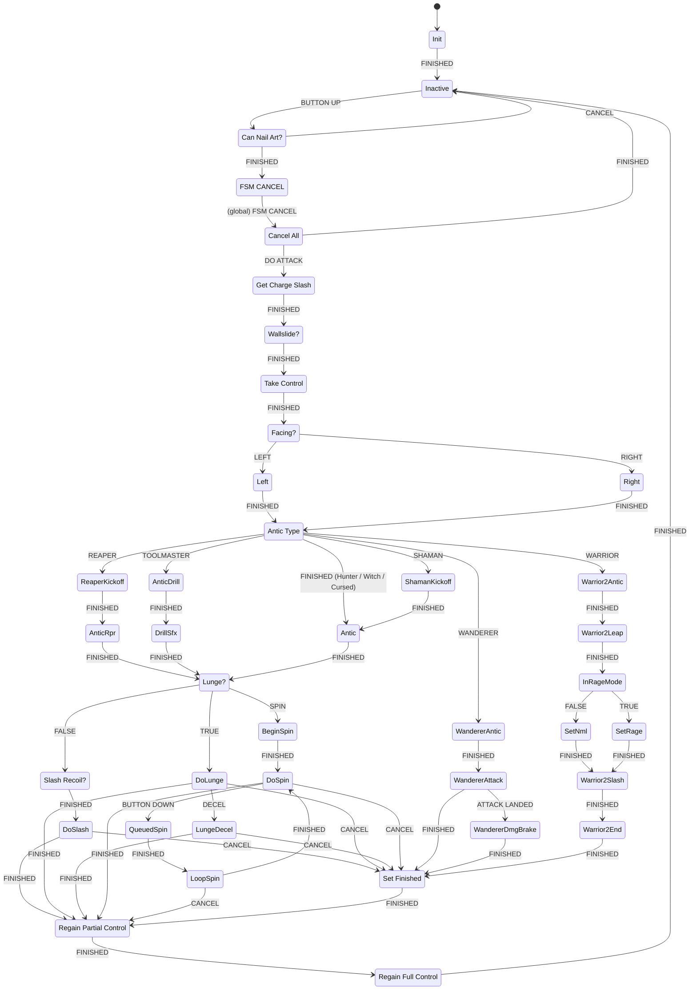

# Needle Strike (charged nail attack, "Nail Arts")

The needle strike is the attack released after holding the attack button until the nail is charged. It has two parts:

- **Charging** runs in C# in `HeroController.Update()`.
- **Execution** runs in the PlayMaker FSM `Nail Arts` on `Hero_Hornet(Clone)`. The FSM activates the per-crest "Charge Slash" GameObject, which is `HeroControllerConfig`'s `ChargeSlash` attack object (the Warrior branch substitutes its own objects).

Conventions used in this page:

- Times are in seconds. Frame counts are given "@60" (frames at 60 fps).
- tk2d animation triggers fire when the clip reaches frame index `i`, at `i / fps` seconds after the clip starts. A `wrap=Once` clip completes at `frames / fps`.
- **Animator (hitbox) times** come from `animator-timelines.txt`, which samples each Unity Animator clip every 1/60 s on an inactive clone. A change listed at sample time `t` happened in the interval `(t − 1/60, t]`. Times are given as the sampled values, measured from the start of the Animator clip, which is the moment the charge-slash GameObject is activated. The intra-frame order between the activating FSM state and the Animator's first evaluation is not in the dump, so a window can be offset by up to one rendered frame.
- Physics: `Time.fixedDeltaTime = 0.01999999` (0.02 s per FixedUpdate), `Physics2D.gravity = (0, -60)`, `Physics2D.simulationMode = FixedUpdate` (`engine-settings.txt`).
- Hornet's facing convention, from `HeroController.FaceRight()`: `localScale.x < 0` means facing **right**, and `localScale.x > 0` means facing **left**.
- `SetVelocityByScale` sets `vx = speed` when `localScale.x > 0` and `vx = -speed` otherwise. So a **negative** `speed` moves Hornet **forward** (in the facing direction), and a positive `speed` moves her backward.
- PlayMaker stops running a state's remaining actions once an action fires a transition event in `OnEnter`.

---

## 1. Charging (C#)

### Charge loop (`HeroController.Update`, inside `if (!gm.isPaused && !playerData.isInventoryOpen)`)

```csharp
if (inputHandler.inputActions.Attack.IsPressed && CanNailCharge()) {
    cState.nailCharging = true;
    nailChargeTimer += Time.deltaTime;
} else if (cState.nailCharging || nailChargeTimer != 0f) {
    CancelNailCharge();   // stops effects, nailCharging=false, nailChargeTimer=0
}
```

Charge effects:

- `nailChargeTimer > CurrentNailChargeBeginTime` and `< CurrentNailChargeTime`: activates `artChargeEffect` and plays `HeroSounds.NAIL_ART_CHARGE`.
- `nailChargeTimer >= CurrentNailChargeTime`: does the following:
  - activates `artChargedEffect`
  - sends camera shake `"EnemyKillShake"`
  - plays `nailArtChargeComplete` and `HeroSounds.NAIL_ART_READY`
  - calls `spriteFlash.flashFocusGet()`
  - calls `ScreenFlash(new Color(1,1,1,0.3f))`

### Charge time values (`hero-controller.txt`)

| Field | Value |
|---|---|
| `NAIL_CHARGE_TIME` | 1.35 |
| `NAIL_CHARGE_TIME_QUICK` | 0.8 |
| `NAIL_CHARGE_BEGIN_TIME` | 0.3 |
| `NAIL_CHARGE_BEGIN_TIME_QUICK` | 0.225 |
| `NailChargeTimeQuickTool` | Pinstress Tool (ToolItemBasic) |

`CurrentNailChargeTime` and `CurrentNailChargeBeginTime` return the `_QUICK` values when `NailChargeTimeQuickTool.IsEquipped` is true, and the normal values otherwise.

### `CanNailCharge()` (private)

All of the following must be true:

- `!cState.dead`
- `!cState.attacking`
- `(!controlReqlinquished || allowNailChargingWhileRelinquished)`
- `!cState.recoiling`
- `!cState.recoilingLeft`
- `!cState.recoilingRight`
- `!cState.hazardDeath`
- `!cState.hazardRespawning`
- `playerData.hasChargeSlash` (a `PlayerData` bool)
- `Config.CanNailCharge` (`HeroControllerConfig.canNailCharge`)
- `!IsInputBlocked()`
- `InteractManager.BlockingInteractable == null`

`canNailCharge` is `True` in every config except `Cloakless` (`False`).

### `CanNailArt()` (called by the FSM on button release)

```csharp
if (!CanDoFsmMove()) return false;            // CanDoFsmMove() => !blockFsmMove
if (!cState.transitioning && (hero_state != ActorStates.no_input || allowNailChargingWhileRelinquished)
    && !cState.attacking && !cState.hazardDeath && !cState.hazardRespawning
    && nailChargeTimer >= CurrentNailChargeTime) { nailChargeTimer = 0f; return true; }
nailChargeTimer = 0f; return false;
```

When `CanDoFsmMove()` passes, `nailChargeTimer` is reset whether the call succeeds or fails.

### Other charge resets

- Taking damage calls `SetAllowNailChargingWhileRelinquished(false)` and `CancelNailCharge()`.
- `ResetMotion(resetNailCharge: true)` sets `nailChargeTimer = 0` unless `allowNailChargingWhileRelinquished` is true.

---

## 2. Nail Arts FSM overview

- **FSM:** `Nail Arts` on `Hero_Hornet(Clone)`
- **Start state:** `Init`

### Variables (runtime values in the dump)

| Name | Type | Value |
|---|---|---|
| Audio Player | GameObject | null |
| Beast Lunge Stopper | GameObject | null |
| Can Drift | Bool | False |
| Chain | Int | 0 |
| Charge Slash Basic | GameObject | null |
| Charge Slash Upgraded | GameObject | null |
| Charge Slash Warrior | GameObject | `Hero_Hornet(Clone)/Attacks/Charge Slash Warrior` |
| Charge Slash Warrior R | GameObject | `Hero_Hornet(Clone)/Attacks/Charge Slash Warrior Rage` |
| Current Charge Slash | GameObject | null |
| Current Lunge Stopper | GameObject | null |
| Cyclone Accel | Float | 1 |
| Cyclone Decel | Float | 0 |
| Cyclone Speed Max | Float | 8 |
| Dash Burst | GameObject | `Hero_Hornet(Clone)/Effects/Dash Burst` |
| Dash Stopper | GameObject | `Hero_Hornet(Clone)/Attacks/Charge Slash Toolmaster/damager/dash stopper` |
| Dashing | Bool | False |
| Deceleration | Float | 0.92 |
| In Rage Mode | Bool | False |
| Is Anim Finished | Bool | False |
| Is Grounded | Bool | False |
| Lunge Deceleration | Float | 0 |
| Lunge Speed | Float | 0 |
| Queued Attack | Bool | False |
| Rage Lunge Stopper | GameObject | null |
| Recoil Method | String | "" |
| Return Bool | Bool | False |
| Special Attack Folder | GameObject | `Hero_Hornet(Clone)/Special Attacks` |
| Sphere Flash | GameObject | `Hero_Hornet(Clone)/Special Attacks/Sphere Flash` |
| Velocity Before Cancel | Vector2 | (0, 0) |
| Velocity Y | Float | 0 |
| Wall Sliding | Bool | False |
| Wanderer Lunge Stopper | GameObject | `Hero_Hornet(Clone)/Attacks/Charge Slash Wanderer/Lunge Stopper` |
| damager 01 | GameObject | null |
| damager 02 | GameObject | null |

- **`Init`** fills the GameObject variables with `FindChild`: `Special Attacks`, `Special Attacks/Sphere Flash`, `Effects/Dash Burst`, `Attacks/Charge Slash Warrior`, `Attacks/Charge Slash Warrior Rage`, `Attacks/Charge Slash Toolmaster/damager/dash stopper`, `Attacks/Charge Slash Wanderer/Lunge Stopper`, `Attacks/Charge Slash Warrior/Lunge Stopper`, `Attacks/Charge Slash Warrior Rage/Lunge Stopper`.
  - Neither `Charge Slash Warrior` nor `Charge Slash Warrior Rage` has a `Lunge Stopper` child (`hero-hierarchy.txt`), so `Beast Lunge Stopper` and `Rage Lunge Stopper` stay null.
- The `Charge Slash Basic` and `Charge Slash Upgraded` FSM variables are never assigned in any state. `Cancel All` deactivates them, which does nothing because they are null. The Hunter charge slash object is reached through `Current Charge Slash` (section 3).
- `Get Charge Slash` reads `Target = <var Hero>`; no variable named `Hero` is in the FSM's variable list.

### Global transitions

- `HERO DAMAGED` → `Cancel All`
- `LEAVING SCENE` → `Cancel All`
- `FSM CANCEL` → `Cancel All`

### Methods called by `SendMessage` / `SendMessageV2`

All targets are on `Hero_Hornet(Clone)` unless stated otherwise. `SendMessage` reaches every component on the target GameObject that has a method of that name.

| Function | Receiver | Effect |
|---|---|---|
| `RelinquishControlNotVelocity` | HeroController | `ControlVersion++`, cancels down spike. If control is not already relinquished: `ResetInput`, `ResetMotionNotVelocity`, `SetState(no_input)`, `IgnoreInput`, `controlReqlinquished = true`, `ResetLook`, `ResetAttacks`, `CancelJump`, clears wall-touch flags. Velocity is kept. |
| `StartAnimationControl` | HeroController | If the AnimationLocked lock allows it, `animCtrl.StartControl()` |
| `StopAnimationControl` | HeroController | removes the AnimationLocked request, `AnimationControlVersion++`, `animCtrl.StopControl()` |
| `FlipSprite` | HeroController | toggles `cState.facingRight`, negates `localScale.x`, removes turn-cancelled extra air velocities, `ChangedFacing()` |
| `flashFocusHeal` | SpriteFlash | `Flash(white, 0.85, 0.01, 0.01, 0.35)` |
| `ResetHardLandingTimer` | HeroController | `willHardLand = false`, `hardLandingTimer = 0`, `fallTimer = 0`, `hardLanded = false` |
| `RegainControl` | HeroController | `RegainControl(allowInput: true)`: among other things sets `hero_state = idle`, `allowRecoilWhileRelinquished = false`, `AcceptInput()`, and, if control was relinquished, `AffectedByGravity(true)`, `controlReqlinquished = false`, `SetStartingMotionState()` |
| `StartAnimationControlToIdle` | HeroController | on ground: `animCtrl.StartControlToIdle(false)`; in air: `animCtrl.StartControl()` |
| `NeedleArtRecovery` | HeroController | `attack_cooldown = 0.35`. `attack_cooldown` decreases by `Time.deltaTime` in `Update`; `CanAttack()` is false while it is `> 0`. |
| `AffectedByGravity` | HeroController | `AffectedByGravity(bool)`: stores/zeroes or restores `rb2d.gravityScale` |
| `SetKeepWorldPosition` (sent to `Current Charge Slash`) | KeepWorldPosition | `enabled = value`. Re-enabling runs `OnEnable` → `Initialise()`, which (with `getPositionOnEnable`) captures the current world position; `Update` then holds the object there. Objects without `KeepWorldPosition` (Charge Slash Basic, Shaman, Warrior, Wanderer) have no receiver. |
| `OnSlashStarting` (sent to `Current Charge Slash`) | NailSlashTravel | Only `Charge Slash Shaman` has a receiver (see Shaman). |

### Remaining dump limitation

- The `FunctionCall.ParameterType` field is not printed. For the `SendMessage "AffectedByGravity"` actions (Antic Rpr [5], Wanderer Attack [1], Warrior2 Antic [2], Warrior2 Leap [1], Warrior2 Slash [2], Warrior2 End [1]) the dump shows only `BoolParameter` (False, False, False, True, False, True). Below they are written as `AffectedByGravity(<BoolParameter>)`.

### State graph



**Unreachable states.** No transition leads into `Warrior Antic`, `State 1`, `Warrior Attack` or `Warrior DmgBrake`. `Warrior Antic` → `State 1` → `Warrior Attack`, and `Warrior Attack` → `Warrior DmgBrake` on `ATTACK LANDED`. Because nothing enters `Warrior Antic`, this whole chain never runs.

### Start sequence (all crests)

All of these states complete in the same frame as the button release.

1. **`Inactive`**
   - [0] `Queued Attack = False`
   - [1] `ListenForAttack`: `wasReleased` → `BUTTON UP`
   - The FSM therefore reacts to the attack button being **released**.
2. **`Can Nail Art?`**
   - [0] `CallMethodProper HeroController.GetState("dashing")` → `Dashing`
   - [1] `CallMethodProper HeroController.CanNailArt()` → `Return Bool`
   - [2] `BoolTest Return Bool`: false → `CANCEL` → `Inactive`. Otherwise the state ends with `FINISHED` → `FSM CANCEL`.
3. **`FSM CANCEL`**
   - [0] `Queued Attack = True`
   - [1] `HeroController.SetAllowNailChargingWhileRelinquished(False)`
   - [2] `GetVelocity2d` → `Velocity Before Cancel` (World)
   - [3] `SendEventByName "FSM CANCEL"` (target `BroadcastAll`, delay 0)
   - The event triggers the global transition → `Cancel All`.
4. **`Cancel All`**
   - [0] `BoolTest Queued Attack`: true → `DO ATTACK` → `Get Charge Slash`
   - [1]–[5] destroy `Audio Player`, and deactivate `Charge Slash Basic`, `Charge Slash Upgraded`, `Dash Burst` and `Current Charge Slash`.
   - Without a queued attack (for example on `HERO DAMAGED`), the state ends `FINISHED` → `Inactive`.
5. **`Get Charge Slash`**
   - `GetHeroAttackObject Attack = ChargeSlash` → `Current Charge Slash`.
   - This returns `HeroController.CurrentConfigGroup.ChargeSlash`.
6. **`Wallslide?`**
   - [0] `Queued Attack = False`
   - [1] `HeroController.TrySetCorrectFacing(True)`
   - [2] `HeroController.GetState("wallSliding")` → `Wall Sliding`
   - [3] `BoolTest Wall Sliding`: false → `FINISHED`
   - [4] `SendMessage FlipSprite`, which runs only when wall sliding.
   - → `Take Control`
7. **`Take Control`**
   - [0] `SendMessage RelinquishControlNotVelocity`
   - [1] `SendMessage StartAnimationControl`
   - [2] `SendMessage StopAnimationControl`
   - [3] `HeroController.AffectedByGravity(False)`
   - [4] `SetVelocity2d = Velocity Before Cancel`
   - [5] log `"TAKEN"`
8. **`Facing?`**
   - `SendEventByScale` (World): `localScale.x` positive → `LEFT`, negative → `RIGHT`.
9. **`Left` / `Right`**
   - `Left`: `Recoil Method = "ChargeSlashRecoilRight"`
   - `Right`: `Recoil Method = "ChargeSlashRecoilLeft"`
   - The recoil method therefore always pushes **away from the facing direction**.
   - Each state also has a disabled `SetDamageEnemyDirectionV2` (180 for `Left`, 0 for `Right`).
10. **`Antic Type`**
    - [0] plays `hornet_needle_art_release_burst` (pitch 1, volume 1)
    - [1] `DoCameraShakeV2` (Main Camera, profile `Small Shake`, no freeze)
    - [2]–[6] `CheckIfCrestEquipped` in this order: Reaper → `REAPER`, Wanderer → `WANDERER`, Warrior → `WARRIOR`, Toolmaster → `TOOLMASTER`, Spell → `SHAMAN`.
    - If none matches (Hunter, Hunter_v2, Hunter_v3, Witch, Cursed), the state ends `FINISHED` → `Antic`.

### End sequence (all crests)

- **`Set Finished`**: `Is Anim Finished = True` → `Regain Partial Control`.
- **`Regain Partial Control`**:
  - [0] `SendMessageV2 SetKeepWorldPosition(True)` to `Current Charge Slash` (DontRequireReceiver)
  - [1] `HeroController.AffectedByGravity(True)`
  - [2] `SendMessage ResetHardLandingTimer`
  - [3] `DoHeroMovement`: each Update calls `hc.UpdateMoveInput()`, each FixedUpdate calls `hc.DoMovement(useInput: true)`.
  - [4] `CallMethodProper HeroController.<Recoil Method>()`
  - [5] `BoolTest Is Anim Finished`: true → `FINISHED` (immediately)
  - [6] `Tk2dWatchAnimationEvents`: clip complete → `FINISHED`
  - [7] `DecelerateV2 deceleration = Deceleration (0.92)`: applied once on entry and then every FixedUpdate, after [3] in the same FixedUpdate. It multiplies both vx and vy.
- **`Regain Full Control`**: `SendMessage RegainControl`, `SendMessage StartAnimationControlToIdle`, `SendMessage NeedleArtRecovery` → `Inactive`.
  - `NeedleArtRecovery` sets `attack_cooldown = 0.35`, so `CanAttack()` is false for 0.35 s after `Regain Full Control`.

---

## 3. Hunter path (Default config)

Hunter, Hunter_v2 and Hunter_v3 all have `heroConfig=null` (`crests.txt`), so they use `configs[0] Default`. None has an animation override library, so the hero clip is the base `Knight` library clip.

### Default config charge-slash values (`hero-configs.txt` configs[0])

| Field | Value |
|---|---|
| canNailCharge | True |
| chargeSlashRecoils | True |
| chargeSlashLungeSpeed | 0 |
| chargeSlashLungeDeceleration | 1 |
| chargeSlashChain | 0 |
| ChargeSlash object | `Charge Slash Basic` |

### Hero clip `Slash_Charged` (Knight library, `animations-tk2d.txt`)

`fps=25 frames=13 wrap=Once triggers=[3:'' 7:'']`

| Point | Frame | Time | @60 |
|---|---|---|---|
| Clip start | 0 | 0.000 s | 0 |
| Trigger 1 | 3 | 0.120 s | 7.2 |
| Trigger 2 | 7 | 0.280 s | 16.8 |
| Clip complete | 13 | 0.520 s | 31.2 |

`HeroAnimationController.AnimationEventTriggered` has no handler for `Slash_Charged`; it only handles "Wake Up Ground", "Footstep" and "Sprint Backflip". `HeroAnimationController.IsTurnBlocked()` returns true while `Slash_Charged` plays.

### State walk-through

Times below are measured from the button release (= entry into `Antic`, same frame).

**`Antic`** (t = 0)

- [0] `SendMessageV2 flashFocusHeal` to owner (RequireReceiver)
- [1] activate `Sphere Flash`
- [2] `Tk2dPlayAnimationWithEvents clipName="Slash_Charged"`, `animationTriggerEvent=FINISHED`
- [3] `DecelerateV2 deceleration=0.85`, `brakeOnExit=False` (once on entry, then every FixedUpdate)
- Gravity is off from `Take Control`.
- Exit: the first trigger (frame 3, **0.12 s**) → `Lunge?`

**`Lunge?`** (instant)

- [0] `GetHeroConfigVariable "ChargeSlashLungeSpeed"` → `Lunge Speed`
- [1] `FloatCompare Lunge Speed vs 0` (tolerance 0): less than or greater than → `TRUE`
- [2] `GetHeroConfigVariable "ChargeSlashChain"` → `Chain`
- [3] `IntCompare Chain vs 0`: greater than → `SPIN`
- [4] `SendEvent FALSE`
- Default has 0 / 0, so the result is `FALSE` → `Slash Recoil?`

**`Slash Recoil?`** (instant)

- [0] `CheckIfCrestEquipped Spell`: false → `FINISHED`
- [1] `CallMethodProper <Recoil Method>` runs only when Spell is equipped.
- For Hunter, Spell is not equipped, so **no recoil is called here** → `Do Slash`.

**`Do Slash`** (t = 0.12 s)

- [0] activate `Current Charge Slash` (= `Charge Slash Basic`)
- [1] `SendMessageV2 SetKeepWorldPosition(False)` to the slash (DontRequireReceiver; Charge Slash Basic has no `KeepWorldPosition`, so nothing receives it)
- [2] `SendMessageV2 OnSlashStarting` to the slash (DontRequireReceiver; no receiver on Charge Slash Basic)
- [3] `DecelerateV2 deceleration = Deceleration (0.92)`
- [4] `Is Anim Finished = False`
- [5] `Tk2dWatchAnimationEvents`: trigger → `FINISHED`, complete → `CANCEL`
- Exit: the next trigger (frame 7, **0.28 s**, i.e. 0.16 s after `Do Slash` began) → `Regain Partial Control`.

**`Regain Partial Control`** (t = 0.28 s)

- Runs the actions listed in the end sequence.
- [4] calls `ChargeSlashRecoilRight` when facing left, or `ChargeSlashRecoilLeft` when facing right (section 5).
- `Is Anim Finished` is False, so the state waits for clip complete (frame 13, **0.52 s**) → `Regain Full Control` → `Inactive`.
- The fallback (`Do Slash` receives `CANCEL` because the clip completed before trigger 2) goes `Set Finished` → `Regain Partial Control`. That state calls the recoil method and immediately finishes.

### Combined Hunter timeline

t = 0 is the frame in which the attack-button release is processed by `ListenForAttack`. Slash windows are `Charge Slash Basic` Animator times (section 4) offset by its activation at 0.12 s.

| t (s) | @60 | Event |
|---|---|---|
| 0.000 | 0 | Release → `Can Nail Art?` … `Antic Type` → `Antic` (same frame). Gravity off, velocity restored to `Velocity Before Cancel`, then ×0.85 per FixedUpdate. `Slash_Charged` frame 0. |
| 0.120 | 7.2 | `Slash_Charged` trigger 1 → `Lunge?` → `Slash Recoil?` → `Do Slash`. `Charge Slash Basic` activated. **slash 01 on.** Velocity ×0.92 per FixedUpdate. |
| 0.2033 | 12.2 | **slash 01 off** (clip 0.0833 s; change in (0.0667, 0.0833]) |
| 0.280 | 16.8 | `Slash_Charged` trigger 2 → `Regain Partial Control`. Gravity on. **Recoil starts** (`vx = ±3.75`, then ×0.92 on entry → 3.45). Horizontal input movement starts (`DoHeroMovement`). |
| 0.3367 | 20.2 | **slash 02 on** (clip 0.2167 s; change in (0.2, 0.2167]) |
| 0.420 | 25.2 | **slash 02 off** (clip 0.3 s; change in (0.2833, 0.3]) |
| 0.44–0.46 | 26.4–27.6 | **Recoil ends**: `CancelRecoilHorizontal()` on the 9th FixedUpdate after the recoil call (8 steps × 0.02 s = 0.16 s, plus 0–0.02 s until the first FixedUpdate). |
| 0.520 | 31.2 | `Slash_Charged` complete → `Regain Full Control` (`RegainControl`, `StartAnimationControlToIdle`, `NeedleArtRecovery`) → `Inactive`. **Control regained.** |
| 0.5367 | 32.2 | `Charge Slash Basic` Animator clip ends (0.4167 s); `Audio Player Actor`, `Audio Player Actor (1)`, `Flintstone Charge Slash Basic 2` set inactive. |
| 0.870 | 52.2 | `attack_cooldown` (0.35 s from `NeedleArtRecovery`) reaches 0; `CanAttack()` can return true again. |
| 1.120 | 67.2 | `DisableAfterTime` (waitTime 1) deactivates `Charge Slash Basic` (unless `Cancel All` did earlier). |

Interval summary:

| Interval | Duration |
|---|---|
| Release → Charge Slash Basic activation (antic) | 0.12 s (7.2 @60) |
| slash 01 active | 0.0833 s (5 @60) |
| slash 01 off → recoil start | 0.0767 s (4.6 @60) |
| Recoil start → slash 02 on | 0.0567 s (3.4 @60) |
| slash 02 active | 0.0833 s (5 @60) |
| Recoil (horizontal recoil flags set) | 0.16–0.18 s (8 FixedUpdate steps) |
| Partial control phase (0.28 → 0.52 s) | 0.24 s (14.4 @60) |
| Total FSM-controlled duration | 0.52 s (31.2 @60) |
| Release → next normal attack possible (attack_cooldown) | 0.87 s (52.2 @60) |

- **The recoil starts before slash 02 is active.** The whole slash 02 window (0.3367–0.42 s) lies inside the recoil (0.28 s to 0.44–0.46 s). Slash 01 ends before the recoil starts.
- `Charge Slash Basic` is a child of the hero (`Attacks/`) and has no `KeepWorldPosition`, so both hitboxes move with Hornet, including during the recoil.

---

## 4. `Charge Slash Basic` (Hunter / Default ChargeSlash object)

Source: `hero-configs.txt` configs[0] `ChargeSlash: Hero_Hornet(Clone)/Attacks/Charge Slash Basic`; component values from `hero-hierarchy.txt`.

### Root object

`Charge Slash Basic`:

- `activeSelf=False`, `tag=Untagged`, `layer=Default`
- `localPos=(-1.03, 0.15, -0.001)`
- `localScale=(0.98, 1.2, 1.2716)`
- `localRot=(0, 0, 2.4125)`

| Component | Values |
|---|---|
| SpriteRenderer | – |
| Animator | enabled, speed=1, updateMode=Normal, cullingMode=CullCompletely, controller=`Charge Slash Basic` |
| DisableAfterTime | `waitTime = 1`, `isRealtime = False`, `sendEvent = ""`. `OnEnable` sets `timeLeft = waitTime`. Update deactivates the object when `timeLeft <= 0`. |
| CameraShakeAnimator | `cameraShakeTargets = (1)[CameraShakeTarget]` |
| ScreenFlashAnimator | `screenFlashColours = (2)[RGBA(1,1,1,0.209), RGBA(1,1,1,0.500)]` |
| HeroExtraNailSlash | `tintSprites = (1)[Charge Slash Basic (SpriteRenderer)]`. On enable, copies the current nail imbuement (`NailElement` / `NailImbuement`) onto all child `DamageEnemies` and tints the sprites. On disable, resets them. |
| HeroNailImbuementEffect | `nailElement = Fire`, `activateObjects = (2)[Flintstone … 1/Embers, Flintstone … 2/Embers]` |
| HeroNailImbuementEffect | `nailElement = Poison`, `activateObjects = (2)[Flintstone … 1/Poison, Flintstone … 2/Poison ]` |

### Animator clip `Hornet Charge Slash Basic`

`length=0.4167s fps=24 loop=False`. Animation events: `0s DoCameraShake`, `0s DoScreenFlash` (both handled by the object's own `CameraShakeAnimator` / `ScreenFlashAnimator`). **No animation event calls a HeroController method.**

Timeline (`animator-timelines.txt`, clip time):

| Clip time | @60 | Change |
|---|---|---|
| 0 | 0 | `slash 01` active, `Audio Player Actor` active (plays `hornet_hunter_needleart_slash_1`), `Flintstone Charge Slash Basic 1` active; `slash 02`, `Audio Player Actor (1)`, `Flintstone … 2` inactive. Sprite `attack_charge_slash_blade0001`. |
| 0.05 | 3 | sprite 0002 |
| 0.0833 | 5 | sprite 0003; **`slash 01` inactive** |
| 0.1333 | 8 | sprite 0007 |
| 0.2167 | 13 | sprite 0004; **`slash 02` active**; `Audio Player Actor (1)` active (plays `hornet_hunter_needleart_slash_2`); `Flintstone … 1` inactive, `Flintstone … 2` active |
| 0.25 | 15 | sprite 0005 |
| 0.3 | 18 | sprite 0006; **`slash 02` inactive** |
| 0.3333 | 20 | sprite 0007 |
| 0.4167 | 25 | `Audio Player Actor`, `Audio Player Actor (1)`, `Flintstone … 2` inactive |

Hitbox active windows (clip time): **slash 01: 0 → 0.0833 s**, **slash 02: 0.2167 → 0.3 s**. The colliders and `DamageEnemies` components stay enabled; the Animator switches the child GameObjects.

### Children

| Child | activeSelf (prefab) | Notes |
|---|---|---|
| Audio Player Actor | False | `PlayRandomAudioEvent`, clip `hornet_hunter_needleart_slash_1`, pitch 0.95–1.05, vol 1, `playOnEnable=True` |
| Audio Player Actor (1) | False | `PlayRandomAudioEvent`, clip `hornet_hunter_needleart_slash_2`, pitch 0.95–1.05, vol 1, `playOnEnable=True` |
| slash 01 | False | hitbox (below), `tag=Nail Attack`, `layer=Attack` |
| slash 02 | False | hitbox (below), `tag=Nail Attack`, `layer=Attack` |
| Noise Maker | True | `NoiseMaker` radius=3, intensity=Normal, `createNoiseOnEnable=True`, localPos (-1.27, 0, 0) |
| Flintstone Charge Slash Basic 1 | True | holds Poison / Embers particle effects |
| Flintstone Charge Slash Basic 2 | False | same structure as Flintstone 1 |
| Charge Slash Hornet Voice | True | `PlayRandomAudioEvent`, table `Attack Needle Art Hornet Voice`, `playOnEnable=True` |

### Hitboxes

| Field | slash 01 | slash 02 |
|---|---|---|
| Components | PolygonCollider2D, DamageEnemies, NailSlashTerrainThunk | same |
| localPos | (1.0436, -0.161, 0.0008) | (1.0436, -0.161, 0.0008) |
| localScale | (0.7271, 0.7276, 0.7274) | (0.8079, 0.6616, 0.7274) |
| localRot | (0, 0, 357.5875) | (0, 0, 357.5875) |
| PolygonCollider2D (trigger, offset 0,0) | `(-0.093,2.106) (-3.894,1.937) (-7.608,0.809) (-8.522,-0.362) (-6.193,-1.474) (-2.765,-1.586) (-0.334,-1.351)` | `(-0.191,2.568) (-4.239,1.948) (-6.841,0.719) (-6.991,-0.615) (-5.324,-1.397) (-0.964,-1.847)` |
| attackType | Heavy | Heavy |
| specialType | CocoonBreak, Heavy | CocoonBreak, Heavy |
| useNailDamage | True | True |
| nailDamageMultiplier | **1.4** | **1.4** |
| damageDealt | 5 (unused when useNailDamage) | 5 |
| useHeroDamageAffectors | False | False |
| stunDamage | 1 | 1 |
| direction | 180 | 180 |
| flipDirectionIfXScaleNegative | True | True |
| circleDirection | False | False |
| magnitudeMult | **0.5** | **1** |
| corpseMagnitudeMult | enabled, 1.2 | enabled, 1.2 |
| multiHitter / stepsPerHit / hitsUntilDeath | False / 0 / 0 | False / 0 / 0 |
| hitOnceUntilEnd | False | False |
| silkGeneration | Full | Full |
| lagHitOptionsProfile | null | null |
| doesNotStun / doesNotTink / doesNotParry | False | False |
| NailSlashTerrainThunk | `generateChild=True`, **`doRecoil=False`**, `overrideTransform=Hero_Hornet(Clone)` | same |
| NailSlashRecoil component | **absent** | **absent** |

The two hitboxes differ only in collider shape, `localScale`, `magnitudeMult` (0.5 vs 1) and active window. They are separate `DamageEnemies` components. Neither has a `NailSlash` component, so `NailSlash` never calls `NailSlashRecoil.Add(...)` for them (it only does so on its own GameObject).

---

## 5. Everything that moves Hornet during and after the Hunter needle strike

### 5.1 FSM-driven velocity (Hunter path)

| State | Time | Action | Effect |
|---|---|---|---|
| Take Control | 0 | `AffectedByGravity(False)`, `SetVelocity2d = Velocity Before Cancel` | Gravity off. Velocity is restored to the value captured in `FSM CANCEL`. `RelinquishControlNotVelocity` does not change velocity. |
| Antic | 0 → 0.12 s | `DecelerateV2 0.85` | vx and vy ×0.85 on entry and each FixedUpdate. |
| Lunge? | – | – | No lunge, because `chargeSlashLungeSpeed = 0`. |
| Slash Recoil? | – | – | No recoil call for non-Spell crests. |
| Do Slash | 0.12 → 0.28 s | `DecelerateV2 0.92` | vx and vy ×0.92 on entry and each FixedUpdate. |
| Regain Partial Control | 0.28 → 0.52 s | `AffectedByGravity(True)`, `DoHeroMovement`, `<Recoil Method>`, `DecelerateV2 0.92` | Gravity on. Each FixedUpdate: input movement, then recoil movement (5.2), then ×0.92 on vx and vy. |

### 5.2 The needle-strike pushback (`ChargeSlashRecoilRight` / `ChargeSlashRecoilLeft`)

**Caller.** The only caller in the Hunter path is the FSM action `Regain Partial Control` [4], `CallMethodProper HeroController.<Recoil Method>()`. The action runs on state entry, which happens at Hunter `Slash_Charged` frame 7 (0.28 s), or at clip end through the `Set Finished` fallback. It is **not** called by:

- an animation event (the `Charge Slash Basic` Animator only has `DoCameraShake` / `DoScreenFlash`, and `HeroAnimationController` has no `Slash_Charged` handler)
- a hit callback (`slash 01` / `slash 02` have no `NailSlashRecoil`, and `NailSlashTerrainThunk.doRecoil = False`)

The only other FSM caller is `Slash Recoil?` [1], which runs only when the **Spell** (Shaman) crest is equipped.

Direction: facing left → `ChargeSlashRecoilRight`; facing right → `ChargeSlashRecoilLeft`. Both push away from the facing direction.

```csharp
public void ChargeSlashRecoilRight() {
    if (Config.ChargeSlashRecoils) { SetAllowRecoilWhileRelinquished(true); RecoilRight(); }
}
public void ChargeSlashRecoilLeft() {
    if (Config.ChargeSlashRecoils) { SetAllowRecoilWhileRelinquished(true); RecoilLeft(); }
}
public void RecoilRight() { if (CanRecoil()) Recoil(isRight: true,  isLong: false); }
public void RecoilLeft()  { if (CanRecoil()) Recoil(isRight: false, isLong: false); }

private bool CanRecoil() {
    if (!CanCustomRecoil()) return false;                    // Time.timeAsDouble >= recoilAllowTime
    if ((cState.recoilingDrill || (!cState.recoilingLeft && !cState.recoilingRight))
        && (!controlReqlinquished || allowRecoilWhileRelinquished))
        return InteractManager.BlockingInteractable == null;
    return false;
}
public void PreventRecoil(float duration) { // recoilAllowTime = max(recoilAllowTime, now + duration)
    double num = Time.timeAsDouble + duration; if (num > recoilAllowTime) recoilAllowTime = num;
}
public void AllowRecoil() { recoilAllowTime = 0.0; }
```

`Recoil(bool isRight, bool isLong)` works as follows:

- `steps = RECOIL_HOR_STEPS` (8).
- If WitchCrest or CursedCrest is equipped, `steps = Gameplay.WitchCrestRecoilSteps` (5).
- If WeightedAnkletTool is equipped, `steps = WeightedAnkletRecoilSteps` (4), or 0 when the Witch/Cursed crest is also equipped.
- `isLong == false`, so it calls `Recoil(isRight, steps, RECOIL_HOR_VELOCITY)`.

`Recoil(bool isRight, int steps, float velocity)` then does the following:

- cancels any dash
- sets `recoilStepsLeft = steps`
- sets `cState.recoilingRight = isRight` and `recoilingLeft = !isRight`
- clears `recoilingDrill`, `wallJumping` and `wallJumpedL/R`
- sets `recoilVelocity = velocity`
- **immediately sets `rb2d.linearVelocity.x = ±velocity`** (y unchanged)

Values (`hero-controller.txt`, `global-settings.txt`):

| Field | Value |
|---|---|
| RECOIL_HOR_VELOCITY | 3.75 |
| RECOIL_HOR_VELOCITY_LONG | 16 (not used here) |
| RECOIL_HOR_VELOCITY_DRILLDASH | 10 (not used here) |
| RECOIL_HOR_STEPS | 8 |
| RECOIL_DURATION | 0.2 (damage recoil, not used here) |
| witchCrestRecoilSteps | 5 |
| weightedAnkletRecoilSteps | 4 |

#### Duration

`HeroController.FixedUpdate` runs this logic while `cState.recoilingLeft || cState.recoilingRight`:

- if `recoilStepsLeft > 0`, it decrements `recoilStepsLeft`
- otherwise it calls `CancelRecoilHorizontal()`, which clears the flags

With `n` steps, the flags stay set for `n` FixedUpdate decrements and are cleared on FixedUpdate `n+1` after the call. With `fixedDeltaTime = 0.02`:

| Steps | Case | Recoil flags cleared after the call |
|---|---|---|
| 8 | Hunter / Shaman, no anklet | 0.16–0.18 s (9.6–10.8 @60) |
| 4 | Weighted Anklet | 0.08–0.10 s (4.8–6 @60) |

The 0–0.02 s spread is the time from the call to the next FixedUpdate. Whether the FSM's `DoHeroMovement` in the final FixedUpdate runs before or after `HeroController.FixedUpdate` clears the flags (script execution order) is not in the dump.

#### Velocity during the recoil

`DoHeroMovement` calls `HeroController.DoMovement(useInput: true)` every FixedUpdate in `Regain Partial Control`. `DoMovement` calls `Move(move_input, true)`, which **sets** `vx = move_input × GetRunSpeed()` (`RUN_SPEED = 8.25`, `QUICKENING_RUN_SPEED = 11.5`; `WALK_SPEED` 5 / 7 in a walk zone on the ground), and then `DoRecoilMovement()`:

- **recoilingLeft:** `vx = (vx > 0) ? -3.75 : vx - 3.75`
- **recoilingRight:** `vx = (vx < 0) ? 3.75 : vx + 3.75`

In the same FixedUpdate, after `DoHeroMovement`, `DecelerateV2 0.92` multiplies vx (and vy) by 0.92. Resulting |vx| at the end of each recoil FixedUpdate (RUN_SPEED 8.25):

| Horizontal input | |vx| after the step |
|---|---|
| none | 3.75 × 0.92 = **3.45** away from facing |
| toward facing (against the recoil) | 3.75 × 0.92 = 3.45 away from facing |
| away from facing (with the recoil) | (8.25 + 3.75) × 0.92 = 11.04 away from facing |

After the recoil flags clear (until 0.52 s), vx = `move_input × 8.25 × 0.92` (0 with no input, 7.59 with full input).

### 5.3 Does the second slash of the Hunter needle strike push Hornet back?

- **There is exactly one pushback event.** The FSM calls `ChargeSlashRecoil{Right|Left}` once, on entry to `Regain Partial Control`, at Hunter `Slash_Charged` frame 7 (0.28 s after the release, 0.16 s after `Charge Slash Basic` is activated).
- **Its values** are a horizontal recoil away from the facing direction, with `RECOIL_HOR_VELOCITY` 3.75 for `RECOIL_HOR_STEPS` 8 FixedUpdate steps (0.16–0.18 s; 4 steps with Weighted Anklet).
- **It runs because** Default `chargeSlashRecoils = True`. It is blocked if `recoilAllowTime` is in the future (an earlier `PreventRecoil`) or `InteractManager.BlockingInteractable` is set.
- **It does not depend on hitting anything.** Neither `slash 01` nor `slash 02` has a recoil-on-hit mechanism:
  - no `NailSlashRecoil` component
  - `NailSlashTerrainThunk.doRecoil = False`
  - no hero-method animation events
- **Timing relative to the hitboxes:** slash 01 is active 0.12–0.2033 s, the recoil starts at 0.28 s, slash 02 is active 0.3367–0.42 s. The recoil starts **0.0567 s (3.4 @60) before slash 02 becomes active** (≥ 0.04 s given the 1/60 s sampling), and slash 02 is active entirely during the recoil. On the `Charge Slash Basic` clip timeline, the recoil call is at clip time 0.16 s; slash 02 turns on at 0.2167 s.

### 5.4 Other movement sources checked

- **Lunge:** Default `chargeSlashLungeSpeed = 0`, so `Do Lunge` is never entered, and `chargeSlashLungeDeceleration = 1` is unused.
- **`NailSlashRecoil` on hit:** not present on `Charge Slash Basic` children.
  - For reference, where `NailSlashRecoil` exists, its `HitResponse` checks that the hit's cardinal direction equals the damager's cardinal direction. It then calls `SetAllowRecoilWhileRelinquished(true)` if the object has no `NailAttackBase`.
  - For hits on the ENEMIES layer (non-`NonBouncer`), it calls `RecoilLeft` / `RecoilRight` / `RecoilDown`, or `RecoilLeftLong` / `RecoilRightLong` against a `BounceShroom`, or `DrillPull` when `drillPull` is set.
  - For TERRAIN / INTERACTIVE_OBJECT hits, it recoils only when the target is tagged `Recoiler`.
- **Terrain thunk:** `NailSlashTerrainThunk` with `doRecoil=True` calls `SetAllowRecoilWhileRelinquished(true)`, then `RecoilLeft` / `RecoilRight` / `RecoilDown`, then `SetAllowRecoilWhileRelinquished(false)`. On `Charge Slash Basic`, `doRecoil=False`.
- **Gravity:** off from `Take Control` until `Regain Partial Control` [1].

---

## 6. Other crest branches

### Config values per crest

From `hero-configs.txt` and `crests.txt`.

| Crest (ToolCrest) | heroConfig | canNailCharge | chargeSlashRecoils | chargeSlashLungeSpeed | chargeSlashLungeDeceleration | chargeSlashChain | ChargeSlash object |
|---|---|---|---|---|---|---|---|
| Hunter / Hunter_v2 / Hunter_v3 | null → Default | True | **True** | 0 | 1 | 0 | Charge Slash Basic |
| Reaper | Reaper | True | False | 0 | 1 | 0 | Charge Slash Scythe |
| Wanderer | Wanderer | True | False | 0 | 1 | 0 | Charge Slash Wanderer |
| Warrior (Beast) | Warrior (HeroControllerConfigWarrior) | True | False | 0 | 1 | 0 | Charge Slash Warrior Old (config). The FSM uses `Charge Slash Warrior` / `Charge Slash Warrior Rage` instead. |
| Warrior rage (specialConfigs[0]) | Warrior | True | False | 0 | 1 | 0 | null |
| Toolmaster (Architect) | Toolmaster | True | False | **-40** | **0.9** | 0 | Charge Slash Toolmaster |
| Witch, and Cursed (both use the Whip config) | Whip | True | False | 0 | 1 | **3** | Charge Slash Witch |
| Spell (Shaman) | Shaman | True | **True** | 0 | 1 | 0 | Charge Slash Shaman |
| Cloakless | Cloakless | **False** | False | 0 | 1 | 0 | null |

`Regain Partial Control` [4] calls `<Recoil Method>` on every branch. It only produces a recoil for configs with `chargeSlashRecoils = True` (Default and Shaman).

### Charged clip per animation library

| Library | Clip | fps | frames | triggers | trigger times | length |
|---|---|---|---|---|---|---|
| Knight (base; Hunter) | Slash_Charged | 25 | 13 | 3, 7 | 0.12 s, 0.28 s | 0.52 s |
| Scythe (Reaper) | Slash_Charged | 15 | 10 | 4, 8 | 0.2667 s, 0.5333 s | 0.6667 s |
| Dagger (Wanderer) | Slash_Charged | 18 | 12 | 2 | 0.1111 s | 0.6667 s |
| Warrior | Slash_Charged | 15 | 9 | 2 | 0.1333 s | 0.6 s (not used by the FSM's Warrior branch) |
| Warrior | NeedleArt Dash | 12 | 8 | 1, 4, 6 | 0.0833 s, 0.3333 s, 0.5 s | 0.6667 s |
| Drill Lance (Toolmaster) | Slash_Charged | 18 | 11 | 4, 10 | 0.2222 s, 0.5556 s | 0.6111 s |
| Whip (Witch/Cursed) | Slash_Charged | 25 | 8 | 1, 7 | 0.04 s, 0.28 s | 0.32 s |
| Whip | Slash_Charged_Loop | 25 | 6 | 5 | 0.2 s | 0.24 s |
| Shaman | Slash_Charged | 25 | 13 | 4, 10 | 0.16 s, 0.4 s | 0.52 s |

### Hitbox active windows per crest

"Clip" = time from activation of the charge-slash object (`animator-timelines.txt` sampled values; DeactivateAfter2dtkAnimation for Wanderer). "From antic" = time from entry into the crest's antic state (the release frame, plus 0 for kickoff states, which are instant).

| Crest | Object / hitbox | Activated by (from antic) | Active (clip) | Active (from antic) |
|---|---|---|---|---|
| Hunter | Charge Slash Basic / slash 01 | Do Slash, 0.12 s | 0 → 0.0833 | 0.12 → 0.2033 |
| Hunter | Charge Slash Basic / slash 02 | | 0.2167 → 0.3 | 0.3367 → 0.42 |
| Reaper | Charge Slash Scythe / slash 01 | Do Slash, 0.2667 s | 0 → 0.05 | 0.2667 → 0.3167 |
| Reaper | Charge Slash Scythe / slash 02 | | 0.05 → 0.2 | 0.3167 → 0.4667 |
| Reaper | Charge Slash Scythe / slash behind | | 0 → 0.0833 | 0.2667 → 0.35 |
| Wanderer | Charge Slash Wanderer (root collider) and Lunge Stopper | Wanderer Attack, 0.1111 s | 0 → end of tk2d clip `Slash_Charged Effect` (0.5 s) | 0.1111 → 0.6111 |
| Warrior | Charge Slash Warrior (Rage) / Right and Left `enemy damager` colliders (both at once) | Warrior2 Slash, 0.3333 s | 0 → 0.1333 | 0.3333 → 0.4667 |
| Warrior (rage) | Charge Slash Warrior Rage / `enemy damager/Terrain Thunker` colliders | | 0 → deactivation (not animated) | 0.3333 → 0.6667 |
| Toolmaster | Charge Slash Toolmaster / `damager` (contains `damager front` and `dash stopper`) | Do Lunge, 0.2222 s | 0 → 0.2667 | 0.2222 → 0.4889 |
| Witch / Cursed (first spin) | Charge Slash Witch / damager 01 | Do Spin, 0.04 s | 0 → 0.1667 | 0.04 → 0.2067 |
| Witch / Cursed (first spin) | Charge Slash Witch / damager 02 | | 0.1667 → 0.2833 | 0.2067 → 0.3233 |
| Shaman | Charge Slash Shaman / damager and Terrain Thunker | Do Slash, 0.16 s | 0 → 0.35 | 0.16 → 0.51 |

### Reaper (`Antic Type` → `REAPER`)

- **`Reaper Kickoff`**
  - `CheckIsCharacterGrounded` (RayCount 3, GroundDistance 0.2, SkinWidth -0.05, SkinHeight 0.1): not grounded → `FINISHED` immediately.
  - If grounded: `SetVelocity2d y = 10` → `Antic Rpr`.
- **`Antic Rpr`**
  - plays `hornet_reaper_nailart_start_on_flash`
  - `SendMessageV2 flashFocusHeal`
  - activates `Sphere Flash`
  - plays `Slash_Charged` (trigger → FINISHED, frame 4 at 0.2667 s)
  - `DecelerateV2 0.85` with **`brakeOnExit=True`** (velocity set to (0,0) when the state exits)
  - `SendMessage AffectedByGravity(False)`
  - → `Lunge?` → FALSE → `Slash Recoil?` (no recoil) → `Do Slash` (same as Hunter, Deceleration 0.92) → trigger frame 8 (0.5333 s) → `Regain Partial Control` (recoil method is a no-op: `chargeSlashRecoils=False`) → clip complete (0.6667 s) → `Regain Full Control`.
- **`Charge Slash Scythe`**
  - Components: Animator clip `Hornet Charge Slash Scythe` (length 0.24 s, 25 fps, event `0s:DoCameraShake`), DisableAfterTime `waitTime=0.5` (root off at 0.7667 s from antic), KeepWorldPosition (`keepX`, `keepY`, `getPositionOnEnable`, `resetOnDisable` all True), CameraShakeAnimator, EnemyDamagerGroup (slash 01, slash 02, slash behind), PlayRandomAudioEvent.
  - `KeepWorldPosition` is disabled by `Do Slash` (`SetKeepWorldPosition(False)`), so the slash follows Hornet during `Do Slash`; `Regain Partial Control` re-enables it, which captures and holds the world position from 0.5333 s.
  - Three damagers, all `attackType=Heavy`, `nailDamageMultiplier=2.5`, `stunDamage=2`, `silkGeneration=Full`, `NailSlashTerrainThunk doRecoil=False`:

| Damager | direction | magnitudeMult | Active (clip) |
|---|---|---|---|
| slash 01 | 180 | 2 | 0 → 0.05 |
| slash 02 | 180 | 2 | 0.05 → 0.2 |
| slash behind | 0 | 1 | 0 → 0.0833 |

### Wanderer (`Antic Type` → `WANDERER`)

- **`Wanderer Antic`**
  - `Slash_Charged` (trigger at frame 2, 0.1111 s → FINISHED)
  - `DecelerateV2 0.85` with `brakeOnExit=True`
  - `SendMessageV2 flashFocusHeal`
  - activates `Sphere Flash`
- **`Wanderer Attack`** (0.1111 s)
  - plays `hornet_wanderer_needle_art`
  - `SendMessage AffectedByGravity(False)`
  - **`SetVelocityByScale speed=-45, ySpeed=0`** (45 forward)
  - (disabled) `DecelerateV2 0.78`
  - `SetVelocity2d y=0`
  - `AccelerateToY accelerationFactor=0.25 targetSpeed=-10`
  - `DecelerateXY decelerationX=0.78`
  - activates `Current Charge Slash`
  - Exits:
    - hero clip complete (0.6667 s) → `Set Finished` → `Regain Partial Control`, which finishes immediately (`Is Anim Finished = True`) → `Regain Full Control`
    - `Wanderer Lunge Stopper` OnTriggerEnter2D → `ATTACK LANDED` → **`Wanderer DmgBrake`**, which sets `vx = 0` and waits for clip complete → `Set Finished`. (Actions [9] and [10] are identical `OnTriggerEnter2D` listeners.)
- The branch bypasses `Lunge?`, so the config lunge fields are unused.
- **`Charge Slash Wanderer`** (`tag=Nail Attack`, `layer=Attack`; no Animator)
  - `tk2dSpriteAnimator` library `Hornet CrestWeapon Dagger Anim`, `defaultClipId = 18` = `Slash_Charged Effect` (20 fps, 10 frames, 0.5 s), `playAutomatically=False`.
  - `DeactivateAfter2dtkAnimation`: `OnEnable` calls `PlayFromFrame(0)` on the animator; `Update` deactivates the GameObject once no listed animator is playing. The root collider (and the `Lunge Stopper` child) are therefore active from activation until the clip ends, 0.5 s later (tk2d source is not in the decompiled set; standard tk2d `PlayFromFrame(int)` plays the default clip when no clip is current).
  - Root collider: trigger polygon `(1.932,-0.383) (-2.925,0.065) (-4.745,-0.033) (-5.281,-1.024) (-4.791,-1.834) (-3.455,-2.153) (2.027,-1.972)`
  - `attackType=Nail`, `specialType=CocoonBreak, Heavy`, `nailDamageMultiplier=0.55`, `stunDamage=0.2`
  - `multiHitter=True`, `stepsPerHit=6`, `hitsUntilDeath=100`
  - `magnitudeMult=0.5`, `direction=180`, `silkGeneration=FirstHit`
  - `NailSlashTerrainThunk doRecoil=True`
  - Child `Lunge Stopper` (`layer=Enemy Detector`): trigger polygon `(1.932,-0.383) (-1.823,-0.113) (-1.904,-1.97) (2.027,-1.972)`.

### Warrior / Beast (`Antic Type` → `WARRIOR`)

- **`Warrior2 Antic`** (0)
  - plays **`NeedleArt Dash`** (first trigger at frame 1, 0.0833 s → FINISHED)
  - `DecelerateV2 0.85`
  - `SendMessage AffectedByGravity(False)`, `SendMessageV2 flashFocusHeal`
  - activates `Sphere Flash`
- **`Warrior2 Leap`** (0.0833 s)
  - watches for the next trigger (frame 4, 0.3333 s)
  - `SendMessage AffectedByGravity(True)`
  - grounded check: `Velocity Y` = **17 if grounded, 10 if not**
  - **`SetVelocityByScale speed=-15`** (15 forward), `ySpeed=Velocity Y`
  - plays `hornet_jump_nogap`
  - `Can Drift` becomes True after 0.05 s (`SetOppositeOnStateEntry=True`)
  - `UmbrellaMotionXV2 accel=1 decel=0 maxSpeed=20` while `Can Drift`: each FixedUpdate adds ±1 to vx toward the held direction, capped at ±20.
  - → `In Rage Mode?`
- **`In Rage Mode?`**: `HeroGetWarriorCrestState` → `In Rage Mode`.
  - `Set Nml`: `Current Charge Slash = Charge Slash Warrior`
  - `Set Rage`: `Current Charge Slash = Charge Slash Warrior Rage`
  - In both states, the `Current Lunge Stopper` assignments are disabled.
- **`Warrior2 Slash`** (0.3333 s)
  - activates the slash
  - plays `hornet_reaper_needle_art` (pitch 1.15)
  - `SendMessage AffectedByGravity(False)`
  - `DecelerateV2 0.85`
  - watches for the next trigger (frame 6, 0.5 s)
- **`Warrior2 End`** (0.5 s)
  - `DecelerateXY decelerationX=0`, which sets vx to 0 each FixedUpdate
  - `SendMessage AffectedByGravity(True)`
  - waits for clip complete (0.6667 s) → `Set Finished`
  - `ActivateGameObject` the slash with `resetOnExit=True`: on state exit (0.6667 s) the slash is **deactivated**. Neither Warrior object has `DisableAfterTime`.
- `chargeSlashRecoils = False`.

**`Charge Slash Warrior`** (`Attacks/Charge Slash Warrior`, `activeSelf=False`, `layer=Attack`, localPos (-0.77, 0.12, -0.002), localScale (1.1, 1.1, 1), localRot (0, 0, 346.2385))

- Components: HeroExtraNailSlash (tints both child SpriteRenderers), EnemyDamagerGroup (Left and Right `enemy damager`), HeroNailImbuementEffect Fire / Poison.
- Children: `Charge Slash Warrior Right` (localPos (0.825, -0.21, 0), rot 1.4443) and `Charge Slash Warrior Left` (localPos (-0.825, 0.21, -0.001), scale (0.8253, 1, 1), rot 16.9422), both `activeSelf=True`, each with SpriteRenderer + Animator (`warrior_dash_slash_blade_type_020000`, cullingMode=AlwaysAnimate, clip `Warrior_Dash_Slash_Type_02` 0.2 s, 30 fps, no events). Also `Noise Maker`, `Flintstone Charge Slash Warrior`, `Charge Slash Hornet Voice`.
- Each child's `enemy damager` (`tag=Nail Attack`, `layer=Attack`) has PolygonCollider2D (trigger) `(-0.096,3.074) (-1.445,1.955) (-2.024,1.107) (-2.402,-0.012) (-2.144,-0.951) (-1.398,-0.702) (1.913,1.783) (2.716,3.17) (1.034,3.462)`, DamageEnemies, NailSlashTerrainThunk (`doRecoil=False`).
- Animator timeline (both children identical): `enemy damager` moves from local (0,0,0) to (-1.35, -2.15, 0) / rot 17.908 over 0.1 s; **`PolygonCollider2D.enabled` False at 0.1333 s**; sprite null at 0.1333 s.

**`Charge Slash Warrior Rage`** (same transform as the normal object)

- Same component set plus child `Rage Cam Shaker` (`CameraShakeOnEnable`, profile `Enemy Kill`, vibrate True, delay 0).
- Children `Charge Slash Warrior Right` (localPos (2.15, 1.3, 0), scale (1.1797, 1.2257, 1.0619), rot 3.7495) and `Charge Slash Warrior Left` (localPos (-0.3842, 0.7946, -0.001), scale (0.8703, 1.0316, 0.9493), rot 18.3097), same Animator clip and collider polygon.
- The `enemy damager` has no `NailSlashTerrainThunk`; a child `Terrain Thunker` (`layer=Tinker`, non-trigger PolygonCollider2D with the same polygon, NailSlashTerrainThunk `doRecoil=False`, kinematic Rigidbody2D) does the terrain hits. Its collider is not animated, so it stays enabled while the object is active.

Damager values:

| Field | Charge Slash Warrior (Right / Left) | Charge Slash Warrior Rage (Right / Left) |
|---|---|---|
| attackType | Heavy | Heavy |
| specialType | CocoonBreak, Heavy | **Piercer**, CocoonBreak, Heavy |
| nailDamageMultiplier | **2.5** | **3** |
| stunDamage | 2 | 2 |
| direction | 180 | 180 |
| magnitudeMult | 1.5 | 1.5 |
| corpseMagnitudeMult | enabled, 1.5 | enabled, 1.5 |
| multiHitter / hitOnceUntilEnd | False / False | False / False |
| silkGeneration | Full | Full |
| Collider active (clip) | 0 → 0.1333 | 0 → 0.1333 |

- The config object `Charge Slash Warrior Old` (tk2d, DeactivateAfter2dtkAnimation) is not used by this branch: `Set Nml`/`Set Rage` overwrite `Current Charge Slash`. Its values: `attackType=Nail`, `nailDamageMultiplier=1`, `multiHitter=True`, `stepsPerHit=8`, `hitsUntilDeath=100`, `magnitudeMult=0.5`, `silkGeneration=None`.

### Toolmaster / Architect drill (`Antic Type` → `TOOLMASTER`)

- **`Antic Drill`** (0)
  - `SendMessageV2 flashFocusHeal`
  - activates `Sphere Flash`
  - plays `Slash_Charged` (trigger at frame 4, 0.2222 s → FINISHED)
  - grounded check: `Velocity Y` = **1.5 if grounded, 0 if not**
  - **`SetVelocityByScale speed=30`** (30 **backward**, away from the facing direction), `ySpeed=Velocity Y`
  - `DecelerateXY decelerationX=0.83`
- **`Drill Sfx`**: plays `hornet_architect_charge_attack` → `Lunge?`.
  - `Lunge Speed = -40 ≠ 0` → `TRUE` → `Do Lunge`.
- **`Do Lunge`** (0.2222 s)
  - activates `Current Charge Slash` and `Dash Burst`
  - `SendMessageV2 SetKeepWorldPosition(False)` to the slash (RequireReceiver): the slash follows Hornet during the lunge.
  - **`SetVelocityByScale speed=Lunge Speed (-40)`** (40 forward), `ySpeed=0`
  - `GetHeroConfigVariable "ChargeSlashLungeDeceleration"` → `Lunge Deceleration`
  - `DecelerateV2 Lunge Deceleration (0.9)`
  - `Is Anim Finished=False`
  - Exits:
    - trigger (frame 10, 0.5556 s) → `Regain Partial Control` (re-enables `KeepWorldPosition`)
    - complete → `CANCEL` → `Set Finished`
    - `dash stopper` OnTriggerEnter2D/Stay2D → `DECEL` → **`Lunge Decel`** (`DecelerateV2 0.8`, same exits)
- **`Charge Slash Toolmaster`**
  - Animator clip `Hornet Charge Slash Toolmaster` (0.3333 s, 15 fps, events `0s:DoCameraShake`, `0.067s:DoScreenFlash`). Timeline: `damager` active 0 → **0.2667 s**; sprite alpha fades 0.844 → 0 between 0.2833 and 0.3333 s.
  - DisableAfterTime `waitTime=1`, KeepWorldPosition (`keepX`, `keepY`, `getPositionOnEnable`, `resetOnDisable` True)
  - `damager/damager front`: polygon `(-2.1,-1.606) (-11.06,-0.491) (-11.056,0.417) (-1.493,2.137)`, `attackType=Nail`, `nailDamageMultiplier=0.6`, `stunDamage=0.2`, `multiHitter=True`, `stepsPerHit=2`, `hitsUntilDeath=5`, `magnitudeMult=0.5`, `direction=180`, `silkGeneration=FirstHit`, `doRecoil=False`
  - `damager/dash stopper`: trigger polygon `(-2.13,-1.267) (-7.043,-0.815) (-7.026,0.774) (-2.153,1.738)`. It is under `damager`, so it is also only active 0 → 0.2667 s.
- `chargeSlashRecoils = False`.

### Witch / Cursed spin (no `Antic Type` match → `Antic`)

- **`Antic`**: same as Hunter, with the Whip `Slash_Charged` (trigger at frame 1, 0.04 s).
- **`Lunge?`**: Lunge Speed 0, `Chain = 3 > 0` → `SPIN` → **`Begin Spin`**.
- **`Begin Spin`**
  - plays `hornet_witch_needle_art` (stored as `Audio Player`)
  - `HeroController.AffectedByGravity(True)`
  - `FindNamedChild` on `Current Charge Slash`: finds the child whose name equals the store variable's name → `damager 01`, `damager 02`
  - `CallMethodProper DamageEnemies.SetSilkGenerationFull()` on both (the equivalent `SendMessage` actions are disabled)
- **`Do Spin`**
  - activates the slash
  - `SendMessageV2 SetKeepWorldPosition(False)` (RequireReceiver)
  - (disabled) `DecelerateV2`
  - `Is Anim Finished=False`
  - `UmbrellaMotionXV2 accel=Cyclone Accel (1) decel=Cyclone Decel (0) max=Cyclone Speed Max (8)`
  - Exits:
    - trigger → `Regain Partial Control` (first spin: Whip `Slash_Charged` frame 7, 0.28 s)
    - complete → `CANCEL` → `Set Finished`
    - attack pressed (`ListenForAttack wasPressed`) → `BUTTON DOWN` → **`Queued Spin`**
- **`Queued Spin`**
  - plays `hornet_witch_needle_art` (pitch 1.2)
  - same UmbrellaMotionXV2
  - reads vy, clamps it to [0, 100], and writes it back once (removes downward velocity)
  - on the hero clip's next trigger or complete → `Loop Spin`
- **`Loop Spin`**
  - `Chain -= 1`; if `Chain <= 0` → `CANCEL` → `Regain Partial Control`
  - otherwise plays `Slash_Charged_Loop` from frame 0, deactivates the slash → `Do Spin` (which reactivates it; the next `Do Spin` trigger is `Slash_Charged_Loop` frame 5, 0.2 s after its start)
  - With `chargeSlashChain = 3`, there are at most 3 spin activations in total (the initial spin plus 2 loops).
- **`Charge Slash Witch`**
  - Animator clip `Hornet Charge Slash Witch` (0.36 s, 25 fps, events `0s:DoCameraShake`, `0.04s:DoScreenFlash`). Timeline: **damager 01 active 0 → 0.1667 s, damager 02 active 0.1667 → 0.2833 s**, sprite null at 0.3333 s.
  - First spin: damager 02 stays active 0.0433 s past the `Regain Partial Control` entry (0.28 s); from that entry `KeepWorldPosition` holds the slash at its world position.
  - Loop spins (each `Do Spin` lasts 0.2 s until the `Slash_Charged_Loop` trigger): damager 01 0 → 0.1667 s, damager 02 from 0.1667 s.
  - DisableAfterTime `waitTime=0.5`, KeepWorldPosition (`keepX`, `keepY`, `getPositionOnEnable`, `resetOnDisable` True)
  - `damager 01` / `damager 02`:
    - `attackType=Nail`, `nailDamageMultiplier=0.7`, `stunDamage=0.25`, `direction=0`, `magnitudeMult=0.5`
    - `silkGeneration=FirstHit` (set to Full by `Begin Spin`); each has a PlayMaker FSM `Only Award Silk First Hit`
    - `NailSlashTerrainThunk doRecoil=True`
    - **have `NailSlashRecoil`**, so they recoil Hornet on hit. With Witch/Cursed equipped, `Recoil()` uses `witchCrestRecoilSteps = 5` steps at 3.75 (0 steps with Weighted Anklet).
- `chargeSlashRecoils = False`.

### Shaman (`Antic Type` → `SHAMAN`)

- **`Shaman Kickoff`**: if grounded, `SetVelocity2d y = 10`; if airborne, it finishes immediately → `Antic`.
- **`Antic`**: Hunter `Antic` with the Shaman `Slash_Charged` (trigger at frame 4, 0.16 s) → `Lunge?` → FALSE.
- **`Slash Recoil?`** (0.16 s): Spell is equipped, so it **calls `<Recoil Method>` here**. With `chargeSlashRecoils=True`, `RecoilLeft/Right` sets vx = ±3.75 immediately (8 steps; flags clear 0.16–0.18 s later, i.e. at 0.32–0.34 s) → `Do Slash`.
- **`Do Slash`** (0.16 s): activates `Charge Slash Shaman`; `SetKeepWorldPosition(False)` has no receiver; **`OnSlashStarting` reaches `NailSlashTravel.OnSlashStarting()`**, which calls `hc.AllowRecoil()` (`recoilAllowTime = 0`) and starts the `Travel()` coroutine. `DecelerateV2 0.92`. Trigger at frame 10 (0.4 s) → `Regain Partial Control`, which calls `<Recoil Method>` a second time. Clip complete at 0.52 s → `Regain Full Control`.
- **`Travel()` coroutine:** waits one frame, calls `hc.AllowRecoil()` again, then each frame advances `elapsed` by `Time.deltaTime` and moves the blade along `travelDistance` by `travelCurve`. On the first frame with `elapsed / travelDuration >= recoilDistance` (elapsed ≥ 0.1125 s), it calls `hc.PreventRecoil(1 − 0.25 × 0.45) = PreventRecoil(0.8875)`.
- **Second recoil call (0.4 s):** `CanRecoil()` → `CanCustomRecoil()` requires `Time.timeAsDouble >= recoilAllowTime`.
  - If `PreventRecoil(0.8875)` ran (about 0.1125 s + one frame after `Do Slash`), `recoilAllowTime` is ≈1.0 s after `Do Slash`, i.e. after the call at 0.24 s after `Do Slash`. **The second recoil is blocked.**
  - `PreventRecoil` does not run if the travel stops earlier: `NailSlashTravel.StopTravelImpact` (on a damager hit on TERRAIN / ENEMIES / a HealthManager target, or on a terrain thunk; `slash` is null, so it deactivates the whole `Charge Slash Shaman` GameObject) stops the coroutine. In that case the first recoil has ended (0.32–0.34 s < 0.4 s), `recoilAllowTime = 0`, and **the second recoil runs** (vx = ±3.75, 8 steps).
- **`Charge Slash Shaman`**
  - Animator clip `crest_weapon_shaman_charge_slash_blade_effect` (0.45 s, 20 fps, no events). Timeline: **`damager` and `Terrain Thunker` active 0 → 0.35 s**; `damager` localScale/position animated over 0–0.3 s; sprite null at 0.4 s.
  - DisableAfterTime `waitTime=0.9`; no KeepWorldPosition.
  - `NailSlashTravel`: `slash=null`, `damager=Charge Slash Shaman/damager`, `distanceFiller=null`, `terrainThunker=Charge Slash Shaman/Terrain Thunker`, `groundedYOffset=0.3`, `travelDistance=(-7, 0)`, `travelDuration=0.45`, `travelCurve` keys `(t=0, v=0, slope 2.904)`, `(t=1, v=1, slope 0.023)`, `recoilDistance=0.25`, `impactPrefab=shaman_blade_impact_needle_art`.
  - `damager`: polygon `(-2.758,0.776) (-1.995,2.126) (-0.946,2.475) (0.436,2.51) (0.756,-2.002) (-0.456,-1.801) (-2.093,-0.765)`, `attackType=Heavy`, `nailDamageMultiplier=2.3`, `stunDamage=1`, `magnitudeMult=0.5`, `direction=180`, `silkGeneration=Full`
  - `Terrain Thunker`: BoxCollider2D (trigger) offset (-0.9891, -0.6827), size (1.4299, 1.5352), `NailSlashTerrainThunk doRecoil=True`

---

## 7. Source references

All raw-dump paths are under `docs/knowledge-base/raw-dump/`.

- **FSM:** `fsm_Hero_Hornet(Clone)_Nail Arts.txt` (all states, variables, SendMessage function names, CallMethodProper store targets).
- **Hero hierarchy** (`hero-hierarchy.txt`, component values):
  - `Charge Slash Basic` 29014 (`slash 01` 29104, `slash 02` 29312)
  - `Charge Slash Scythe` 29578
  - `Charge Slash Warrior Old` 30992
  - `Charge Slash Wanderer` 31444
  - `Charge Slash Toolmaster` 31783
  - `Charge Slash Witch` 32093
  - `Charge Slash Shaman` 32830 (`NailSlashTravel` 32872)
  - `Charge Slash Warrior` 35264
  - `Charge Slash Warrior Rage` 35754
- **Animator timelines** (`animator-timelines.txt`): Charge Slash Basic 1, Scythe 79, Toolmaster 136, Witch 193, Shaman 250, Warrior Right/Left 454/477, Warrior Rage Right/Left 500/526.
- **Hero configs** (`hero-configs.txt`): configs[0] Default 1 (values 1–33, ChargeSlash 2260), Cloakless 3015, Reaper 5060 (ChargeSlash 6957), Warrior 7893 (9531), Wanderer 9978 (12512), Toolmaster 13042 (14961), Whip 15462 (17680), Shaman 18394 (20413), specialConfigs[0] Warrior 20977.
- **tk2d animations** (`animations-tk2d.txt`): Knight `Slash_Charged` 978; Dagger 228 (`Slash_Charged Effect` 247); Drill Lance 264; Scythe 289; Shaman 312; Warrior 333 / `NeedleArt Dash` 350; Whip 386 / 392.
- **Crests** (`crests.txt`): crest → heroConfig mapping and override libraries (Scythe 227, Dagger 325, Warrior 433, Whip 562/568, Drill Lance 666, Shaman 758).
- **HeroController values** (`hero-controller.txt`): RUN_SPEED 3, WALK_SPEED 4, NAIL_CHARGE_* 34–38, RECOIL_* 59–63, RECOIL_DURATION 70, QUICKENING_RUN/WALK_SPEED 86–87.
- **Global settings** (`global-settings.txt`): `witchCrestRecoilSteps = 5` (213), `weightedAnkletRecoilSteps = 4` (227).
- **Engine** (`engine-settings.txt`): `Time.fixedDeltaTime`, `Physics2D.gravity`, `Physics2D.simulationMode`.
- **Decompiled C#** (scratchpad `decomp/`):
  - `HeroController.cs`: Update charge block (~2382–2416), `attack_cooldown` decrement (2290), `FixedUpdate` recoil countdown (2973), `DoMovement` / `DoRecoilMovement` (~3380–3416), `Move` (3926), `FlipSprite` (5017), `NeedleArtRecovery` (5050), `RecoilLeft`/`RecoilRight` (6500–), `CanRecoil` (6532), `CanCustomRecoil`/`PreventRecoil`/`AllowRecoil` (6545–6562), `Recoil` (6565–6634), `ChargeSlashRecoilRight`/`Left` (6636–6652), `ResetHardLandingTimer` (7416), `RelinquishControlNotVelocity` (7449), `RegainControl` (7492–), `CanNailArt` (7896), `StopAnimationControl` / `StartAnimationControl` / `StartAnimationControlToIdle` (8086–8130), `AffectedByGravity` (8289), `CancelRecoilHorizontal` (10037), `CancelNailCharge`/`ResetMotion` (~10120–10165), `CanAttack` (10955), `CanNailCharge` (11112), `SetAllowNailChargingWhileRelinquished`/`SetAllowRecoilWhileRelinquished` (11752–11760), `GetRunSpeed` (11862)
  - `HeroControllerConfig.cs`: `ChargeSlashRecoils`, `ChargeSlashLungeSpeed`, `ChargeSlashLungeDeceleration` (default 1f), `ChargeSlashChain`
  - `PlayerData.cs`: `hasChargeSlash`
  - `SpriteFlash.cs` (`flashFocusHeal`), `KeepWorldPosition.cs`, `NailSlashTravel.cs`, `DeactivateAfter2dtkAnimation.cs`, `HeroExtraNailSlash.cs`, `DisableAfterTime.cs`, `NailSlashRecoil.cs`, `NailSlash.cs` (line 67 `NailSlashRecoil.Add`), `NailSlashTerrainThunk.cs`, `HeroAnimationController.cs` (`AnimationEventTriggered`, `IsTurnBlocked`)
  - `HutongGames.PlayMaker.Actions/`: `GetHeroAttackObject.cs`, `GetHeroConfigVariable.cs`, `SetVelocityByScale.cs`, `DecelerateV2.cs`, `DecelerateXY.cs`, `AccelerateToY.cs`, `UmbrellaMotionXV2.cs`, `DoHeroMovement.cs`, `Tk2dWatchAnimationEvents.cs`, `FindNamedChild.cs`, `SendMessage.cs`
