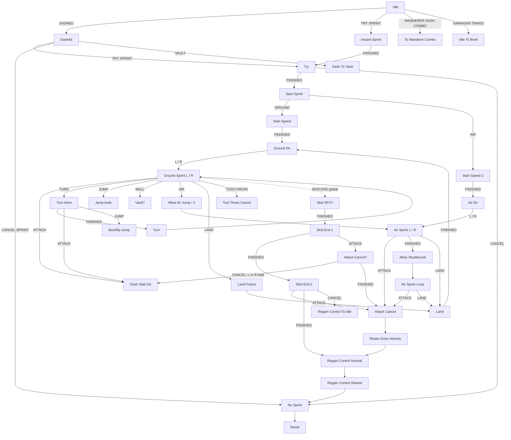
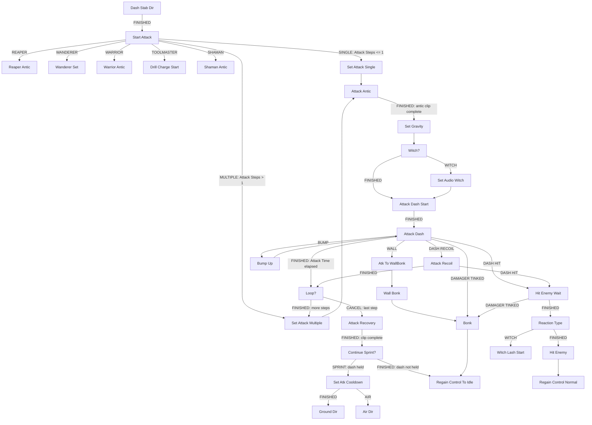

# Sprint and sprint attacks

This page covers the hero's PlayMaker FSM `Sprint` on `Hero_Hornet(Clone)`, which runs the sprint, the
sprint skid and turn, and every crest's sprint attack (dash attack / "sprint slash" / dash stab). It also
covers the small helper FSM `Sprint Silk Usage`.

Conventions on this page:

- Durations of tk2d clips are `frames / fps` (the clip is wrap `Once` unless noted). "@60" is the same
  duration in frames at 60 fps.
- The hero faces right when `transform.localScale.x = -1` (`HeroController.FaceRight`) and left when it is
  `+1`. FSM speeds written as negative numbers multiplied by `X Scale`, and `SetVelocityByScale` with a
  negative `speed`, therefore mean "forwards" (the facing direction). A positive `SetVelocityByScale` speed
  means "backwards".
- `DecelerateXY` / `DecelerateV2` multiply the velocity by the factor once on state entry and then once
  per `FixedUpdate` while the state is active. `AccelerateToX` also runs per `FixedUpdate`. The physics
  timestep is 0.02 s (50 Hz), see [nail attacks and pogo](nail-attacks-and-pogo.md).
- `Wait`, `TimeLimitSetV2` / `TimeLimitCheckV2` all use scaled time (`realTime = False`; the TimeLimit
  actions compare against `Time.time`).
- When an action in a state fires a transition event during state entry, PlayMaker leaves the state at that
  point, so actions listed after it do not run. Several states below rely on this (for example `Dash Stab Dir`,
  `Set Gravity`, `Skid End 1`).
- `SendMessage` actions are in the dump, but their `functionCall` (the method name) is not. Wherever a state
  depends on one, this page marks the call as "not determinable from dump".

## 1. Overview

- FSM: `Sprint` on `Hero_Hornet(Clone)`, start state `Init`. It has 156 states.
- `Init` caches child objects and attack objects, then goes to `Idle` with `FINISHED`.
- `HeroController.sprintFSM` holds a reference to this FSM, and `HeroController` drives it with events
  (see section 6).

### Global transitions

| Event | Target |
|---|---|
| `HERO DAMAGED` | `Cancel All` |
| `FSM CANCEL` | `Cancel All` |
| `SPRINT CANCEL` | `Cancel All` |
| `HC CONFIG UPDATED` | `Cancel All` |
| `MANTLE SPRINT` | `Start Sprint` |
| `LEAVING SCENE` | `Leaving Scene` |
| `DO SPRINT SKID` | `Do Sprint Skid` |
| `SKID END` | `Skid SFX?` |
| `ENTER SPRINTING` | `Enter Sprint Wait` |

`Cancel All` → `Reset` → `Reset Nail Charge State` → `Hard Landed?` → `Enable Renderer Check` → `Idle`.
`Cancel All` disables the current dash stab (`Dash Stab Crt`) collider and renderer. It then re-reads
`DashStab`, `DashStabAlt`, `DashStabSpeed`, `DashStabTime` and `DashStabSteps` from the current hero config,
which is why `HC CONFIG UPDATED` (a crest change) routes through it. `Reset` sends `STOP SILK USAGE`, clears
`isSprinting` and `isInCancelableFSMMove`, and zeroes `Extra Velocity`.

### Variables that matter

Initial values come from the dump. Where the dump shows runtime values (for example values read from the
config), they are the values for the Default config.

| Variable | Value | Role |
|---|---|---|
| `Dash Speed` | -28 | Velocity applied when a sprint starts (`Sprint Start Speed = (Dash Speed - Add Speed) * X Scale`) |
| `Add Speed` | 0 | Read by `HeroController` (`sprintSpeedAddFloat`). Subtracted from the start speed, then reset to 0 |
| `Sprint Speed Regular` | -17.5 | Ground sprint target speed (multiplied by `X Scale`) |
| `Sprint Speed Quick` | -23.5 | Target speed when exactly one of `Is Quickening Active` / `Sprintmaster Active` is true |
| `Sprint Speed Quicker` | -27.5 | Target speed when both are true |
| `Air Sprint Speed` | -12 | Air sprint target speed |
| `Attack Speed` | -50 | Dash stab speed, read from config `DashStabSpeed` |
| `Attack Time` | 0.12 | Dash stab duration, read from config `DashStabTime` |
| `Attack Steps` | 1 | Number of dash stab steps, read from config `DashStabSteps` |
| `Attack Cooldown` | 0 | Sprint attack cooldown. Counts down at 1/s in the sprint states; `Attack Ready` is true when it is 0 |
| `Sprint Grace` | 0.3 | Sprints shorter than this skip the skid animation |
| `Sprint Deceleration Fast` / `Slow` | 0.85 / 0.95 | Skid deceleration factors |
| `Grounded Distance` / `Short Grounded Distance` | 1.2 / 0.2 | Ground ray lengths |
| `Bump Force Grounded Delay` | 0.5 | |
| `Wallrun Speed` | 13.5 | Used only by the unreachable wall-run states (see section 4.9) |
| `Dash Stab` | `Dash Stab` (GameObject) | Config `DashStab` attack object (`GetHeroAttackObject` with `DashStab`) |
| `Dash Stab Alt` | null | Config `DashStabAlt` (null for Default) |
| `Hunter SprintAttackBurst` | `Effects/Hunter SprintAttackBurst` | Effect turned on for non-Witch dash stabs |

The dump of `GetHeroConfigVariable` prints only the stored value (`-50`, `0.12`, `1`), not the name of the
target variable. The targets are taken to be `Attack Speed`, `Attack Time` and `Attack Steps` because these
are the only variables used as dash stab speed, duration and step count, and their dumped values match.

`Init` also stores the crest-specific attack objects:

| FSM variable | Child path |
|---|---|
| `Reaper Slash` | `Attacks/Scythe/DashUpper Slash` |
| `Wanderer RecoilStab` | `Attacks/Wanderer/RecoilStab` |
| `SpinSlash` | `Attacks/Warrior/DashSpinSlash` (stored but not used by any state) |
| `Warrior Dash Slash` / `Warrior Dash Slash R` | `Attacks/Warrior/DashSlash` / `Attacks/Warrior/DashSlash Rage` |
| `Witch Lash Damager` | `Attacks/Witch/Sprint Lash Damager` |
| `Toolmaster Drill Stab` / `... Charged` | `Attacks/Toolmaster/Dash Stab` / `Attacks/Toolmaster/Dash Stab Charged` |
| `Shaman Dash Slash` | `Attacks/Shaman/DashSlash` |
| `Wanderer DashCombo Burst` | `Effects/Wanderer DashCombo Burst` |
| `Witch DashSlashFinal` | `Attacks/Witch/Dash Stab Parent/Dash Stab 2` |
| `Followup Slash` | `Attacks/Witch/Followup Slash` |
| `Lash Checker` | `Attacks/Witch/Lash Checker Sprint` |

## 2. State flow

### 2.1 Starting a sprint, sprinting, stopping

### 2.2 Sprint attack dispatch

`Start Attack` checks crests in this order and the first match fires: `Reaper`, `Wanderer`, `Warrior`,
`Toolmaster`, `Spell` (Shaman). Every other crest goes through `IntCompare(Attack Steps, 1)`. That covers
Hunter, Hunter_v2 and Hunter_v3 (config `Default`, steps 1, `SINGLE`), Cloakless (steps 1, `SINGLE`), and
Witch / Cursed (config `Whip`, steps 2, `MULTIPLE`).

## 3. Hunter crest walk-through (config `Default`)

Hunter, Hunter_v2 and Hunter_v3 have `heroConfig=null` and use the hero's `Default` config. They have no
animation override library, so every clip below comes from the hero's default `Knight` library. The Sprint
FSM has no Hunter-specific check, so all three Hunter variants behave identically here.

### 3.1 Getting into the sprint

There are two ways in:

- **From a dash.** `HeroController` sends `DASHED` when a dash starts, and `Idle` goes to `Dashed`.
  - `Dashed` sends `START SILK USAGE BURST` and sets `HeroBoxControl = Sprint`.
  - It raycasts forwards 1 unit on layers [8, 13] for a high wall and checks for a bump each frame. The
    `VAULT` event goes to `Dash To Vault`.
  - When the dash ends (`HeroController` dash-finish code), the controller sends `TRY SPRINT` if the hero
    is on the ground or in the air and input is not blocked. It sends `CANCEL SPRINT` after a downward dash.
- **Directly.** `TRY SPRINT` while in `Idle` goes to `Instant Sprint`, which does the same silk-burst and
  hero-box setup, then goes to `Try`.

`HeroController` sends `TRY SPRINT` in two other places as well: when a falling shuttlecock is cancelled
while dash is held, and from the conveyor code.

`Try`:

1. Sets `Sprint Stop Wait = 0`, `Sprint Timer = 0`, `Fast Skid Timer = 0` and
   `Sprint Deceleration = Sprint Deceleration Slow` (0.95).
2. Runs `CheckHeroCanSprint`, which calls `HeroController.CanSprint()`. If that returns false it sends
   `CANCEL` → `No Sprint`.

`CanSprint()` requires all of:

- `hero_state` is not `no_input`, `hard_landing` or `dash_landing`
- not `cState.dashing`
- not (`cState.attacking` with `attack_time < Config.AttackRecoveryTime`)
- not `cState.preventDash`
- not `controlReqlinquished`

`Start Sprint`:

1. `Attack Cooldown = 0`, so a sprint attack is available immediately.
2. `Sprint Anim = "Sprint"`, gravity scale 1.
3. Calls `SetAllowNailChargingWhileRelinquished(True)`, `RelinquishControlNotVelocity` and
   `StopAnimationControl`.
4. `HeroBoxControl = Sprint`.
5. `Sprint Start Speed = (Dash Speed - Add Speed) * X Scale = 28` forwards when `Add Speed = 0`, then
   `Add Speed = 0`.
6. Sends `GROUND` if `Force Grounded Timer` has not expired or `onGround` is true. Otherwise it sends `AIR`.

`Start Speed` sets the x velocity to `Sprint Start Speed` and calls `CameraTarget.SetSprint(True)`.

`Ground Dir`:

1. Sets `Is Sprinting`, `cState.isInCancelableFSMMove = True` and `cState.isSprinting = True`.
2. Calls `RefreshAnimationEvents` and sends `START SILK USAGE` (see section 5.3).
3. Branches to `Ground Sprint L` or `Ground Sprint R` by scale.

### 3.2 `Ground Sprint R` / `Ground Sprint L`

The two states are mirror images. Translate is +0.05 / -0.05 x on entry, and the raycast direction is +1 /
-1. Per frame, unless noted:

- **Target speed and clip.** `Sprint Speed` is chosen from (`Is Quickening Active`, `Sprintmaster Active`):
  -17.5 / -23.5 / -27.5. The clip is `"Sprint"` / `"Sprint Lv2"` / `"Sprint Lv3"`.
  `Sprint Speed Crt = Sprint Speed * X Scale`, and `AccelerateToX` uses factor 1.1 towards
  `Sprint Speed Crt`.
- **Animation.** The clip plays on entry (`tk2dPlayAnimationOptionalReset`):
  - `Sprint`: fps 16, 8 frames, Loop, loopStart 1
  - `Sprint Lv2`: fps 20, 8 frames
  - `Sprint Lv3`: fps 22, 8 frames
- **Sprint timer.** `Sprint Timer` += 1/s.
- **Releasing dash.** `ListenForDash isNotPressed → SKID END` (global → skid), active after
  `delayBeforeActive = Sprint Stop Wait`.
- **Attack.**
  - `Attack Cooldown` -= 1/s, clamped to [0, 10].
  - `Attack Ready = (Attack Cooldown == 0)`.
  - `GetWasButtonPressedQueued(ATTACK, Consume = True)` is gated by `Attack Ready` and sends `ATTACK`.
    The input queue keeps a press for `BUTTON_QUEUE_TIME = 0.1` s (`InputHandler`), so a press up to 0.1 s
    before `Attack Ready` becomes true still triggers the attack.
- **Tool throw.** `ListenForToolThrow` sends `TOOLTHROW`, gated by `ThrowToolCooldownReady`.
- **Jump.** A queued jump sends `JUMP`, gated by `Not Forcing Grounded`.
- **Ground and landing.** The grounding rays (`Grounded`, `Short Grounded`) and the bottom collision drive
  `LAND` (after `Can Do Land` becomes true 0.25 s into the state) and `AIR`.
- **Walls and bumps.** `HeroCheckForBumpV2(+1 or -1)` sends `WALL` when a wall is hit with no bump, not
  forcing grounded and not on a conveyor.
- **Short falls.** `Falling Short` plays `"Sprint Air Short"`.
- **Turning.** `TURN` fires when only the opposite direction is held and `Sprint Stop Timer` has ended.
- **Velocity clamp.** x is clamped to [-40, 40].

### 3.3 Sprint attack: exact path and timing (Hunter, ground)

| # | State | Actions in order (exact values) | Leaves on | Time spent |
|---|---|---|---|---|
| 1 | `Ground Sprint L/R` | `GetWasButtonPressedQueued` sees ATTACK while `Attack Ready` (`Attack Cooldown == 0`) | `ATTACK` | 0 (same frame as the input is polled) |
| 2 | `Dash Stab Dir` | `Attack Direction = 0`, `Is Stabbing Right = True`, `SendEventByScale` (negative scale = facing right → `FINISHED`). Otherwise `Attack Direction = 180`, `Is Stabbing Right = False` | `FINISHED` | instant |
| 3 | `Start Attack` | `Did First Slash = False`, `In Attack = True`, `HeroController.IncrementAttackCounter()`, `cState.isSprinting = False`, `SetAllowNailChargingWhileRelinquished(False)`, five `CheckIfCrestEquipped` (none match), `Attack Step = 1`, `IntCompare(Attack Steps = 1, 1)` → `SINGLE` | `SINGLE` | instant |
| 4 | `Set Attack Single` | `Can Attack Bonk = 0.1`, `Attack Antic Anim = "Dash Attack Antic"`, `Attack Anim = "Dash Attack"`, `Dash Stab Crt = Dash Stab` | `FINISHED` | instant |
| 5 | `Attack Antic` | play `hornet_new_kickoff` (pitch 1, vol 1); `Tk2dPlayAnimationWithEvents("Dash Attack Antic", animationCompleteEvent = FINISHED)`; (disabled `SetVelocity2d x=0`); `Attack Speed Crt = Attack Speed (-50) * X Scale`; `DecelerateXY(0.85)` | `FINISHED` when the antic clip completes | **`Dash Attack Antic`: fps 24, 4 frames = 0.1667 s = 10 frames @60** |
| 6 | `Set Gravity` | `CheckIfCrestEquipped Witch → FINISHED`, `CheckIfCrestEquipped Cursed → FINISHED` (neither matches for Hunter); `SendMessage` to owner (method not determinable from dump) | `FINISHED` | instant |
| 7 | `Witch?` | Witch/Cursed checks (no match); `Is Cloakless = CheckIfCrestEquipped(Cloakless)`; `Clip = Is Cloakless ? hornet_cloakless_dash_attack : hornet_sword_4`; `ActivateGameObject(Hunter SprintAttackBurst, True)` | `FINISHED` | instant |
| 8 | `Attack Dash Start` | `Attack Heavy Hornet Voice` random clip; Cloakless check; play `Clip` (pitch 0.9–1.1); `Did First Slash = True`; `Dash Stab Crt.DamageEnemies.SetDirection(0)`; `Tk2dPlayFrame(Dash Stab Crt, 0)`; `Tk2dPlayAnimationWithEvents("Dash Attack", no events)`; `Attack Time End = Time.time + Attack Time (0.12)`; `SetVelocity2d x = Attack Speed Crt`; **`SetPolygonCollider(Dash Stab Crt, active = True)`**; `NailAttackBase.OnCancelAttack`, `OnSlashStarting`, **`OnPlaySlash`** (calls `DamageEnemies.StartDamage()`); `SetMeshRenderer(Dash Stab Crt, True)`; (disabled `EnemyKillShake`) | `FINISHED` | instant: **the hitbox is live from here** |
| 9 | `Attack Dash` | `TimeLimitCheckV2(Attack Time End)` every frame → `FINISHED`; `SetVelocity2d x = Attack Speed Crt` (once); `DecelerateXY(0.925)`; `HeroCheckForBump(-1)` and `(+1)`; `WALL` when the wall in the stab direction is hit with no bump; `BUMP` on any bump; `FindChild(Dash Stab Crt, "Clash Tink")`; `SetPolygonCollider(Clash Tink, True, resetOnExit = True)` | `FINISHED` / `DASH HIT` / `DASH RECOIL` / `WALL` / `BUMP` / `DAMAGER TINKED` | **0.12 s (`DashStabTime`) = 7.2 frames @60** unless interrupted |
| 10a (miss) | `Loop?` | `Dash Stab Crt.OnCancelAttack()`; `IntCompare(Attack Step 1, Attack Steps 1)` equal → `CANCEL` | `CANCEL` | instant |
| 11a | `Attack Recovery` | `SendMessage` to owner (method not determinable from dump); `DecelerateXY(0.8)`; collider and renderer of `Dash Stab Crt` off; `Dash Stab.OnCancelAttack()`; `Tk2dPlayAnimationWithEvents("Dash Attack Recover", complete → FINISHED)` | `FINISHED` | **`Dash Attack Recover`: fps 20, 2 frames = 0.1 s = 6 frames @60** |
| 12a | `Continue Sprint?` | (disabled `BoolTest Hit Enemy`); `ListenForDash`: held → `SPRINT`, not held → `FINISHED` | `SPRINT` → `Set Atk Cooldown`; `FINISHED` → `Regain Control To Idle` | instant |
| 13a | `Set Atk Cooldown` | `Chooser = Wanderer equipped`; `Attack Cooldown = Chooser ? 0.1 : 0.25` (**0.25 for Hunter**); ground check (distance 0.2), not grounded → `AIR` | `FINISHED` → `Ground Dir`; `AIR` → `Air Dir` | instant |
| 10b (hit) | `Hit Enemy Wait` | `Dash Stab Crt.OnCancelAttack()` (two disabled `NextFrameEvent`) | `FINISHED` (or `DAMAGER TINKED` → `Bonk`) | instant |
| 11b | `Reaction Type` | Witch / Cursed checks (no match) | `FINISHED` | instant |
| 12b | `Hit Enemy` | collider off; `Dash Stab.OnCancelAttack()`; `SendMessage` to owner (method not determinable from dump); collider and renderer off; `HeroController.SetStartWithDashStabBounce()`; `HeroController.StartDownspikeInvulnerability()` | `FINISHED` → `Regain Control Normal` → `Regain Control Shared` → `No Sprint` → `Reset` … → `Idle` | instant |

#### Where the delay between attack input and the hit is

States 1–4 and 6–8 have only instant actions, so they finish on the frame they are entered. The only state
on the path that holds time before the hitbox exists is `Attack Antic` (step 5). It waits for the
`Dash Attack Antic` clip to complete (`animationCompleteEvent = FINISHED`), and it has no `Wait` action.

- Input → hitbox active: **0.1667 s (4 frames at 24 fps), which is 10 frames at 60 fps.** This counts from
  the frame the ATTACK press is consumed in `Ground Sprint`. A press made while `Attack Cooldown > 0` waits
  in the 0.1 s input queue.
- During the antic, the sprint velocity decays by ×0.85 per physics step (`DecelerateXY 0.85`). The stab
  velocity is then set to 50 forwards (`Attack Speed Crt`) in `Attack Dash Start`.
- In `Attack Dash Start`, the hitbox (`Dash Stab` `PolygonCollider2D`, disabled by default) and
  `DamageEnemies.StartDamage()` are turned on together. Contact is evaluated by Unity's trigger callbacks,
  so the first possible contact is the next physics step after that frame.
- Active window: from `Attack Dash Start` until `Attack Dash` ends at `Time.time >= start + 0.12` s.
  - On a miss, the collider stays enabled through `Loop?` and is disabled in `Attack Recovery`.
    `Loop?` calls `OnCancelAttack()`, which calls `DamageEnemies.EndDamage()`, so damage ends at 0.12 s.
  - On a hit, `DashStabNailAttack` sends `DASH HIT` straight away, because Default has
    `waitForBounceTrigger = False`, `waitForEndDamage = False` and `doEnemyHitRecoil = False`. It does this
    from `DamageEnemies.WillDamageEnemyOptions` unless the target has an active `NonBouncer`. The FSM then
    ends the attack and starts the bounce.
- `Dash Attack` (the hero clip played during the stab) is fps 18, 3 frames, wrap Once, loopStart 1:
  0.1667 s. Nothing waits on it. The stab length is set only by `Attack Time`.

#### Full cycle numbers (Hunter, ground, no hit)

| Segment | Duration |
|---|---|
| Antic (`Dash Attack Antic`) | 0.1667 s (10 @60) |
| Active stab (`Attack Time`) | 0.12 s (7.2 @60) |
| Recovery (`Dash Attack Recover`) | 0.1 s (6 @60) |
| Total input → control back or sprint resumed | 0.3867 s (≈23.2 @60) |
| `Attack Cooldown` after resuming the sprint (dash held) | 0.25 s before the next sprint attack can be triggered |

#### On hit

`Hit Enemy` calls `HeroController.SetStartWithDashStabBounce()`. With Default's
`forceShortDashStabBounce = False`, it:

- raycasts 3.5 units upwards (layer mask 8448)
- sets `startWithDownSpikeBounceShort` if the ray hits, otherwise `startWithDownSpikeBounce`
- sets `attack_cooldown = 0.15`
- sets `isDashStabBouncing = true`

While `isDashStabBouncing` is set, `HeroController.Jump()` uses `Config.DashStabBounceJumpSpeed`
(Default 18.6) as the vertical speed instead of `JUMP_SPEED` (18.6). `StartDownspikeInvulnerability()` is
also called. Control is then returned through `Regain Control Normal` → `Regain Control Shared`. On a hit
the sprint does not continue.

#### Other exits from `Attack Dash`

- **`BUMP`** → `Bump Up` translates +0.1 y and returns to `Attack Dash`. The `Attack Time End` deadline is
  not reset.
- **`WALL`** → `Atk To WallBonk`: `OnCancelAttack`, `hornet_hit_reject_dull`.
  - Then `Wall Bonk` → `Bonk`.
  - `Bonk` plays `Sprint Bonk` (fps 15, 3 frames = 0.2 s = 12 @60), sets `Sprint Speed Crt *= -2` as the
    x velocity, `DecelerateXY(0.9)`, `AffectedByGravity(True)`, and sends `SPRINT BONKED` to the wall.
  - Then `Regain Control To Idle`.
- **`DAMAGER TINKED`** → `Bonk` (same as above).
- **`DASH RECOIL`** → `Attack Recoil`: `Attack Speed Crt *= -0.1`, set as velocity, `DecelerateXY(0.925)`.
  It stays until `Attack Time End`, then `Loop?`. `DASH HIT` → `Hit Enemy Wait`. For Default this event is
  never sent, because `doEnemyHitRecoil = False`.

### 3.4 Other sprint-attack entry points (all crests)

- **`Turn Anim`.** Plays `Sprint Turn` (fps 20, 6 frames = 0.3 s), calls `FlipSprite`,
  `DecelerateXY(0.9)`, and also counts `Attack Cooldown` down. `ATTACK` (gated by `Attack Ready`) →
  `Dash Stab Dir`, so a turn can be cancelled into a dash attack. `JUMP` → `Backflip Jump`.
- **`Skid End 1`.** Plays `Skid End 1` (fps 20, 4 frames = 0.2 s), using `Skid Deceleration` 0.95 when the
  facing direction is held and 0.85 otherwise.
  - `ListenForAttack wasPressed → ATTACK` → `Attack Cancel?`.
  - In `Attack Cancel?`, if left or right is held it sends `CANCEL` → `Dash Stab Dir` (a sprint attack);
    otherwise it sends `FINISHED` → `Attack Cancel` (control is handed back).
  - This listener is not gated by `Attack Cooldown`.
  - When `Sprint Timer <= Sprint Grace (0.3)`, `Skid End 1` sends `FINISHED` before the skid animation
    starts. `Did Skid` is then false, and `Skid End 2` sends `CANCEL` → `Regain Control To Idle`.
- **`Skid End 2`.** Plays `Skid End 2` (fps 20, 1 frame = 0.05 s). `ATTACK` → `Attack Cancel`, which
  hands control back and does not do a sprint attack.
- **Air sprint (`Air Sprint L/R`, `Air Sprint Loop`).** `ATTACK` → `Attack Cancel` → `Retain Extra Velocity`
  → `Regain Control Normal`. **There is no dash stab from the air sprint.** The FSM ends the sprint, keeps
  the current x velocity as `Extra Velocity` (y = 0), and returns control. What `Attack Cancel`'s
  `SendMessage` calls on the hero is not determinable from the dump. `Air Sprint L/R` clamp
  `Attack Cooldown` to a minimum of 0.1 on entry.

### 3.5 Other sprint states (summary)

| State | Key values |
|---|---|
| `Air Dir` | `Sprint Speed Crt = Air Sprint Speed (-12) * X Scale`; sets `isSprinting`; plays `Sprint Air Flip` sound at volume 1 |
| `Air Sprint L/R` | sends `STOP SILK USAGE`; clip `Sprint Air` (fps 17, 4 frames = 0.235 s) or `Sprint Air Short` when ground is within 3 units below or `Warrior Slash To Fall`; `Wait 0.235 → FINISHED` → `Allow Shuttlecock` → `Air Sprint Loop`; `AccelerateToX 1.1`; fall clamp eases from -10 to -30 over 1 s; `DASH CANCEL` → `Air Dash Cancel` (`DashCooldownReady`, `SetStartWithDash`) |
| `Air Sprint Loop` | clip `Sprint Air Loop` (fps 17, 3 frames, Loop); releasing dash sends `END` |
| `Land` | `ShouldHardLand` → `CANCEL`; `Sprint Anim = "Land to Sprint"`; dash not held → `CANCEL` → `Regain Control To Idle`; else → `Ground Dir` |
| `Jump Antic` | clip `Shuttlecock Antic` (fps 20, 2 frames = 0.1 s) → `Jump` |
| `Queue Sprint Jump?` | `CouldJumpCancel` → `Set Air Jump`; else `Jump Queue Timer = 0.075` |
| `Do Sprint Skid` (global `DO SPRINT SKID`, from `HeroController.DoSprintSkid`) | `Sprint Timer = Sprint Grace + 1`; `RelinquishControl`; velocity `Sprint Speed Regular * X Scale` → `Skid SFX?` |
| `Skid SFX?` | `hornet_slide_after_sprint`; if speed < 4 → `Skid End 1` directly |
| `Enter Sprint Wait` / `Enter Sprinting` (scene entry while sprinting) | `Sprint Stop Wait = 0.05`; `Force Grounded Timer = 0.3`; `Set Gravity Timer = 0.1`; `Sprint Timer = Sprint Grace + 1`; `Sprint Deceleration = Fast` → `Start Sprint` |
| `Vault?` / `Vault!` | ledge vault, clip `Mantle Vault` → `Land` |

## 4. Other crests

All durations use the crest's override library from `crests.txt`, falling back to the default `Knight`
library when the override has no clip of that name. `Tk2dPlayAnimationWithEvents` resolves clips through
`IHeroAnimationController.GetClip`.

### 4.1 Reaper (`Reaper` config, override lib `Hornet CrestWeapon Scythe Anim`)

`Start Attack` → `REAPER` → `Reaper Antic` → `Reaper Upper` → `Reaper End` → `Regain Control Normal`.

- **`Reaper Antic`.**
  - Plays the `Attack Normal Hornet Voice` random clip.
  - Plays `Dash Upper Antic` (fps 16, 2 frames = **0.125 s = 7.5 @60**) and finishes when the clip completes.
  - `DecelerateV2(0.65)`, `SetAllowRecoilWhileRelinquished(True)`.
- **`Reaper Upper`.**
  - Plays `hornet_reaper_dash_scrape`.
  - `SendMessage` to owner, then `Reaper Slash.DamageEnemies.SetDirection(0)`, then `SendMessage` to
    `Reaper Slash` (`Attacks/Scythe/DashUpper Slash`). The method names are not determinable from the dump.
  - `CameraTarget.SetSprint(False)`.
  - `SetVelocityByScale speed = -50` (50 forwards), `onGround = False`, `DecelerateXY(0.85)`.
  - Plays `Dash Upper` (fps 22, 6 frames = **0.2727 s = 16.4 @60**) and finishes when the clip completes.
  - `CurveFloat Speed Y` over 0.3 s, applied as the y velocity every frame. The curve keys are not in the
    dump.
- **`Reaper End`.** y velocity = 7, two `SendMessage` calls, `SetAllowRecoilWhileRelinquished(False)`.
- **Timing.** Input → slash activation is **0.125 s**, assuming the `SendMessage` to `Reaper Slash` starts
  the damager. The method name is not in the dump.
- **Unused objects.** Reaper's config `DashStab` object (`waitForBounceTrigger = True`,
  `doEnemyHitRecoil = True`) and its `Dash Attack Antic` / `Dash Attack` overrides are not used by this
  branch.

### 4.2 Wanderer (`Wanderer` config, override lib `Hornet CrestWeapon Dagger Anim`)

`Start Attack` → `WANDERER` → `Wanderer Set ` (the state name has a trailing space).

- **`Wanderer Set `.** `Can Attack Bonk = 0.1`. If `Alt Timer > 0` it sends `ALT` → `Wanderer Alt`;
  otherwise `FINISHED` → `Wanderer Nml`.
  - `Alt Timer` is set to 0.5 by `Wanderer Nml` and counts down at 1/s in `Ground Sprint`.
  - It is reset to 0 in `Idle`, `Turn Anim`, `Jump Antic` and `Wanderer Alt`.
  - So sprint attacks alternate when the next one starts within 0.5 s of sprinting time.
- **`Wanderer Nml` / `Wanderer Alt`.**
  - Play `Wanderer Dash Attack` / `Wanderer Dash Attack Alt` (both fps 18, 5 frames, trigger at frame 2) with
    `animationTriggerEvent = FINISHED`. The state leaves on the frame-2 trigger: **2/18 = 0.1111 s =
    6.7 @60**.
  - `Attack Speed Crt = Sprint Speed * X Scale` (the current sprint speed, -17.5 / -23.5 / -27.5; not
    `DashStabSpeed`).
  - `Dash Stab Crt` = config `DashStab` (Nml) or `DashStabAlt` (Alt).
- **`Wanderer Nml Audio` / `Wanderer Alt Audio`.** Play `hornet_wanderer_dash_sword_1` / `_2`.
- **`Wanderer Attack Start`.**
  - Plays the `Attack Heavy Hornet Voice` random clip.
  - `Attack Time End = Time.time + 0.15` (fixed value; `DashStabTime` 0.2 is not used here).
  - Sets the velocity, `SetDirection(0)`, and `SendMessage` to `Dash Stab Crt` (method not determinable
    from dump).
- **`Wanderer Attacking`.** Velocity set every frame (the deceleration action is disabled), same wall and
  bump checks as `Attack Dash`. `FINISHED` after 0.15 s → `Wanderer Recovery` (all actions disabled) →
  `Continue Sprint?`.
  - `Set Atk Cooldown` uses **0.1** for Wanderer.
  - `Wanderer Recovery` has no animation, so Wanderer has no recovery time.
- **Timing.** Input → hitbox is **0.1111 s**, and the active window is 0.15 s.
- **On hit.**
  - The Wanderer `DashStab` / `DashStabAlt` objects are `NailSlash` objects with a
    `Send Hit To Player` FSM that sends `DASH HIT`.
  - `DASH HIT` → `Hit Enemy Wait 2` (two `NextFrameEvent` actions, a one-frame delay) → `Wanderer Recoil`:
    - `onGround = False`, plays `hornet_forward_spin_single`, `SendMessage` to `Dash Stab Crt` and to owner
      (methods not determinable from dump), `DecelerateV2(0.85)`.
    - Velocity y = 20, then x = 30 by scale (30 backwards).
    - Clip `Wanderer DashRecoil` (fps 24, 8 frames, trigger at frame 5 → leaves at 5/24 = 0.2083 s).
    - Attack is queued after 0.13 s, and a jump cancel is allowed after 0.13 s.
  - Then `W Recoil Cancelable`, which waits for the clip to complete:
    - `ATTACK` → `RecoilStab Dir`
    - `DASHED` → `W DashCancel`
    - `JUMP` → `W JumpCancel`
    - `FINISHED` → `W Recoil End`
  - `W Recoil End` calls `HeroController.StartWandererDashComboWindow()`, which sets
    `wandererDashComboWindowTimer = DASHCOMBO_WINDOW_TIME = 0.15`. A normal attack started while the timer
    is above 0 with crest `Wanderer` sends `WANDERER DASH COMBO`. From `Idle` this goes to
    `To Wanderer Combo` → `RecoilStab Dir`.
- **RecoilStab chain.** `RecoilStab Dir` picks the direction from the held input or the facing.
  - `RecoilStab Antic`: velocity 0, clip `Wanderer RecoilStab` (fps 20, 6 frames, triggers at frames 2 and
    3), leaves on a trigger.
  - `RecoilStab Dash`: `Wanderer DashCombo Burst` on, `hornet_hunter_new_dash`, velocity -45 by scale and
    y -15, leaves on a trigger.
  - `RecoilStab Attack`: `SendMessage` to `Wanderer RecoilStab`, finishes when the clip completes,
    `DecelerateV2(0.9)`.
  - `DASH HIT` → `RecoilStab Bounce` → `SetStartWithDashStabBounce`.
  - The dump does not show whether replaying the same clip in successive states restarts it, so the exact
    per-state durations of the RecoilStab chain are not determinable from the dump. The first trigger
    (frame 2) is at 0.1 s.

### 4.3 Beast (`Warrior` config, override lib `Hornet CrestWeapon Warrior Anim`)

`Warrior Antic` → `Warrior Leap` → `Rage Mode?` → `Warrior Slash`. The config `DashStab` is null; the
branch uses `Attacks/Warrior/DashSlash`, or `DashSlash Rage` when `HeroGetWarriorCrestState.IsInRageMode`.

- **`Warrior Antic`.** Plays `Dash Attack Antic` (fps 24, 2 frames = **0.0833 s = 5 @60**) and waits for
  completion. Plays `hornet_beast_dash_attack_foley`.
- **`Warrior Leap`.**
  - Plays `Dash Attack Leap` (fps 16, 2 frames = **0.125 s = 7.5 @60**) and waits for completion.
  - Velocity -20 by scale (20 forwards), y = 18.
  - `UmbrellaMotionXV2` (accel 1.5, max 20) once `Can Drift` becomes true after 0.05 s.
  - x speed pushed out of (-3, 3) every frame (`FloatMinClamp` min -3, max 3).
- **`Warrior Slash`.**
  - Plays `Dash Attack Slash` (fps 20, 4 frames = 0.2 s) and waits for completion.
  - `Current Attack.SetDirection(0)` and `SendMessage` to `Current Attack` (method not determinable from
    dump).
  - `AddForce2d y = -60` every frame, `UmbrellaMotionXV2` (accel 1, max 20).
  - Exits:
    - `LAND` / `HERO TOUCHED GROUND` → `Warrior Land`
    - `DASH HIT` → `Warrior Bounce` (`SetStartWithDownSpikeBounce`: `startWithDownSpikeBounce = true`,
      `attack_cooldown = 0.15`)
    - `NAIL CLASH` (`HeroController.NailParry`) → `Dash Stab Bounce` (`SetStartWithDashStabBounce`)
    - `BOUNCE CANCEL` → `Warrior End`
    - `FINISHED` → `Continue Sprint? 2`
- **`Warrior Land`.** Sets `isSprinting`, `DecelerateXY(0.9)`, plays `Downspike Recovery Land` (default
  lib: fps 15, 3 frames = 0.2 s) → `Continue Sprint? 2`.
  - Dash held → `Restart Sprint`: x velocity × 0.75, `Attack Cooldown = 0.25`, `Warrior Slash To Fall = True`
    → `Air Dir`.
  - Dash not held → `Regain Control Normal`.
- **Timing.** Input → slash activation is **0.0833 + 0.125 = 0.2083 s = 12.5 @60**.

### 4.4 Architect (`Toolmaster` config, override lib `Hornet CrestWeapon Drill Lance Anim`)

`Drill Charge Start` → `Drill Charge` → `Set Uncharged` / `Set Charged` → `Drill Antic` → `Drill Type` →
`Drill Attack Unch` / `Drill Attack Ch` → `Drill End` → `Attack Recovery`.

- **`Drill Charge Start`.**
  - Plays `hornet_architect_charge_attack_grounded_start`.
  - Plays `Dash Attack Charge` (fps 16, 6 frames, loopStart 5, trigger at frame 3) and leaves on the
    trigger: **3/16 = 0.1875 s = 11.25 @60**.
  - `DecelerateXY(0.9)`. Not grounded (0.2 ray) → `CANCEL` → `Drill End`.
- **`Drill Charge`.**
  - Attack not held → `UNCHARGED`.
  - When `Dash Attack Charge` completes → `CHARGED`: 6/16 = 0.375 s after the clip started, which is
    0.1875 s after entering this state. A `Wait 0.375 → CHARGED` action exists but is disabled.
  - `DecelerateXY(0.9, brakeOnExit = True)`.
- **`Set Uncharged` / `Set Charged`.** `Drill Stab Crt` = `Attacks/Toolmaster/Dash Stab` /
  `Dash Stab Charged`.
- **`Drill Type`.** Plays the voice clip, `SetDirection(0)`, `SendMessage` to owner (method not determinable
  from dump), sends `EnemyKillShake`.
- **`Drill Attack Unch`.**
  - Plays `hornet_architect_charge_attack_slashes_short` and clip `Dash Attack` (fps 15, 3 frames, Loop).
  - Velocity -22 by scale.
  - **`Wait 0.15 → FINISHED`**.
  - `SendMessage` to `Drill Stab Crt` (method not determinable from dump).
  - Wall check sends `WALL`.
- **`Drill Attack Ch`.** `Dash Burst` on, `hornet_architect_charge_attack_slashes_long`, velocity -30 by
  scale, **`Wait 0.2 → FINISHED`**.
- **On `DASH HIT`.**
  - `Drill Grind Unch` (`DashStabEffect` on the stab object, `Wait 0.1`) or `Drill Grind Ch` (`Wait 0.2`).
  - Both apply `DecelerateXY(0.8)` and y velocity 0.
  - Then `Drill Bounce`: `SetStartWithDownSpikeBounce`, `SetStartWithRecoilBack`, and a `SendMessage` to the
    stab.
- **`Drill End` → `Attack Recovery`.** `Dash Attack Recover` comes from the default lib (the Drill Lance lib
  has no override): 0.1 s.
- **Timing.**
  - Uncharged input → stab activation is at least **0.1875 s** (attack released by then).
  - Charged is **0.375 s** after the input.
- **Config values not used by this branch.** `DashStabSpeed` (-50) and `DashStabTime` (0.25); the speeds
  and durations are the fixed values above.

### 4.5 Witch (`Witch` crest, config `Whip`, override lib `Hornet CrestWeapon Whip Anim`); also `Cursed`

`Attack Steps = 2`, so `Start Attack` → `MULTIPLE` → `Set Attack Multiple`.

- **`Set Attack Multiple`.**
  - `Attack Antic Anim = "Dash Attack Antic {0}"`, `Attack Anim = "Dash Attack {0}"`,
    `Attack Child Name = "Dash Stab {0}"`, and `Dash Stab Crt = child of Dash Stab`.
  - The dump prints the format argument as `[0]`. The variable bound to `{0}` is not named in the dump. The
    Whip library's clip names (`... 1`, `... 2`) and `Dash Stab 1` / `Dash Stab 2` children match
    `Attack Step`.
- **Step 1.**
  - `Attack Antic`: `Dash Attack Antic 1` (fps 14, 1 frame = **0.0714 s = 4.3 @60**).
  - `Set Gravity`: `FINISHED` is fired by the Witch/Cursed check, so the `SendMessage` is skipped.
  - `Witch?` → `Set Audio Witch`: `Did First Slash` is false here, so `hornet_witch_slash_4`.
    `Hunter SprintAttackBurst` is not turned on for Witch.
  - `Attack Dash Start`: clip `Dash Attack 1`, speed `DashStabSpeed` -30, duration `DashStabTime` 0.15.
- **Miss on step 1.** `Loop?` → `Attack Step = 2` → `Set Attack Multiple` → `Attack Antic`
  (`Dash Attack Antic 2`, fps 20, 1 frame = 0.05 s) → … → `Attack Dash` (0.15 s, `Dash Stab 2`, audio
  `hornet_witch_slash_3`) → `Loop?` → `CANCEL` → `Attack Recovery` (`Dash Attack Recover` override: fps 20,
  1 frame = 0.05 s).
- **Hit objects.**
  - `Dash Stab 1` has `waitForBounceTrigger = True`, `doEnemyHitRecoil = True`. A hit sends `DASH RECOIL`
    (→ `Attack Recoil`) right away. `DASH HIT` is held until the stab object's tk2d animation trigger (or is
    sent immediately if the trigger has already fired).
  - `Dash Stab 2` has all three flags False.
- **On `DASH HIT`.** `Hit Enemy Wait` → `Reaction Type` → `WITCH` → `Witch Lash Start`:
  - stab off, velocity -12 by scale
  - `Followup Slash` placed at local (-5, -0.6), rotation z 0, random Y flip, then activated
  - hero renderer hidden, `Wait Time = 0.18`
- **`NewLash Move`.** Counts `Wait Time` down at 1/s and sets `whipLashing`. `Lash Checker` trigger → `STOP`
  → `NewLash Stop` (velocity 0). The state reaches `NewLash End` after at most 0.18 s.
- **`NewLash End`.** Velocity 0, renderer back, `Followup Slash` off.
- **`Witch Downslash Bounce`.** Clip `Downspike Followup` from lib `Hornet CrestWeapon Witch Anim`,
  `StartDownspikeInvulnerability`, `SetStartWithDownSpikeBounce`, `SetStartWithRecoilBackLong`.
- **Tink.** `DAMAGER TINKED` during the lash → `NewLash Tink Cancel` → `Bonk`.
- **Timing.** Input → step 1 hitbox is **0.0714 s**. Input → step 2 hitbox (after a step 1 miss) is
  0.0714 + 0.15 + 0.05 = 0.2714 s.

### 4.6 Shaman (`Spell` crest, config `Shaman`, override lib `Hornet CrestWeapon Shaman Anim`)

`Shaman Antic` → `Shaman Leap` → `Shaman Slash`. The config `DashStab` is null; the branch uses
`Attacks/Shaman/DashSlash`.

- **`Shaman Antic`.** Plays `Dash Attack Antic` (fps 18, 2 frames = **0.1111 s = 6.7 @60**) and waits for
  completion. Plays `hornet_beast_dash_attack_foley`.
- **`Shaman Leap`.** Plays `Dash Attack Leap` (fps 12, 2 frames = **0.1667 s = 10 @60**) and waits for
  completion. y velocity = 14.5, x = -10 by scale every frame, voice clip.
- **`Shaman Slash`.**
  - Plays `Dash Attack Slash` (fps 18, 6 frames = 0.3333 s) and waits for completion.
  - `SetDirection(0)` and `SendMessage` to `Current Attack` (method not determinable from dump).
  - Velocity x = 8 by scale (8 backwards), y = 10, `DecelerateV2(0.9)`.
  - Exits:
    - `ATTACK LANDED` → `Warrior Bounce`
    - `LAND` → `Warrior Land`
    - `BOUNCE CANCEL` or `FINISHED` → `Warrior End`
- **Timing.** Input → slash activation is **0.1111 + 0.1667 = 0.2778 s = 16.7 @60**.

### 4.7 Cloakless (hidden crest, config `Cloakless`, override lib `Hornet Cloakless Anim`)

Cloakless takes the same `SINGLE` path as Hunter.

- **Antic.** `Dash Attack Antic` override: fps 14, 2 frames = **0.1429 s = 8.6 @60**.
- **Stab.** `Attack Dash Start` plays `hornet_cloakless_dash_attack`. Speed -50, duration 0.175.
- **Hit object.** `Dash Kick`: `useNailDamage = False`, `damageDealt = 3`, `nailDamageMultiplier = 0.6`,
  `stunDamage = 0.5`, and all three `DashStabNailAttack` flags are False.
- **Recovery.** `Dash Attack Recover` override: fps 20, 3 frames = 0.15 s.
- **Effect.** `Hunter SprintAttackBurst` is also turned on.

### 4.8 Timing summary (ground sprint attack, input → hit object activated)

| Crest (config) | States holding time before activation | Input → active | Active window |
|---|---|---|---|
| Hunter (Default) | `Attack Antic` (`Dash Attack Antic` 4f @24) | 0.1667 s | 0.12 s (`DashStabTime`) |
| Cloakless | `Attack Antic` (2f @14) | 0.1429 s | 0.175 s |
| Witch / Cursed (Whip) | `Attack Antic` (`Dash Attack Antic 1` 1f @14) | 0.0714 s | 0.15 s per step, 2 steps |
| Reaper | `Reaper Antic` (`Dash Upper Antic` 2f @16) | 0.125 s | not determinable from dump (activated by `SendMessage`) |
| Wanderer | `Wanderer Nml/Alt` (trigger at frame 2 @18) | 0.1111 s | 0.15 s (fixed) |
| Beast (Warrior) | `Warrior Antic` (2f @24) + `Warrior Leap` (2f @16) | 0.2083 s | until `Dash Attack Slash` (0.2 s) ends or landing |
| Shaman | `Shaman Antic` (2f @18) + `Shaman Leap` (2f @12) | 0.2778 s | until `Dash Attack Slash` (0.3333 s) ends or landing |
| Architect (Toolmaster) | `Drill Charge Start` (trigger at frame 3 @16) [+ charge] | ≥0.1875 s uncharged / 0.375 s charged | `Wait` 0.15 s uncharged / 0.2 s charged |

### 4.9 States with no incoming transition

No transition in the dumped FSM targets these states, and `Init` / the global transitions do not reach them:

- Wall-run states: `Wallrun Antic`, `Wallrun`, `Wallcling`, `Walljump Antic`, `Walljump Flip`, `To Wall Run`,
  `Drop Flip`, `Mantle Over`, `Check Input`, `Launch Up`, `Start Wallcling`, `Cling-run Antic`
- Witch lash states: `Witch Connect`, `Witch Lash To`, `Witch Lash Bounce`
- `Set Speed Clamp`

## 5. HeroControllerConfig values

### 5.1 Dash stab config values per config

`HeroControllerConfig` fields: `dashStabSpeed`, `dashStabTime`, `forceShortDashStabBounce`,
`dashStabBounceJumpSpeed`, `dashStabSteps` (clamped to ≥ 1 in `OnValidate`).

| Config (crest) | dashStabSpeed | dashStabTime | forceShortDashStabBounce | dashStabBounceJumpSpeed | dashStabSteps |
|---|---|---|---|---|---|
| Default (Hunter, Hunter_v2, Hunter_v3) | -50 | 0.12 | False | 18.6 | 1 |
| Cloakless | -50 | 0.175 | False | 18.6 | 1 |
| Reaper | -30 | 0.2 | True | 12 | 1 |
| Warrior (Beast) | -35 | 0.2 | False | 18.6 | 1 |
| Wanderer | -30 | 0.2 | False | 18.6 | 1 |
| Toolmaster (Architect) | -50 | 0.25 | False | 12 | 1 |
| Whip (Witch, Cursed) | -30 | 0.15 | False | 18.6 | 2 |
| Shaman (Spell) | -50 | 0.18 | False | 18.6 | 1 |

The Sprint FSM uses `DashStabSpeed`, `DashStabTime` and `DashStabSteps` only on the generic `Attack Antic` →
`Attack Dash` path (Default, Cloakless, Whip). The Reaper, Wanderer, Warrior, Toolmaster and Shaman branches
use their own fixed values and do not read these variables.

`HeroController` reads `dashStabBounceJumpSpeed` and `forceShortDashStabBounce` in
`SetStartWithDashStabBounce` and `Jump`, so they apply to every branch that calls
`SetStartWithDashStabBounce`: Hit Enemy, RecoilStab Bounce, Dash Stab Bounce and Witch Lash Bounce.

- `forceShortDashStabBounce = True`: `startWithDownSpikeBounceShort = true`, `attack_cooldown = 0.1`.
- `forceShortDashStabBounce = False`: a short bounce if a 3.5-unit upward ray hits (mask 8448), otherwise a
  normal down-spike bounce; `attack_cooldown = 0.15`.

### 5.2 Dash stab objects

| Config | `DashStab` | `DashStabAlt` |
|---|---|---|
| Default | `Dash Stab` (`DashStabNailAttack`) | null |
| Cloakless | `Dash Kick` (`DashStabNailAttack`) | null |
| Reaper | `Dash Stab` (`DashStabNailAttack`, `waitForBounceTrigger = True`, `doEnemyHitRecoil = True`); not used by the Reaper sprint branch | null |
| Warrior | null | null |
| Wanderer | `DashStab` (`NailSlash` + `Send Hit To Player` FSM) | `DashStabAlt` (same components) |
| Toolmaster | `Dash Stab` (`NailSlash`) | null |
| Whip | `Dash Stab Parent` with children `Dash Stab 1` (`waitForBounceTrigger = True`, `doEnemyHitRecoil = True`, `nailDamageMultiplier = 1`, `stunDamage = 0.5`) and `Dash Stab 2` (flags False, `nailDamageMultiplier = 0.5`, `stunDamage = 0.5`) | null |
| Shaman | null | null |

#### Default `Dash Stab` setup

- **Transform.** `localPos = (0.30, -0.27, 0.00)`, `localScale = (-0.94, 1.19, 1.23)`,
  `localRot = (0, 0, 182.93)`.
- **Components.** `MeshFilter`, `MeshRenderer`, `tk2dSprite`, `tk2dSpriteAnimator`, `PolygonCollider2D`,
  `DamageEnemies`, `DashStabNailAttack`.
- **`PolygonCollider2D`.** `enabled = False` (enabled by the FSM), `trigger = True`. Points:
  `(-0.751,0.77) (-3.995,-0.015) (-3.309,-0.209) (-0.891,-0.314) (-0.081,0.022)`.
- **Animator.** Library `Knight`, current clip `DashStabEffect` (fps 23.33333, 5 frames, loopStart 1, Once).
  The FSM restarts it with `Tk2dPlayFrame(0)`. In `hero-animations.txt` the clip has triggers at frames 0
  and 3.
- **`DamageEnemies`.**
  - `attackType = Nail`, `useNailDamage = True`, `nailDamageMultiplier = 1`, `damageDealt = 5` (not used
    while `useNailDamage`), `stunDamage = 1`, `direction = 0` (set to 0 again by the FSM).
  - `magnitudeMult = 1`, `multiHitter = False`, `silkGeneration = Full`, `firstHitFreeze = None`,
    `canWeakHit = False`.
- **`DashStabNailAttack`.** `waitForBounceTrigger = False`, `waitForEndDamage = False`,
  `doEnemyHitRecoil = False`, `imbuedSlashAnimName = "DashStabEffect_Glow"`, `vibration = dash_stab`,
  `canHitSpikes = True`, `clashTinkPoly = Clash Tink`.
- **Child `Clash Tink`.** `PolygonCollider2D` (`enabled = False`, `trigger = False`, same points as the
  hitbox), `NailSlashTerrainThunk` (`doRecoil = False`, `handleTink = False`), `Rigidbody2D`. `Attack Dash`
  enables it while the dash runs (`resetOnExit = True`).
- **Child `Imbuement`.** Visual for nail imbuement.

### 5.3 Related HeroController constants

| Field | Value |
|---|---|
| `DASH_SPEED` | 28 |
| `DASH_TIME` | 0.1 |
| `DASH_COOLDOWN` | 0.425 |
| `RUN_SPEED` | 8.25 |
| `JUMP_SPEED` | 18.6 |
| `SHUTTLECOCK_SPEED` | 18 |
| `DASHCOMBO_WINDOW_TIME` | 0.15 |
| `QUICKENING_RUN_SPEED` | 11.5 |

`HeroController` writes `Is Quickening Active` on the Sprint FSM, and the `Sprint Silk Usage` FSM writes
`Sprintmaster Active`. Together they select the sprint speed and clip tier (section 3.2).

#### `Sprint Silk Usage` FSM

- Start state `Check Pause` waits 0.25 s, then `Check Sprintmaster` checks whether the `Sprintmaster` tool
  is equipped: equipped → `Idle`, otherwise `Unequipped` (sets `Sprintmaster Active = False`).
- In `Idle`, `START SILK USAGE` (sent by `Ground Dir`) → `Start Usage`. If silk > 0, it sets
  `Sprintmaster Active = True` and calls `SetSilkRegenBlocked(True)`.
- `Usage` adds 1 to `Use Silk Timer` per second, and at ≥ 6 it takes 1 silk (`TakeSilkV2`, source
  `ActiveUse`) unless silk drain is disabled. With 0 silk it goes to `Pause Usage`
  (`Sprintmaster Active = False`).
- `STOP SILK USAGE` (sent by `Reset` and by `Air Sprint L/R`) → `StopUsage`: `Sprintmaster Active = False`,
  `SetSilkRegenBlocked(False)`.
- `Idle` resets the timer after `Wait 4`.
- `START SILK USAGE BURST` (sent by `Dashed` / `Instant Sprint`) has an empty transition target in `Idle`.
  The `Burst` state (`Use Silk Timer += 1`) has no incoming transition in the dump.

## 6. Source references

- **FSM dumps.** `raw-dump/fsm_Hero_Hornet(Clone)_Sprint.txt` and
  `raw-dump/fsm_Hero_Hornet(Clone)_Sprint Silk Usage.txt`.
  - Generic dash stab path: `Idle`, `Dashed`, `Instant Sprint`, `Try`, `Start Sprint`, `Start Speed`,
    `Ground Dir`, `Ground Sprint L/R`, `Dash Stab Dir`, `Start Attack`, `Set Attack Single`,
    `Set Attack Multiple`, `Attack Antic`, `Set Gravity`, `Witch?`, `Set Audio Witch`, `Attack Dash Start`,
    `Attack Dash`, `Attack Recoil`, `Bump Up`, `Loop?`, `Attack Recovery`, `Continue Sprint?`,
    `Set Atk Cooldown`, `Hit Enemy Wait`, `Reaction Type`, `Hit Enemy`, `Bonk`, `Atk To WallBonk`,
    `Cancel All`, `Reset`.
  - Turn, skid and air states: `Turn Anim`, `Skid End 1/2`, `Attack Cancel?`, `Attack Cancel`,
    `Air Sprint L/R`, `Air Sprint Loop`.
  - Crest branches: `Reaper *`, `Wanderer *`, `W *`, `RecoilStab *`, `Warrior *`, `Rage Mode?`, `Shaman *`,
    `Drill *`, `Witch Lash Start`, `NewLash *`, `Witch Downslash Bounce`.
- **Other dumps.**
  - `raw-dump/fsm_DashStab_Send Hit To Player.txt`, `fsm_DashStabAlt_Send Hit To Player.txt`,
    `fsm_RecoilStab_Send Hit To Player.txt`, `fsm_DashSlash_Send Hit To Player.txt`: each sends `DASH HIT`.
  - `raw-dump/hero-animations.txt` (`Knight` library), `raw-dump/crests.txt` (override libraries and
    config values), `raw-dump/hero-configs.txt` (`configs[0]` Default `DashStab` object, other configs'
    DashStab objects), `raw-dump/hero-controller.txt` (constants).
- **Decompiled C#.**
  - `HeroController`:
    - `CanSprint`, `SetStartWithDashStabBounce`, `SetStartWithDownSpikeBounce`, `Jump` (uses
      `Config.DashStabBounceJumpSpeed` while `isDashStabBouncing`)
    - `StartWandererDashComboWindow` and the `WANDERER DASH COMBO` send in the attack code
    - dash start (`DASHED`) and dash end (`TRY SPRINT` / `CANCEL SPRINT`)
    - `NailParry` (`NAIL CLASH`), `DoSprintSkid` (`DO SPRINT SKID`), scene entry (`ENTER SPRINTING`),
      `HERO TOUCHED GROUND`, `HARD LANDING`
    - the `sprintFSMIsQuickening`, `sprintMasterActiveBool` and `sprintSpeedAddFloat` bindings
  - `HeroControllerConfig`: `DashStabSpeed`, `DashStabTime`, `ForceShortDashStabBounce`,
    `DashStabBounceJumpSpeed`, `DashStabSteps`.
  - `DashStabNailAttack`: `OnWillDamageEnemy`, `DoRecoilHit` (`DASH RECOIL`), `DoHitResponse` (`DASH HIT`),
    `OnSlashStarting`, `OnHitTrigger`.
  - `NailAttackBase`: `OnSlashStarting`, `OnPlaySlash` (`DamageEnemies.StartDamage`), `OnCancelAttack`
    (`DamageEnemies.EndDamage`).
  - `InputHandler`: `GetWasButtonPressedQueued`, `BUTTON_QUEUE_TIME = 0.1`.
  - PlayMaker actions: `CheckHeroCanSprint`, `GetHeroConfigVariable`, `GetHeroAttackObject`,
    `Tk2dPlayAnimationWithEvents`, `Tk2dPlayFrame`, `TimeLimitSetV2`, `TimeLimitCheckV2`, `DecelerateXY`,
    `AccelerateToX`, `SetVelocityByScale`, `GetWasButtonPressedQueued`.
